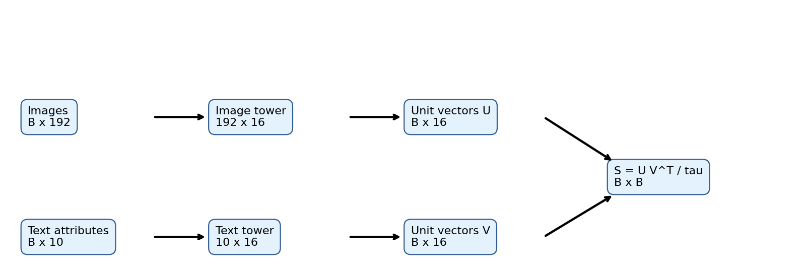
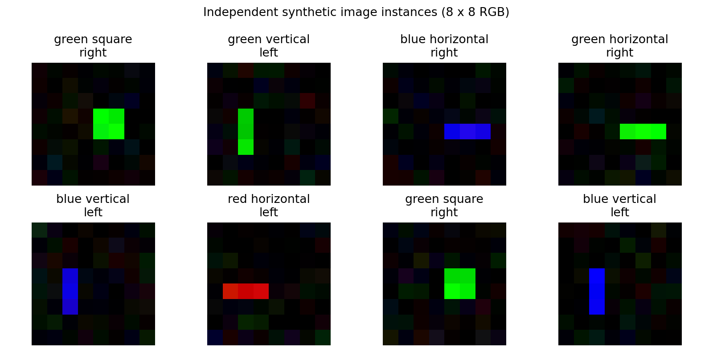
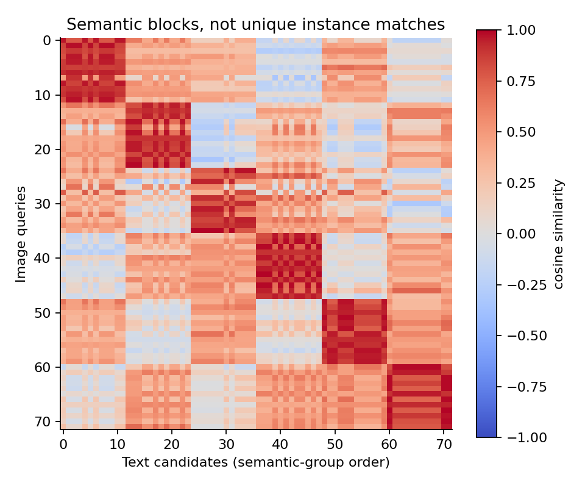
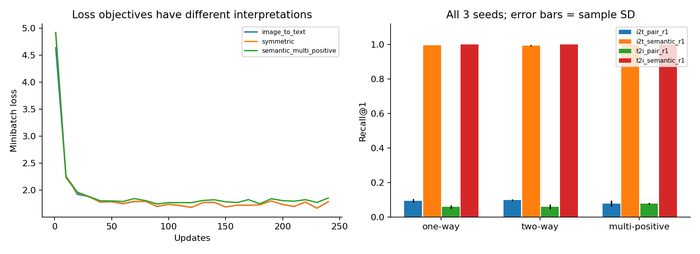
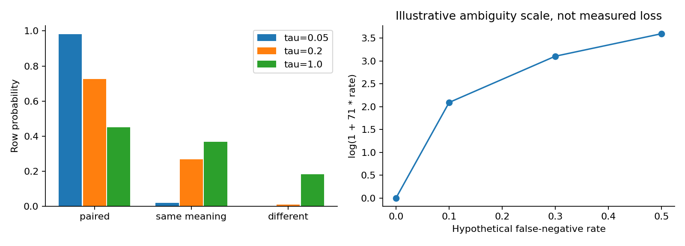

# DL088 跨模态表示与对齐

**对应新版大纲 M1。直接先修：049、059。** 若需要自己训练卷积视觉骨干，可补044；若选视觉Transformer，可补047。本讲先从可画出来的小图像和可逐项检查的文本特征开始，不要求先下载大型预训练模型。

本讲的问题是：一张图和一句话的数值形式完全不同，我们怎样让它们变得可比较？更重要的是，相似度高究竟证明了什么？你将手推双编码器、单向和双向对比目标，亲自训练两座小型编码器，检查检索结果，并识别“数据里配成一对”和“语义上只有这一对正确”之间的区别。

实验使用原创程序生成的8×8 RGB图像，共18种颜色、形状和位置组合。没有自然人照片、网络抓取数据、预训练权重和收费API。所有参数更新均由NumPy与手写梯度完成；这是一项可核验的对齐教学实验，不是CLIP的规模复现。完整代码、实际权重、原始指标和逐例检索记录随课提供。

## 1 从“找到红色横线”开始

想象桌上有三张卡片：左边的一条红色横线、右边的一条蓝色竖线、左边的一个绿色方块。另有三句描述。人能把图与句子配起来，因为颜色、形状和位置的含义可以在两种表达方式之间对应。计算机最初看到的却是像素数组与词编号，两个数组甚至没有相同长度，不能直接逐元素相减。

最简单的办法是分别训练一个函数，把图像变成向量，把文本也变成相同长度的向量。向量方向接近，就认为这对图文相近。这里的“相近”必须由任务定义：找同一张照片的原始标题、找任何符合描述的照片、找包含描述中某一物体的照片，分别对应不同的正确集合。

例如两张独立生成的红色横线都在左边。如果一句话只说“左边有红色横线”，两张都正确；如果任务要求找回最初配对的文件，只有一个文件编号正确。这个差别不是指标实现上的小事，而是监督假设。本课会同时报告严格配对检索和语义检索，让你看到同一个模型可以在前者很低、后者很高。

检索还不同于生成。双编码器通常回答“这些候选中谁最相似”，它不会因此自动拥有自由描述、计数推理或事实核验能力。把检索模型接到生成模型之前，需要下一讲的融合接口与信息路径分析。

## 2 最少需要的数学：向量、矩阵和方向

一个长度为d的向量，就是d个有顺序的数。我们把一批B个向量按行堆叠，得到B×d的矩阵。矩阵乘法的内侧维度必须相同：B×d乘d×B，结果是B×B。后面相似度矩阵的每个格子都来自一次向量点积。

设a=(3,4)，b=(4,3)，它们的点积为3×4+4×3=24，各自长度都是5。余弦相似度是24/(5×5)=0.96。若把a放大十倍，点积会放大十倍，但余弦仍为0.96。这解释了为何归一化能把注意力从“向量有多长”转向“向量朝哪里”。

向量坐标本身不必对应人能命名的概念。第一个坐标不一定就是红色，第二个不一定就是横线。只要图像与文本共享同一套几何关系，就可以检索。对两种向量同时施加同一个正交旋转，点积保持不变，因此坐标轴没有唯一语义解释。

这也提醒我们：看某个二维投影图时，不要把视觉上漂亮的团簇当成唯一证据。降维可能丢失距离，投影算法和参数会改变形状。实际检索应在原始嵌入空间计算，并保留对应候选与正确集合。

## 3 先理解本讲的数据，而不是先背模型名字

每个语义类别由三个属性组成：颜色有红、绿、蓝三种，形状有横线、竖线、方块三种，位置有左、右两种，所以共有3×3×2=18类。每张图片是8×8×3的浮点数组。脚本先加入标准差0.055的独立高斯背景噪声，再在指定位置画形状；亮度在0.72到1.0之间随机变化。

横线和竖线各由三个亮点组成，方块由四个亮点组成。它们是离散像素图案，不是自然场景中的连续物体。位置、噪声和亮度范围都是生成器的强先验；模型成功只能说明在这套规则下能学到对应关系。

文本采用两种固定表述模板，例如“a red horizontal on the left”和“there is a red horizontal on the left”。实验不训练分词器，而把颜色三维、形状三维、位置二维、模板二维拼成10维向量。每个属性组只有一个位置为1，所以每句文本有四个1。两句语义相同但模板不同，其最后两维不同。

这是一个明确的教学简化：文本编码器面对的是已知属性表示，没有学习自然语言词义、语法或同义词。视觉编码器仍从192个像素值学习。若把本实验称为自然语言理解评测，就夸大了任务；正确说法是“在给定文本属性表示下学习图文对齐”。

## 4 双编码器逐步写成公式

记图像输入矩阵为X，形状B×192；文本输入为T，形状B×10。我们训练图像权重W_i，形状192×16，和文本权重W_t，形状10×16。未归一化表示为：

$$H_i=XW_i\in\mathbb R^{B\times16},\qquad H_t=TW_t\in\mathbb R^{B\times16}.$$

对每一行h做归一化。代码采用一个很小的稳定项ε=10⁻¹²：

$$z=\frac{h}{\sqrt{\sum_{k=1}^{16}h_k^2+\varepsilon}}.$$

得到U和V，形状都是B×16。ε使零向量附近不出现除零；在通常非零表示上，向量长度极接近1。严格说它不是对所有输入都恰好等于1，测试因此使用数值容差，而不是对浮点数做不必要的精确相等判断。

两塔参数总量为192×16+10×16=3232，没有偏置、额外分类头或隐藏骨干。这种结构很小，却已经是真实可训练的双编码器：两个矩阵都接收对比损失的梯度，并在每一步更新。只用人工预设向量画相似度图，不能替代这项训练。

在更大模型中，线性矩阵前面可以接CNN、ViT或Transformer文本网络。公共空间宽度相同不要求两个骨干同构，也不要求它们内部隐藏层维度相同。最终投影层负责接口兼容；深层骨干负责更复杂的特征提取。[CLIP原论文](https://proceedings.mlr.press/v139/radford21a.html)提供了经典双编码器对齐方案，本课只复现其基础目标思想。

## 5 一张相似度矩阵里有多少问题

对第i张图的向量u_i和第j句文本的向量v_j，先计算余弦近似u_i·v_j，再除以正温度τ：

$$S_{ij}=\frac{u_i^\top v_j}{\tau},\qquad S=UV^\top/\tau\in\mathbb R^{B\times B}.$$

S不是概率矩阵。它可以包含负数，每一行也不必加起来等于1。行i表示“固定图像i，逐一比较文本候选”；列j表示“固定文本j，逐一比较图像候选”。对角线S_ii表示数据文件给定的原始配对。

假设一个批次中第一和第二条都是红色横线，第三条是蓝色竖线。若前两条文本表示相同，则第一、第二列可能完全相同。此时让第一张图只选择第一句、第二张图只选择第二句，在信息上就有矛盾：编码器没有获得能区分两句的输入证据。

批内负样本的便利在于，一次矩阵乘法就得到B²个相似度，其中B个给定配对被指定为正例，另外B²−B个默认当作负例。但“默认”不是事实保证。图文网页上的邻接、文件名配对或标注流程，都可能产生遗漏、弱相关或错误配对。

矩阵的对角线亮并不足以证明对齐质量。若训练和测试共享实例编号，模型可能只记住编号；若负例都过于容易，模型可能只分清颜色而没有学会位置。研究中应主动设计同色不同形、同形不同位等困难但确实不匹配的对照。

## 6 从候选选择推导单向损失

固定一张图像i，把该行分数送入softmax：

$$P^{I\to T}_{ij}=\frac{\exp(S_{ij})}{\sum_{k=1}^{B}\exp(S_{ik})}.$$

分母遍历的是文本候选k，不是图像查询。P的每行和为1。假设只有原配对i正确，选择该文本的负对数概率就是−log P_ii。对B个图像查询平均，得到图到文损失：

$$L_{I\to T}=-\frac1B\sum_{i=1}^{B}\log P^{I\to T}_{ii}.$$

为什么用负对数？正确候选概率越接近1，损失越接近0；正确概率接近0时，损失变得很大。负对数还有便利的梯度形式，因此容易优化。它不是“相似度距离”的另一个名字，而是在一个指定候选集合上的条件分类目标。

手算一个例子。三个余弦分数为1.0、0.8、0.1，τ=0.2，logit为5、4、0.5。把最大值5减掉，指数为1、约0.3679、约0.0111，归一化概率约为0.7252、0.2668、0.0081。若第一个是原配对，损失约0.3214。第二个虽然非常接近，也被单正例目标当作需要压低的竞争者。

实现时先减去每行最大值，可防止exp溢出。减去相同常数不改变softmax，因为分子分母同时乘上相同因子。稳定计算是正确实现的一部分；不能把NaN简单替换成0后继续宣称训练正常。

## 7 为什么再加一个方向

文字检索图像时，固定的是文本列j，候选是该列所有图像。对应概率为：

$$P^{T\to I}_{ij}=\frac{\exp(S_{ij})}{\sum_{k=1}^{B}\exp(S_{kj})},\qquad
L_{T\to I}=-\frac1B\sum_{j=1}^{B}\log P^{T\to I}_{jj}.$$

此时每列和为1。双向损失取两个方向的平均：

$$L_{\rm sym}=\tfrac12(L_{I\to T}+L_{T\to I}).$$

两项使用同一个分数矩阵，但归一化方向不同，所以通常不是同一个数。若S=[[2,0],[1,0]]，行方向正确概率是约0.8808和0.2689，平均损失约0.7201；列方向正确概率是约0.7311和0.5，平均损失约0.5032；双向平均约0.6116。

双向训练直接关心两种检索用途，也对不同模态的候选竞争施加约束。但它不是数学上保证两种测试召回都更高的定理。数据分布、模型容量、优化噪声、批内重复和评测定义都能影响结果。特别是在简单任务已经接近满分时，额外方向可能只带来极小波动。

本讲保留所有方法和种子的结果，实验并不支持“只要双向就优于单向”的口号。研究价值可以是准确识别一个没有明显收益的条件，而不是强行使预设方法获胜。

## 8 手动求梯度，知道程序真正训练了什么

对某一行的单正例交叉熵求导，可得到“预测概率减目标概率”。设Y为单位矩阵，则：

$$\frac{\partial L_{I\to T}}{\partial S}=\frac{P^{I\to T}-Y}{B}.$$

双向时，两种方向梯度各乘1/2再相加。记最终分数梯度为G，形状B×B。由S=UVᵀ/τ，有：

$$G_U=GV/\tau\in\mathbb R^{B\times16},\qquad
G_V=G^\top U/\tau\in\mathbb R^{B\times16}.$$

这两行公式清楚地告诉你：单向图到文损失也会更新文本塔，它并不意味着只训练图像塔。方向描述的是哪个条件分布被优化，不是哪个编码器被冻结。冻结文本塔是另一个独立实验设置，需要明确写出。

归一化也必须反传。对r=√(hᵀh+ε)、z=h/r，如果上游梯度为g，则：

$$\frac{\partial L}{\partial h}=\frac{g-z(z^\top g)}{r}.$$

当ε很小时，第二项大致去掉沿向量方向的梯度分量，剩下更能改变方向的部分。最后G_Wi=XᵀG_Hi，G_Wt=TᵀG_Ht。矩阵形状分别回到192×16和10×16，恰好对应参数。

代码没有自动微分库，所以我们用中心有限差分检查若干参数：把一个参数加ε_fd、减ε_fd，观察损失差除以2ε_fd。默认ε_fd=10⁻⁵，三种目标最大绝对误差均低于4×10⁻¹¹。这个检查支持局部梯度实现正确，不等于自动证明所有索引、数据切分和研究结论都正确。

## 9 温度既改变概率，也改变优化

τ小，分数差被放大，softmax更尖锐；τ大，概率更平坦。它不会改变固定余弦向量的排序，所以如果只改变推理时的正温度而不重新训练，Top-k候选通常不变。但训练时温度进入梯度，学到的表示可能随之变化。

还用余弦1.0、0.8、0.1这个例子。τ=1时，第一候选概率约0.449；τ=0.2时约0.725；τ=0.05时约0.982。非常低的温度使最相似的竞争者更重要。如果这个竞争者其实语义正确，强行把它推开可能加剧目标错配。

“梯度里有1/τ，所以τ越小梯度必定越大”也不严谨。因为P本身依赖τ：一个已正确且极有把握的样本，其P−Y会接近0；另一个很自信却错误的样本可能产生大梯度。必须连同概率饱和、数值范围和样本困难程度一起分析。

主实验固定τ=0.2，没有从测试集选择最优值。附加τ=0.05与1.0只在seed11运行，是单种子的诊断，不是完整超参数比较。本讲不会用这两个点推出普遍最佳温度，也不会把不同温度下的softmax当作经过校准的现实可靠性概率。

## 10 假负样本不是“很难的负样本”

困难负样本与假负样本必须分开。若查询是“左边的红色横线”，右边的红色横线是困难但确实不满足完整语义的负例；另一张左边的红色横线则可能是正确候选，被单配对标签误当作负例。二者都可能分数很高，但应采取的处理不同。

本实验每个训练语义类有24个实例，共432条。对任一查询，在另外431条中，有23条同语义。因此全训练集非对角候选中语义假负比例是23/431≈5.3364%。这个比例来自生成器标签，是可核验的，不是靠嵌入距离猜出的真值。

当批量B=72、无放回随机采样时，对一个已入批样本，其同语义竞争者的期望数量是71×23/431≈3.789。这个期望不意味着每个批次恰好有3.789个同义项；实际整数个数会随抽样变化。扩大量既增加真正的负例，也可能增加语义冲突。

现实数据通常没有完备语义标签。一张街景可能既满足“汽车”又满足“夜景”；两句相近的描述也可能在关键数字上相反。不能把“余弦高”直接当成同义，再全部从负样本中删掉，否则可能失去重要辨别能力。应结合标注、内容审查和任务定义来估计误标风险。

[Debiased Contrastive Learning](https://arxiv.org/abs/2007.00224)讨论随机采到同类样本时的负例偏差问题。本讲采用可控标签诊断，不实现该论文的去偏估计器；不能把本课多正例变体标成那篇论文的算法复现。

## 11 多正例目标到底改了哪里

本课第三种方法利用生成器的语义类标签。定义A_ij=1表示两条属于同一语义类，包括对角线。对每行归一化：Y_ij=A_ij/∑_k A_ik。然后把单正例交叉熵的单位矩阵替换成Y。文本到图像方向也沿对应候选轴归一化。

$$L_{I\to T}^{\rm multi}=-\frac1B\sum_i\sum_jY_{ij}\log P^{I\to T}_{ij}.$$

若某一行有四个正例，目标概率在四者上各为1/4，其余为0。这个目标要求模型照顾全部已知正例，而不是一定找出原始文件编号。它使用了额外语义监督，比较报告必须承认这个信息优势，不能把它描述为“不需要任何额外知识的免费改进”。

这个公式还有一个常被忽略的性质：最佳交叉熵不一定是0。如果目标均匀分布在m个正例上，即使预测完全等于目标，损失仍为log m。这是目标本身的熵，不是模型还没学会。不同批次正例个数不同时，损失基线也会变化。

另一种可能的多正例目标是−log(∑_{j∈P_i}P_ij)，它只要求正例集合获得较大总概率，允许大部分概率集中在某个正例上。它与本课“对正例对数概率取平均”不同，不能混写公式却继续使用同一段梯度代码。它们适合不同需求，应先定义任务再选择。

[Supervised Contrastive Learning](https://arxiv.org/abs/2004.11362)提供了利用类别信息组织正例的代表性研究。本课借用多正例视角，具体批次与跨模态均匀目标由教学实验自己定义，不复现原文全部训练系统。

## 12 检索指标必须先说明“谁算正确”

对每张测试图，给定216句候选文本；对每句测试文本，也给定216张候选图。原始配对的编号与查询编号相同。严格配对Recall@k检查原配对是否位于前k名；语义Recall@k检查前k名是否至少存在一条同语义候选。

其中TopK_i表示第i个查询的前k名候选集合，P_i表示其正确候选集合；交集非空记为1，否则为0。

$$R@k=\frac1N\sum_{i=1}^N\mathbf{1}[\mathrm{TopK}_i\cap\mathcal{P}_i\ne\varnothing].$$

注意这个“检索成功率”定义对每个查询只记0或1，不是信息检索中以全部相关项数量为分母的另一种召回定义。术语相同不意味着公式相同，报告应直接给出计算方式。

平均倒数排名MRR对每个查询取第一个正确项排名r的倒数1/r，再平均。本课保存严格配对MRR。一个系统把正确结果从第100名移到第6名，R@1和R@5可能都不变，MRR却能反映进步；相反，MRR也不能替代Top-1业务错误率。

同一语义类在测试集有12个实例，文本又只有两种模板，所以存在完全相同文本输入。代码对相同分数使用稳定索引顺序打破并列，且数据已经固定随机打乱。并列处理不是可偷偷挑选的自由度；换一种处理可以改变严格配对排名，所以必须声明。

若一个模型把全部语义排对，但无法识别无意义的原始实例编号，严格配对R@1接近每类实例数的倒数是可以预期的量级。然而本实验还存在模板、图像噪声和确定性并列，所以不能把1/12当作每次运行必须精确达到的定理。

## 13 划分数据时，需要切断什么联系

训练集432条、验证集108条、测试集216条，分别由种子8801、8802、8803独立生成。它们共享18种语义组合，但不共享图像实例。这样评估的是已知语义组合的新噪声、新亮度实例，而不是未见颜色、未见形状或新属性组合。

完整图像字节哈希交叉检查发现训练与测试完全相同图像重合数为0。跨集最大像素余弦约0.886，测试图与训练图最近邻余弦均值约0.843。这些图像本来由同一小模板产生，视觉近似是任务设定的一部分；高相似度本身不能直接判定泄漏。

文本共有36种，训练与测试全部共享。这是刻意允许的语义词表复用，并不表示模型会理解新词。若研究目标是新描述泛化，应按句式、词义或概念组合设计另一套划分。不能在同一个分区上得到好结果后，给它换成“开放词汇泛化”的名字。

真实图文库应优先按原始图片、文档、视频、拍摄事件或用户实体分组划分。对同一照片裁剪后的不同区域逐条随机划分，可能让训练看见测试主体。只检查文件名不同远远不够；哈希、近重复检测和人工抽查应服务于明确的实例边界。

## 14 冻结协议之后，再运行比较

主实验三种方法各用训练种子11、23、37，共9次训练。每次240步，每步从432个训练实例中无放回抽72条；跨步可以再次出现同一个实例。学习率0.012，使用Adam，一阶衰减0.9、二阶衰减0.999、分母稳定项10⁻⁸。没有权重衰减、早停或验证集超参数选择。

相同种子下三种方法使用相同初始权重与批次序列，因此目标函数差异的比较具有配对结构。多正例方法还使用语义类标签，这是额外信息差异。相同步数与相同参数量并不意味着全部计算量恰好相同：双向目标多一次列归一化，多正例目标还构造标签矩阵。

验证集只记录预先约定的语义R@1，未用来选择最好方法或停止时刻。测试在训练完成后评价，所有方法都报告，不因结果不好删除种子。附加温度诊断不进入主表的三种子均值，也不被用来重新选择主实验温度。

9次主训练共2160次更新、155520条训练样本呈现；两次温度诊断再增加480次更新与34560条呈现，总计11次训练、2640次更新、190080条呈现。“呈现”不是独立样本数，不能据此说模型见过19万张不同图片。

研究协议记录在research_plan.json，便于读者检查。它是本教学包的冻结设计说明，不声称有第三方时间戳、外部预注册或独立盲审。

## 15 实际结果：语义很高，原始配对很低

下表由outputs/results.json的三个种子直接取均值。百分数分母是216个测试查询。完整CSV保留每个种子，不只保存汇总表。

| 方法 | 图到文配对R@1 | 图到文语义R@1 | 文到图配对R@1 | 文到图语义R@1 |
|---|---:|---:|---:|---:|
| 单向图到文 | 9.41% | 99.54% | 5.86% | 100.00% |
| 双向 | 9.72% | 99.38% | 6.02% | 100.00% |
| 语义多正例双向 | 7.87% | 100.00% | 7.87% | 100.00% |

首先，双编码器确实学到了这个窄任务的跨模态区分。其次，双向目标在本数据上没有显示一致的语义收益，图到文均值还略低于单向。第三，多正例语义检索达到满分，但严格配对并未相应达到满分，这是目标与评价定义不同造成的正常现象。

不能说多正例“信息更少却更强”，因为它看到了语义类标签；也不能说单向“没有训练文本侧”，因为两座塔都被更新。更不能因严格配对较低就推断模型完全不会对齐，这与语义检索数据冲突。

这些数字也不能证明多正例对真实开放数据必然有效。本数据只有18类，背景噪声规则固定，文本已经属性化，所有语义组合都在训练中出现。三种子主要描述初始化与批次随机性的变化，不是对真实世界全部图像分布的置信区间。

## 16 从一次失败检索里学到什么

打开predictions.csv，找到pair_correct=0而semantic_correct=1的记录。先看查询类别和Top-1类别是否一致，再回到data.npz查看两条字幕及图像。你通常会发现模型找到了正确语义，只是没有选择原始文件配对。这种失败应归到评价粒度，而不是笼统写成“视觉识别错误”。

再找semantic_correct=0的少量记录。逐项比较颜色、形状、位置，记录是哪一项不符。可能的原因包括噪声导致像素模式混淆、线性编码容量不足、模板表示差异或训练尚未完全收敛。只看一个错误不能唯一决定原因，需要有针对性的干预。

例如怀疑位置没学好，可以保持颜色形状不变只交换左右；怀疑文本模板影响，可以固定图片、替换句式；怀疑亮度影响，可以对同一图案调亮度而不重采背景噪声。配对干预一次只改一个因素，通常比另找一批完全不同图片更能定位敏感性。

但诊断干预不是万能因果证明。图像变换可能制造训练中从未出现的边界，位置变化也可能改变像素覆盖。应记录干预是否仍在数据生成规则内，并把“本模型对这个操作敏感”与“真实任务错误全部由该因素导致”分开。

## 17 零样本标签模板为什么需要克制

大规模图文对齐模型常把类别名写成提示句，再把图像与各类别文本比较。这就是一条常见的零样本分类接口。一个类别可以写成“dog”“a photo of a dog”或其他模板，文本表示会变化，分类结果也可能变化。

如果你在测试集上试了几十种模板，只报告最好一个，就把测试标签参与了选择。报告“零样本”也不能消除这种测试集调参。较严谨的方式是事先固定模板，或在独立验证集选择；若使用多个模板平均，应记录完整模板集合与平均方式。

嵌入平均和概率平均不是同一操作。先把不同模板向量平均再归一化，与各模板分别计算softmax后平均，可能得到不同排序。代码、报告、表格必须一致，不能用一句“prompt ensemble”遮住实现差异。

本讲两种模板只是同义风格变量，没有实施开放类别零样本测试。不能把当前语义检索分数改名为“零样本准确率”。这是研究写作中的命名边界，也是防止不经意夸大能力的基本训练。

## 18 计算与存储预算怎么估算

批量72、嵌入维度16，相似度矩阵有72²=5184个元素。如果使用float64，仅这个矩阵占41472字节。两塔输出各有72×16个元素。还要存梯度、softmax结果、优化器动量与中间表示，因此矩阵字节数不能冒充进程峰值内存。

相似度矩阵乘法数量级是B²d；两个线性编码器分别是B×192×16和B×10×16。扩大B会使候选比较项平方增长，也会改变负样本分布，因此大批量既是成本变化，又是学习问题变化。不能把性能差异全归因于“看见更多负例”，却不报告总样本呈现与优化器设置。

检索服务可以预先编码图库，把查询向量与候选库比较。双编码器的这个结构有利于缓存，但图库更新、向量索引近似误差、权限过滤和删除传播都会影响实际系统。近似近邻检索R@k与模型语义R@k还需分开测，前者可能在编码器不变时引入额外漏检。

本次运行保存每个模型优化循环秒数与总实验秒数，具体数字见JSON。计时只对应这台CPU环境，包含或排除的步骤在代码中可见；没有GPU测量、服务吞吐或大型模型成本估算。重跑环境负载不同会改变秒数，不应期待完全一致。

## 19 数据许可、隐私和错误用途

本课数据由代码生成，不包含外部作品、个人照片或个人记录。共享这个数据生成器相对简单；真实图文数据则涉及图片版权、文本许可、人物隐私、抓取条件及再分发范围。网页可以访问，不自动意味着允许训练、再发布或用于所有用途。

跨模态检索还可能把不同来源的身份线索连接起来。一个原本不显眼的背景、地点标牌或说明文字，经过检索系统可能暴露敏感关系。研究验收应检查数据目的、最小必要字段、访问限制及删除机制，而不能只报告精度。

本讲不建立身份识别、个人属性推断或敏感场景监控任务。将教学代码扩展到真实数据时，先选择有明确授权、低风险的公开物体或自制素材；涉及个人信息的输入、存储、上传和分享应各自核对许可。

误用还可能来自错误解释。例如把高相似图像当成事实证据，把语义相近当作来源相同，把检索到的描述当作图片中确实存在的对象。相似度只是模型判断，仍需回到原图、原始说明和任务条件核验。

## 20 研究验收：哪些问题必须回答

第一，输入表征是什么？请明确本实验文本是10维属性，不是训练出来的自然语言编码器。第二，两个塔是否真的训练？请展示参数变化、梯度检查、损失记录和可重载权重。第三，负例假设是否合理？请报告同语义非对角项及其比例。

第四，检索方向和候选池是否明确？两种方向都使用216个候选，不能在小候选池评估后暗示百万图库同样有效。第五，正确集合如何定义？严格配对和语义集合应分别报告。第六，是否把额外语义标签优势误写成算法本身优势？多正例必须说明监督来源。

第七，所有种子是否保留？本课9次主训练均纳入均值。第八，近重复检查是否结合实例边界？高像素相似与确切重复应分别记录。第九，是否通过测试调温度或模板？默认协议没有这样做。第十，结论有没有超出数据、模型和干预的支持范围？

合格的短结论可以这样写：“在18种已知合成语义组合的新图像实例上，三种双编码器目标均达到较高语义检索；原始配对检索受同义候选和实例信息缺失影响较低。双向目标未表现出稳定的额外语义收益；利用类别标签的多正例目标达到满分，但不证明开放词汇泛化。”

## 21 练习与下一讲连接

先不用运行代码，完成三道手算：计算两个二维向量的余弦；对一个2×2矩阵分别做行、列softmax；推导四个等价正例时目标熵为何为log4。然后运行默认实验，找到一个严格配对失败但语义正确的样本，写出不夸大的错误解释。

进一步，设计一个训练中完全没出现的属性组合划分。你需要修改哪些标签集合、如何确保每种单独属性在训练中仍出现、用什么指标区分属性识别与组合泛化？先写协议再跑，不要先看结果决定任务名称。

最后，思考双编码器的局限：一张图压成一个16维向量后，如何回答“右边那个对象是什么颜色”？如果全局表示把左右对象平均，信息可能已经丢失。下一讲将把图像保留成多个视觉token，通过投影、交叉注意力或统一序列进入问题处理过程。

详见lab.md的分步操作及answers.md的完整答案。教材中所有图都是本课原创结构示意或由随附数据实际绘制；引文用于定位原始研究，不把引用文献中的实验数字当作本课的实测结果。

## 参考来源与阅读路线

1. Radford等，2021，Learning Transferable Visual Models From Natural Language Supervision。重点读双编码器、归一化相似度和对称交叉熵；本课不复制其预训练规模。[原论文与出版页](https://proceedings.mlr.press/v139/radford21a.html)
2. Chuang等，2020，Debiased Contrastive Learning。重点理解随机负样本可能属于同一语义类的问题；本课未实现其估计器。[作者论文](https://arxiv.org/abs/2007.00224)
3. Khosla等，2020，Supervised Contrastive Learning。重点比较正例集合与单实例标签；本课目标需以实际公式和代码为准。[作者论文](https://arxiv.org/abs/2004.11362)

以上来源于2026-10-19核对。来源帮助理解方法脉络；本实验所有结果以outputs/results.json、metrics.csv、predictions.csv与可重跑代码为准。
