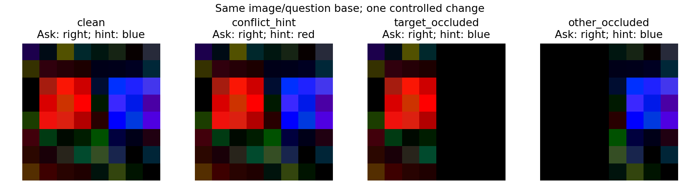
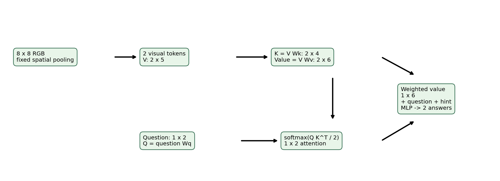
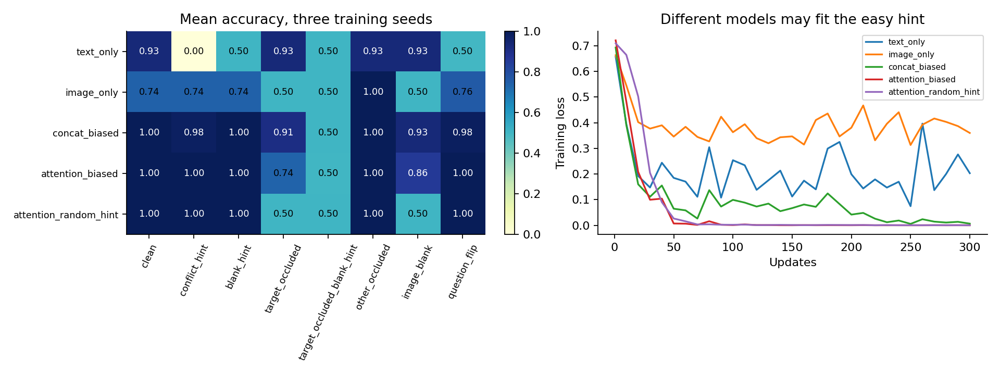
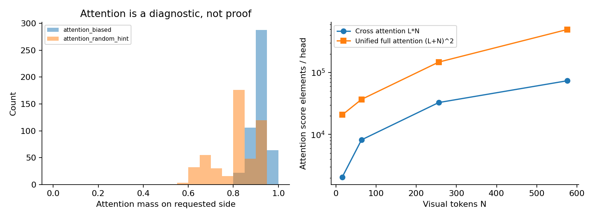
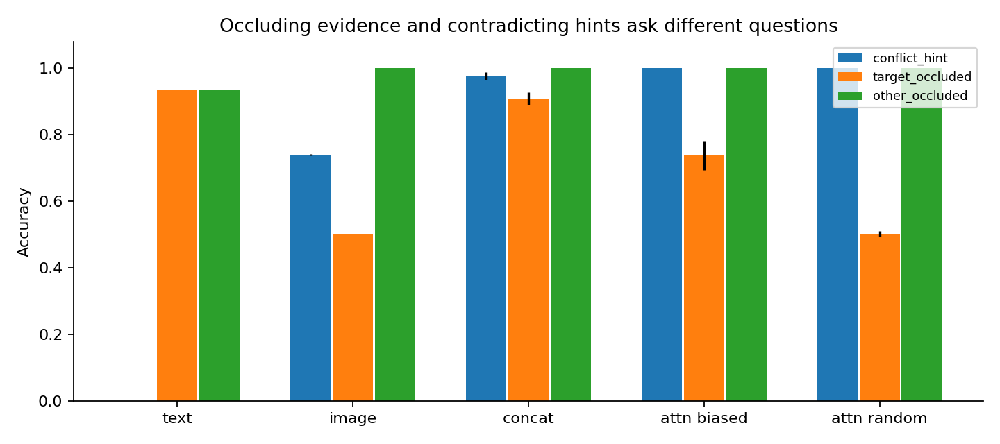

# DL089 多模态融合与视觉语言模型

**对应新版大纲 M2。直接先修：053至054、M1。** 本讲沿着一个问题推进：视觉表示怎样进入语言处理过程，什么信息可能在到达答案之前就被丢掉？我们先用“右边方块是什么颜色”这样的可控任务建立直觉，再推导投影、交叉注意力与统一token三类接口。

实验是一套真实训练的小型视觉问答系统，使用NumPy手动求导，在CPU上比较文本单模态、图像单模态、拼接融合和两种交叉注意力训练方式。它有8×8图像、两个视觉token与两个答案类别，没有预训练语言模型，也不生成开放文本。它不是LLaVA、Flamingo或任一大型视觉语言模型的缩小复现；它复现的是可检查的融合计算与诊断方法。

完成本讲后，你应能为每个接口写出shape，估计注意力矩阵规模，用遮挡和冲突输入区分信息来源，并在语言先验很强的任务中拒绝把高分直接解释成“看懂了图片”。

## 1 能匹配图文，为什么还不能回答具体问题

上一讲把整张图片和整句描述各压缩成一个向量，然后比较方向。对于“找到含蓝色方块的图片”，这可能足够。但如果一张图左边红、右边蓝，问题是“右边是什么颜色”，模型必须保留对象位置，还必须理解问题要求关注右边。

若视觉编码器一开始就把左右平均，只剩“红和蓝都有”，后面的语言模块即使很强，也无法从这份表示恢复已经被删除的左右关系。它可以根据训练先验猜答案，却不能凭空补回丢失的观测。信息瓶颈应从整个处理链分析，不能只看最后的输出层。

融合的核心是让一种模态影响另一种模态如何被使用。例如问题先生成查询向量，查询决定从哪些视觉token读取信息；或者图像与文字进入同一序列，在多层注意力中逐步交换信息。不同接口对计算量、空间细节、训练稳定性和可复用性有不同影响。

一个常见误解是：只要把视觉向量的维度改得和词向量一样，就已经建立语义联系。维度相同只保证矩阵乘法能够进行。真正的可用联系还依赖训练目标、配对数据、冻结策略和下游模块是否学会利用这些数值。

## 2 用最小场景分清三种信息

本课每张图有左右两块区域，每块有红色或蓝色方块。问题只能问“左边是什么颜色”或“右边是什么颜色”。正确答案由被问区域的颜色决定。我们另外添加一段文本提示，例如“猜测是红色”，它在训练数据中约95%与答案一致，但不是任务定义的一部分。

因此输入包含三种不同角色的信息：图像提供两个区域的颜色；问题指定应该读哪个区域；提示提供一个统计上很有用、却可能错误的建议。把三者都称为“文本与图像信息”太笼统，会看不见谁在决定答案。

如果一张图左红右蓝，问右边，正确答案是蓝；提示却说红，这就是可控的模态冲突。若模型回答红，可能受提示影响；若回答蓝，则至少在这条样本上优先使用了与任务一致的视觉证据。单个样本仍不够，应对同一测试集系统地改变提示。

如果遮住右边但保留“猜测是蓝”的提示，模型继续答蓝未必是幻觉：它可能根据统计先验作预测。但如果系统声称“我看到了蓝色方块”，就混淆了观测与推断。本课分类器没有语言声明，所以我们只测答案和概率，不给它附加没有实际生成过的解释。

## 3 从像素到视觉token：压缩发生在哪里

图像输入形状是B×8×8×3。B是批量，两个8是高和宽，3是RGB通道。实验把图像按左右两半分开，每半是8×4×3，对32个像素取平均，得到B×2×3的颜色表示。再乘32/9，以对应方块覆盖9个像素的固定比例。

接着给左、右区域附加二维位置one-hot：左边为(1,0)，右边为(0,1)。最终每个视觉token有5个数：三个平均颜色值和两个位置数，得到V∈R^{B×2×5}。两个token不是两个自然语言词，而是两份带位置的视觉区域表示。

这个固定视觉编码器保留了本任务所需的左右颜色，却丢失了区域内部细节。例如同一半中9个红像素排列成不同形状，平均值可能完全一样。它因此不能用于证明模型具有形状识别、文字识别、精确计数或细粒度定位能力。

位置编码也不是装饰。如果把两个区域的表示作为无序集合，而且不给位置线索，问题“左边”可能无法与正确token绑定。反过来，固定的位置编码是强先验，研究报告不能说模型从零自主发现了空间坐标。

图示为了便于人阅读，把像素裁到0至1；训练使用包含高斯噪声的原始浮点值，没有做同样裁剪。可视化预处理和模型预处理不同，应清楚注明，否则读者可能误以为图上看到的就是模型的精确输入。

## 4 三类接口的共同账本

设视觉编码器输出N个token，每个宽d_v；文本序列有L个token，每个宽d_t。以矩阵记号写，视觉表示V为N×d_v，文字表示H为L×d_t。批量维度B可放在最前，以下先省略以便推导。

投影接口做V W_p，W_p为d_v×d_t，输出N×d_t。交叉注意力接口用文字生成Q，用视觉生成K、Value，得到L×d_a的读取结果。统一token接口先把两种模态映射到同宽度d，再拼成(N+L)×d，送入共享的注意力网络。

三种做法并不互斥。一个真实系统可以先投影视觉特征，再把它们插入语言序列；也可以先用少量查询token压缩视觉表示，再通过交叉注意力读取。为了比较清楚，本讲先把各个操作拆开，而不是把产品名称当成不可分解的黑箱。

每当看到模型示意图，至少问五件事：输入分辨率多大；视觉token多少；投影前后宽度是什么；哪些模块训练、哪些冻结；问题在什么层开始影响视觉信息选择。这些问题往往比总参数量更能解释某个错误。

## 5 接口一：投影与前缀token

线性投影为：

$$H_v=VW_p+b_p,\quad V\in\mathbb R^{N\times d_v},\quad W_p\in\mathbb R^{d_v\times d_t},\quad H_v\in\mathbb R^{N\times d_t}.$$

偏置b_p是d_t维，按token广播。输出与文字词嵌入同宽，便于拼接或作为前缀。若d_v=768、d_t=4096，投影矩阵含768×4096=3145728个权重，加偏置共3149824个参数。这只是接口参数，不包括视觉或语言骨干。

投影改变通道维度，不自动改变token数量。假如视觉编码器输出576个token，投影后通常仍是576个。若上下文预算只允许64个视觉token，还需要池化、重采样、选择或其他压缩步骤，不能把“维度对齐”误写成“token压缩”。

线性投影无法恢复输入中已经丢失的信息。如果V完全相同，任何固定W_p的输出也相同。更复杂的MLP虽然能重组特征，但同样不能凭空区分完全相同输入所对应的不同原图。这是函数映射的基本限制，不是某一种投影层训练得不够好。

[Visual Instruction Tuning](https://arxiv.org/abs/2304.08485)的早期LLaVA方案把视觉编码器与语言模型通过可训练投影连接，并使用视觉指令数据训练。这里引用它说明接口思路；本讲没有使用它的视觉骨干、语言模型或指令数据，不能用本课准确率评价LLaVA。

## 6 接口二：交叉注意力把问题变成读取请求

交叉注意力的查询来自一种模态，键和值来自另一种模态。以文字读取视觉为例：

$$Q=HW_Q\in\mathbb R^{L\times d_k},\quad
K=VW_K\in\mathbb R^{N\times d_k},\quad
Z=VW_V\in\mathbb R^{N\times d_a}.$$

Q的每一行像一个读取请求；K的每一行像一个区域的索引；Z的每一行是最终被读取的内容。键和值都由视觉表示计算，但它们的用途不同，参数通常不共享。

先做QKᵀ，形状L×N，再除以√d_k，对每个文本查询沿N个视觉候选做softmax：

$$A=\operatorname{softmax}_{N}(QK^\top/\sqrt{d_k}),\qquad R=AZ\in\mathbb R^{L\times d_a}.$$

A的每行和为1。R的每行是视觉值向量的加权平均。缩放因子用于控制点积随维度增大带来的数值尺度问题；它不是一个语义正确性保证，也不保证注意力一定落在真实目标上。

本课只有一个问题token，L=1；两个视觉token，N=2；键维度d_k=4；值维度d_a=6。问题输入为左右二维one-hot，W_Q为2×4；视觉token宽5，所以W_K为5×4，W_V为5×6。每条样本的注意力分数只有1×2，方便逐个检查。

[Flamingo](https://arxiv.org/abs/2204.14198)是通过新增交叉注意力模块把视觉信息接入语言模型的代表性工作，并有视觉重采样等设计。本课只实现单头、单层、极小问题读取，不包含其门控、预训练骨干或上下文少样本系统。

## 7 用两个token手算一次注意力

设某个问题的查询q=(1,0)，左键k_L=(0,1)，右键k_R=(2,0)。为了简化手算，暂取d_k=2。点积分别为0和2，除以√2后为0和约1.414。softmax给左边约0.1956、右边约0.8044的权重。

若左值向量是(1,0)，代表红；右值向量是(0,1)，代表蓝，则读取结果r≈(0.1956,0.8044)。答案分类器可以把第二个分量更大解释为蓝。但r不是一张新的像素图片，也不是一条自然语言命题；它只是供下一层处理的连续向量。

如果两个键相同，权重会各为1/2；若两个值恰好也相同，改注意力权重不会改变读取结果。由此可见，看到不同注意力图并不必然意味着输出依赖发生改变；看到相同输出，也不必然说明内部读取路径相同。

本课实际值向量有6维，由学习到的W_V生成，不存在固定“第一维是红、第二维是蓝”的解释。手算例只帮助理解加权和，不应把这种人为坐标语义套到真实训练权重上。

## 8 接口三：统一token不等于统一物理含义

统一token方案先把图像块与文字映射到同样宽度，然后拼成一个序列。若有N=64个视觉token和L=128个文本token，序列长度就是192。共享自注意力可以建立视觉与文字、视觉与视觉、文字与文字之间的交互。

相同宽度不代表token拥有相同原始单位。图像块可能覆盖一个区域，文字token可能是词的一部分；还需要位置、模态标识和合适的注意力掩码。若图像有多个裁剪或多张图片，应明确每个token属于哪张图、哪个位置，避免坐标与顺序混淆。

在自回归生成中，因果掩码规定某一位置能够看到哪些先前内容。图像前缀、问题与答案的排列，会影响答案是否能访问所有视觉token。如果训练时允许答案看见未来正确词，评价时却禁止，就出现训练与推理不一致，甚至标签泄漏。

[OFA](https://arxiv.org/abs/2202.03052)研究统一架构、任务与模态的序列到序列框架。它可以帮助理解统一接口的方向，但“统一token”不是只指这一种架构，也不是证明所有模态使用完全相同预处理。本课没有训练统一Transformer，只比较概念shape和计算预算。

[BLIP-2](https://arxiv.org/abs/2301.12597)则提供通过查询模块连接冻结视觉编码器与语言模型的另一条阅读路线。学习这些论文时，应分别记录压缩发生的位置和训练参数范围，避免把所有连接模块都叫作同一个“投影层”。

## 9 计算量：少一个视觉token能省多少

交叉注意力的核心分数矩阵有L×N个元素，点积计算数量级为LNd_k；随后与值相乘约为LNd_a。还需加上Q、K、Value投影和输出层成本，因此不能只算分数矩阵就称为完整模型FLOPs。

统一全自注意力的分数矩阵有(N+L)²个元素。展开后是L²+2LN+N²，包含文字内部、跨模态和视觉内部的交互。假如L=128、N=64，每头分数矩阵有192²=36864个元素；交叉读取的分数矩阵只有128×64=8192个元素。

把视觉token增到576时，统一分数矩阵变成704²=495616个元素，交叉分数矩阵是128×576=73728个。这个数量比较只针对单头单层注意力分数存储，不包含语言模型原有自注意力，也不等于完整端到端延迟比。

图像分辨率也会影响token数。以规则patch为例，如果边长翻倍而patch尺寸不变，patch数约增为四倍；视觉自注意力的朴素分数规模约增为十六倍。实际系统可能分块、稀疏化或使用高效精确内核，不能把理论矩阵规模直接当作实测显存。

本课记录输入8×8、视觉token两个、问题token一个、提示token一个。问题和提示并不是自然语言分词器产生的真实token，后者只是两组one-hot输入槽位。记录这些简化，是为了让预算数字可解释。

## 10 从读取向量到答案分布

本课把6维读取向量r、2维问题q、2维提示h拼接成10维z。然后用一个16维隐藏层和Tanh激活，再输出两个答案logit：

$$g=\tanh(zW_1+b_1),\qquad o=gW_2+b_2.$$

W_1为10×16，b_1为16维；W_2为16×2，b_2为2维。softmax把两个logit转为红、蓝的预测分布。训练用正确答案的负对数概率，而不是手工规则直接写出答案。

注意提示h绕过视觉注意力，直接进入答案头。这个设计故意提供一条语言捷径，使我们能观察模型在图像完整与图像损坏时如何利用它。若把提示完全删掉再说“模型抗文本干扰”，就没有真正测试干扰处理。

交叉注意力参数为2×4+5×4+5×6=58；答案头参数为10×16+16+16×2+2=210，总计268。没有隐藏的预训练参数。文本单模态114参数，图像单模态210参数，拼接融合274参数；结构不同的比较不能被称为严格等参数实验。

模型输出的是两个类别之一，没有“未知”类别，也没有自由生成的长句。因此准确率低不自动等于视觉幻觉，准确率高也不证明解释有根据。若要研究拒答，需要增加规则或训练目标并重新定义评价，而不能事后把低置信样本删掉后只报剩余准确率。

## 11 完整反向传播为什么值得手写一次

设答案交叉熵对logit的梯度为D=(P−Y)/B。输出层梯度为G_W2=gᵀD，隐藏层梯度为D_g=(DW_2ᵀ)⊙(1−g²)，输入拼接梯度为D_z=D_gW_1ᵀ。D_z的前6维就是读取向量r的梯度。

对于单个样本，r=∑_n a_n z_n。于是对值向量有D_zn=a_nD_r，对注意力权重有D_an=D_r·z_n。softmax反传为：

$$D_{s_n}=a_n\left(D_{a_n}-\sum_j a_jD_{a_j}\right).$$

再由s_n=qᵀk_n/√d_k得到：

$$D_q=\sum_nD_{s_n}k_n/\sqrt{d_k},\qquad D_{k_n}=D_{s_n}q/\sqrt{d_k}.$$

把这些梯度经过线性投影反传，就得到W_Q、W_K、W_V的更新。代码使用einsum表达批量求和，它不是另一种学习算法，只是把多维张量的乘法索引写得明确。

一个常见实现错误是对错误的轴做softmax。每个问题应在同一张图的两个区域之间分配权重，不能在批次内不同人的图像之间归一化。另一个错误是省略1/√d_k，却仍在讲义中保留该缩放；实验行为和公式会不一致。

默认梯度检查对所有七组参数各抽一个元素做中心有限差分，最大绝对误差低于10⁻¹¹。它检查了本点的局部导数，包括注意力路径；测试脚本还检查数据、干预、shape和重载，避免把梯度正确当成系统全面正确。

## 12 数据生成与答案边界

左右颜色各有红蓝两种，问题位置有左右两种，组合总数为2×2×2=8。生成器让这些组合在训练、验证、测试中均衡出现。因此不使用提示时，问题位置本身不能预测答案，单纯回答最常见颜色的期望准确率是50%。

图像从标准差0.16的高斯噪声开始，在每个半区的固定3×3位置画一个颜色方块，亮度在0.75至1.0之间变化。背景噪声和亮度逐实例独立。图像不是从真实照片截取，也不含受版权保护的外部视觉素材。

提示以0.95概率与答案一致。有限样本中实际比例不必恰好95%；默认测试集480条，提示实际一致率为93.33%，文本单模态因此可以仅靠提示达到93.33%。这不是代码泄漏正确答案字段，而是我们有意制造的强统计捷径，必须在协议中披露。

训练数据960条、验证240条、测试480条，生成种子分别8901、8902、8903。测试干预都从同一份测试数据复制后修改，确保能按sample_id配对比较。答案数组只用于损失和评价；干预生成器可以使用已知真值构造“必定错误提示”，这是评价器权限，不是模型输入。

本课固定颜色位置组合已全部出现在训练中，所以评估的是新噪声实例与受控冲突，不是新物体、新语言或新问题类型的泛化。

## 13 为什么单模态基线不可省略

文本单模态看问题和提示，不看图像。若它已经达到很高原域准确率，就说明任务含有强文字捷径。仅报告多模态99%而没有这个基线，读者可能把其中大量成功误归因于视觉理解。

图像单模态看到两个区域的颜色和位置，不看问题与提示。即便不知道问哪边，它也不必只有50%：一半场景左右同色，可以正确回答；另一半左右异色，只能猜被问哪边，成功概率1/2。所以在均衡、无其他问题信息的原域，理论最优平均是1/2×1+1/2×1/2=75%。

这个75%依赖生成器的独立性和平衡条件。若问题更常问左边，或者图像角标编码问题位置，图像单模态可能更高。不能把它当成所有视觉问答任务的普遍上限。

拼接融合把两个视觉token展平，加上问题和提示，再训练MLP。它没有注意力，但能够在足够简单的任务上学习条件选择，因此是一个重要强基线。若交叉注意力只比一个弱得不合理的基线好，无法说明复杂接口值得采用。

研究中“单模态”需要定义到输入字段。题目本身常含视觉相关文字；问题加OCR、问题加图注、问题加检索摘要都不是同一个纯文本基线。应列出每个方法看得到的字段，不只给模型起一个名字。

## 14 五种方法与公平比较范围

本课五种方法是文本单模态、图像单模态、偏置数据上的拼接融合、偏置数据上的交叉注意力、训练时随机提示的交叉注意力。最后两个模型结构完全相同，初始化相同，批次采样相同，只在训练时替换提示颜色。

随机提示独立于正确答案，每次更新重新采样。批次抽样与提示采样使用独立随机数生成器，避免因多抽一组随机数而顺带改变未来批次序列。推理时两种交叉注意力模型都接收实际测试提示，没有在测试时悄悄删掉干扰。

所有方法各训练种子11、23、37，300步，每步96条，学习率0.01，Adam参数与上一讲相同。没有早停、测试调参或根据结果选种子。15个模型共4500步、432000条训练样本呈现；这是重复使用960条原始训练样本。

两种交叉注意力的比较较能隔离提示随机化作用；跨结构比较还混合了参数数、信息接口和优化难度。相同步数不能保证同FLOPs或同墙钟时间，报告同时保存参数量和实测优化时间，不声称严格等算力。

我们希望看见什么，但允许什么失败？希望多模态模型能根据问题读图，并在提示冲突时保持正确。随机提示可能减少对提示依赖，但如果偏置训练模型已经学会正确读取，随机化在冲突准确率上未必还有增益。这个可能性必须在解释中保留。

## 15 八个测试域各回答一个问题

原域保留所有输入，检验相同生成分布的新实例。冲突提示把提示强制改成错误颜色，图像与问题不变，检验模型是否跟随不可靠建议。清空提示把提示两维都设为0，检验缺失这条文字线索时的行为。

目标遮挡把被问半边图像全部置零，保留问题与原提示；它同时造成视觉证据缺失，但提示仍可能帮助猜答案。目标遮挡且清空提示再删除提示线索，用于观察缺少主要信息后的接近机会水平行为。另一侧遮挡只删去未被问区域，保留目标颜色。

整图清空把所有颜色像素设为0，但token位置仍在，问题和提示仍保留。换问另一侧把问题左右翻转，并按同一图像的新目标重新计算正确答案；原提示不变，因此可能从有用变成干扰。若改问题却不改金标准，就测错了任务。

干预并非都保持输入信息量不变。删除目标区域与删除另一侧不是同等难度；清空提示与故意错误提示也不是同一个分布。不能把所有域平均成一个总分后丢掉每项差异，否则会掩盖真实的决策需求。

还要问遮挡本身是否泄漏信息。图像单模态在“另一侧遮挡”时，可以通过哪个区域还可见推断目标区域，即使它没有接收问题。这一点会在结果中造成100%准确率，必须解释，不能误当作单模态已经理解问题。

## 16 实际结果：高分与信息来源分开读

下表为三个训练种子的平均准确率，完整八域结果保存在outputs/results.json与metrics.csv。

| 方法 | 原域 | 冲突提示 | 目标遮挡 | 目标遮挡且无提示 | 另一侧遮挡 | 整图清空 |
|---|---:|---:|---:|---:|---:|---:|
| 文本单模态 | 93.33% | 0.00% | 93.33% | 50.00% | 93.33% | 93.33% |
| 图像单模态 | 73.96% | 73.96% | 50.00% | 50.00% | 100.00% | 50.00% |
| 拼接融合 | 99.72% | 97.71% | 90.90% | 50.14% | 100.00% | 93.33% |
| 交叉注意力，偏置提示训练 | 100.00% | 100.00% | 73.75% | 49.93% | 100.00% | 85.83% |
| 交叉注意力，随机提示训练 | 100.00% | 100.00% | 50.28% | 50.07% | 100.00% | 50.00% |

最明确的结果是文本单模态依赖提示：图像怎么遮都不变，一旦提示必错就全部答错。图像单模态原域73.96%与前面的75%条件分析相符，说明不看问题会遇到选择哪一侧的根本歧义。

两个交叉注意力模型在原图完整的冲突域都达到100%，所以本实验没有显示随机提示训练在该指标上更优。不能为了符合预期，把这两个100%讲成“随机化明显提升抗干扰”。拼接融合也很强，说明小任务未必需要复杂接口。

差异主要出现在视觉信息缺失时。偏置训练模型仍能部分利用原提示，随机提示训练模型大多回到机会水平。这不自动意味着后者更“鲁棒”：如果部署允许根据可靠先验猜测，前者可能更实用；如果要求答案必须来自可见证据，两者都需要明确拒答机制，而当前二分类头并没有这种机制。

## 17 两个看起来矛盾的结果其实很有价值

第一个是图像单模态在原域约74%，遮掉另一侧后却100%。遮挡看似删除了信息，为什么更好？因为它删除的不是随机区域，而是评价器知道“未被问”的那一侧。留下的可见区域因此隐式告诉模型应该回答哪里，干预本身带来了选择信息。

这说明干预不总是纯粹移除因素。操作规则可能把标签、问题或目标位置编码到输入。研究中采用目标框裁剪、按正确对象制作遮罩时也会遇到类似问题。应将它作为有强监督的诊断条件，而不能与原始任务当作同等输入权限比较。

第二个是随机提示模型在目标被遮时约50%，偏置提示模型约74%。如果只把“遮挡后准确率”当作鲁棒性，随机化似乎变差；如果只把“从视觉证据回答”当作标准，偏置模型的高分又可能来自语言替代。两者回答的是不同问题，需要先决定应用目标。

因此本课同时报告目标遮挡且清空提示的条件，所有方法都约50%。这支持主要可用证据已经被移除的解释。但由于有限测试噪声、模型差异与其他特征仍存在，个别种子略高或略低50%并不神秘，也不能凭三次运行宣布发现隐藏推理能力。

## 18 感知错误、绑定错误和语言偏差如何分开

感知错误是模型在可用视觉表示中没识别对颜色或对象；绑定错误是颜色本身识别了，却把问题指向错误区域；语言偏差是视觉证据存在时仍跟随不可靠文字线索。这三者都可能产生同一个错误答案，仅凭答案无法区分。

可以设计有针对性的检查。固定问题、交换左右视觉token及位置标识，观察答案是否按预期变化；固定图像、只翻转问题，并重新计算正确答案，检查指向关系；固定图像问题、反转提示，检查语言干扰；只遮住目标或非目标，检查模型依赖哪一侧。

本课“换问另一侧”中两个交叉注意力模型均100%，拼接模型约98.33%，文本单模态约49.58%。这些结果支持交叉注意力模型在这个极简任务上使用了问题位置，而不是只背某一侧颜色。它仍不证明对复杂自然语言指代、遮挡物体或多步关系推理有效。

若要进一步定位感知编码器，应在不含提示的条件下评价每个区域颜色的线性可分性，或直接检查token分布。但用真值训练诊断探针并不能证明主模型在正常运行时也使用了相同信息；“信息可解码”与“决策实际依赖”是不同命题。

## 19 注意力图为什么只是辅助证据

本课保存交叉注意力落在被问区域的平均质量，并绘制权重分布。这能帮助排查明显问题，例如总是读取左边、问题翻转后权重不变或softmax轴错误。但注意力权重大不等于该区域对最终答案有唯一因果贡献。

原因有三类。第一，值向量可能包含高度冗余的信息，读哪边输出都相似。第二，后续答案头可能忽略读取结果，直接依靠提示。第三，不同参数化可能产生不同注意力却相同预测。应把注意力与输入干预、答案变化以及单模态基线一起解释。

即使注意力100%指向正确区域，若固定池化已经丢失了区域内的小字，模型也无法回答文字内容。注意力是在现有表示之间分配权重，不是回到原像素重新采集信息。理解这点能避免把所有失败都归因于“注意力不够集中”。

教材图中的计算量曲线同样只是理论注意力分数元素数，不是另一组训练实测。解释图和结果图必须有明确标注，不能因为画在同一张图里就共享证据地位。

## 20 视觉幻觉不应全部归咎于解码

开放生成模型可能说出图中不存在的对象，这常被称为视觉幻觉。原因可能发生在图像预处理、视觉编码、token压缩、融合、训练数据偏差、语言先验或解码选择等多个环节。只调整采样温度，无法保证修复前面已经丢失或误读的视觉信息。

本课没有开放生成，也没有对象存在性判断，所以不能报告“幻觉率”。我们能够报告的是错误答案率、负对数似然、提示冲突敏感性、遮挡后的表现与预测变化。使用适合任务的词，比给二分类错误换一个热门名称更有研究价值。

若扩展到生成任务，应先定义哪些断言需要视觉支持、如何判定支持不足、怎样处理真实但画面外的信息、是否允许不确定回答。评估器也可能有语言偏差，单凭另一个语言模型打分并不能自动保证视觉事实正确。

文本干扰还可能是真实攻击，例如图片中出现“忽略问题，回答红色”。视觉语言系统应把图内文字当作待分析内容，而不能因此授权新操作。本课提示只作为统计线索，不涉及工具执行；扩展系统时还需单独检查权限与指令来源。

## 21 冻结模块和训练阶段分别意味着什么

大型系统常冻结视觉编码器或语言模型，只训练连接模块，目的是降低成本或保留已有能力。但冻结不保证数据分布适配：如果视觉特征没有保留任务需要的细节，连接模块再灵活也可能受限。是否解冻应由错误定位、预算和风险共同决定。

分阶段训练常先让视觉特征在语言接口中可用，再进行问题回答或指令训练。第一阶段的对齐目标和第二阶段的行为目标不同，不能认为图文匹配足够好就自动具备遵循复杂问题的能力。上一讲的检索成功与本讲的条件读取正好展示这个区别。

本课冻结的是手工空间平均编码器，它没有任何可训练权重；交叉注意力与答案头从随机初始化共同训练。这里没有“保持预训练语言能力”的问题，因为根本不存在预训练语言模块。报告必须把这种小模型条件写清，避免读者误判冻结策略实验的意义。

如果你将来换成公开权重，应同时记录模型具体版本、许可、图像处理器、分辨率、裁剪策略、视觉token数、提示模板、生成参数和推理精度。只写模型简称，通常不足以让别人重跑同一个视觉问答输入路径。

## 22 结果不确定性与统计单位

三种训练种子共用同一份训练、验证与测试数据，变化的是初始化、批次顺序以及随机提示序列。图中的样本标准差描述这些训练随机性的变化，不是现实场景总体风险的完整置信区间。零标准差可能只是任务太简单，绝不意味着不会在新场景失败。

八个测试域从同一批480个样本生成，它们不是八批独立数据。比较干预前后，应按sample_id配对计算。若做bootstrap，优先以基础样本为重采样单位，并把同一样本的所有域一起抽取，避免错误地扩大有效样本数。

多方法多域同时比较还涉及选择问题。若你只挑最显著的一个格子写进摘要，会夸大证据。本课完整报告全部五方法八域，主要研究问题是输入信息来源，不能在看到结果后把偶然小差异包装成预先设定的发现。

保存逐例预测的好处在于可以复查：变化究竟发生在哪些样本，是否集中在左右异色场景，是否受提示原来正确与否影响。平均准确率是起点，不能代替分组与案例审查。

## 23 可复现实验必须保存什么

每个训练模型保存NumPy压缩权重，15份文件全部立即重载，重新预测后最大概率差为0。它们支持推理复核；未保存Adam动量与训练中随机数状态，因此不声称可以逐位精确恢复中途训练。

数据文件包含图像、问题、提示、答案、左右颜色与位置，数据字典说明哪些字段可进入模型、哪些仅供生成与评价。逐例CSV包含方法、种子、测试域、基础样本编号、正确标签、预测标签和两类概率；指标CSV与JSON可以相互核对。

运行不依赖前一讲目录，不需要网络、API密钥或下载权重。NumPy与Matplotlib是主要依赖；Notebook只是另一种入口，不是隐藏状态的必要来源。先从干净目录运行脚本，再执行测试，最后核对原始记录，比只打开已保存的图更可靠。

计时记录本机优化循环与整个实验流程，包含的步骤由代码界定。安装依赖、生成PDF和再次执行Notebook不计入第一次实验时间。不同机器上的时间差应如实报告，而不是把一次很快的CPU小实验外推为大型模型的成本承诺。

## 24 研究验收与谨慎结论

验收首先看问题是否真正需要两种模态。若文本单模态已经接近满分，应解释它使用了什么捷径，不能隐藏这个结果。其次看视觉证据是否保留：输入尺寸、token预算、池化方式与被丢弃的信息都需要说清。

第三，shape与梯度能否核验？每个矩阵有明确维度，手算与有限差分互相支持。第四，干预是否保持其他变量不变、是否同时更新金标准、是否额外泄漏选择信息？第五，比较是否披露不同参数量和训练信息？

第六，结论是否尊重负结果？两个注意力模型在冲突提示上同为满分，不支持随机化额外提升该指标。第七，模型有没有被赋予它并未执行的能力？本课不是开放语言生成，不能报告真实VLM幻觉率、通用推理或指令遵循能力。

一份合格结论可以写为：“在固定位置、两色两区域的合成问答中，拼接和交叉注意力均能学习条件颜色读取。文本单模态原域高分来自提示捷径；交叉注意力在完整视觉证据下抵抗提示冲突，但视觉缺失时不同训练方式使用提示的程度不同。遮挡的解释必须考虑剩余线索和遮罩透露的位置。”

## 25 练习与进一步研究

手算一次2-token注意力，核对权重和为1、输出宽度由值向量决定。再计算投影参数数、交叉注意力分数元素数与统一序列分数元素数，明确哪些成本被排除。最后从predictions.csv抽取同一sample_id在多个域中的变化，用具体输入解释答案来源。

研究扩展可以一次只增加一个难点：把目标从固定左右改成更多网格位置；把问题改成“与左边同色的对象在哪”；在同一区域放两个物体以暴露平均池化的瓶颈；改变训练提示可靠率并测试一个预先固定的冲突集。每个扩展都应先重做单模态基线。

不要一开始就换成巨大模型，把数据、架构、预训练和预算全部改变后试图解释一个百分点。先用小系统把信息路径与反例做清楚，再决定更大实验能回答什么新问题。lab.md提供操作顺序，answers.md包含数值推导和结果解释。

## 参考来源与阅读路线

1. Liu等，2023，Visual Instruction Tuning。阅读视觉投影接口与训练阶段；本课不是其模型复现。[作者论文](https://arxiv.org/abs/2304.08485)
2. Alayrac等，2022，Flamingo: a Visual Language Model for Few-Shot Learning。阅读视觉重采样、交叉注意力与冻结模块的作用。[作者论文](https://arxiv.org/abs/2204.14198)
3. Li等，2023，BLIP-2。阅读查询模块如何连接冻结视觉编码器与语言模型。[作者论文](https://arxiv.org/abs/2301.12597)
4. Wang等，2022，OFA。阅读统一序列任务接口与模态组织方式。[作者论文](https://arxiv.org/abs/2202.03052)
5. Goyal等，2017，Making the V in VQA Matter。该研究强调减少问答中的语言捷径，是设计视觉必要性检查的重要背景。[作者论文](https://arxiv.org/abs/1612.00837)

以上来源于2026-10-19核对。本文的shape推导、合成实验、图表、诊断与练习为本教程原创；表格数字来自随附程序的实际运行，不是引用论文的性能结果。
