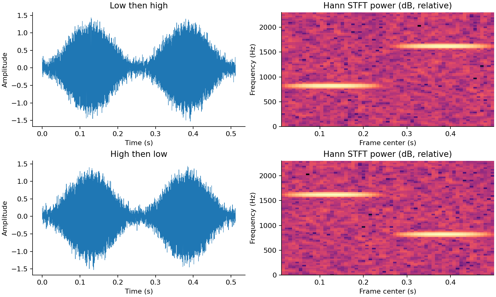
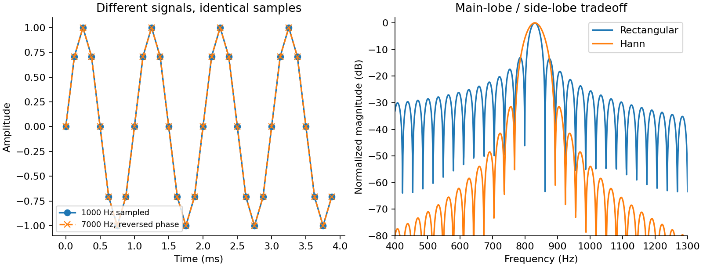
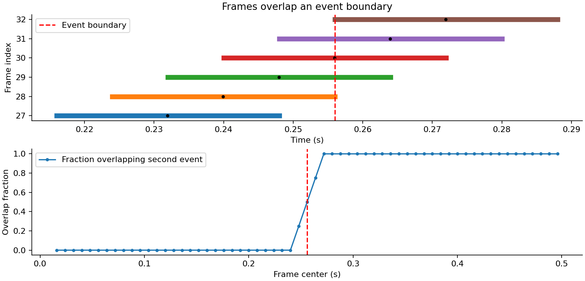
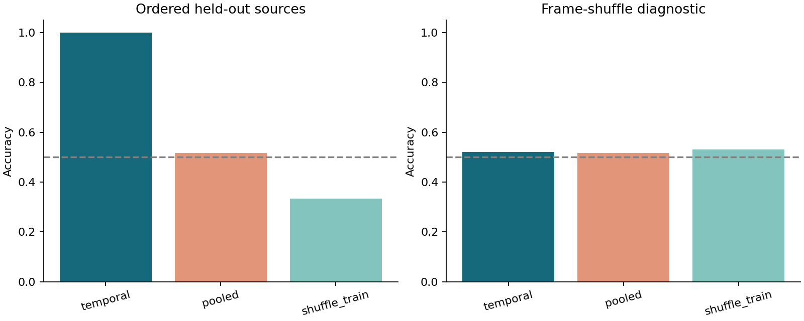
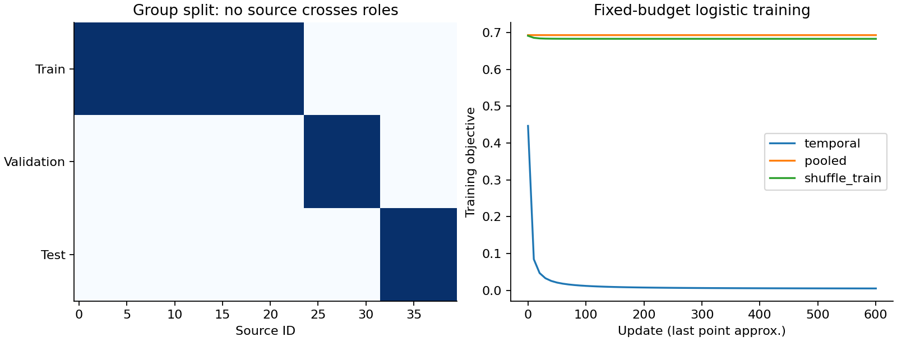

# DL090 音频、视频与时间结构

对应研究分支 M3。直接先修为 053、065；若准备把本课的线性分类器换成循环网络，再补 050。本讲不把复杂架构设成入门门槛。先把时间、采样和标签处理正确，再讨论网络是否需要更强的表示能力。

贯穿问题是：一段声音先出现低音再出现高音，还是先高后低？我们将它压缩成一个可完全检查的研究任务：不用外部音频，不下载权重，不依赖付费服务，只用 NumPy 生成信号、计算频谱并训练分类器。任务非常简单，正适合揭示一个经常被性能数字掩盖的问题：模型究竟识别了哪些声音，还是确实利用了它们的先后次序？

阅读本讲后，应能手算一个分帧张量的 shape；解释为什么相同样本数组配上错误采样率就成了另一段声音；正确变换裁剪后的时间标签；设计时间打乱基线；在文件级、生成源级和事件级之间选择合适的拆分单位。研究验收要求以原始结果为证据，不要求三种方法出现预想中的排名。

## 1 从一个声音问题开始

设 A 是约 800 Hz 的短音，B 是约 1600 Hz 的短音。类别 0 是 AB，类别 1 是 BA。两类都含 A 和 B，持续时长一样，总体音量也匹配。仅问“有没有高音”无法区分它们；必须问“高音在什么时候”。这与“开门再关门”和“关门再开门”具有相同的顺序结构，但不能因此声称解决了自然视频动作理解。

每段样本长 0.512 秒，采样率 8000 Hz，共有 4096 个数。每个短音占 2048 个数，约 0.256 秒。我们从 40 个独立生成源中生成数据，每源包含 6 对 AB/BA，合计 480 段。一个源固定拥有频率偏移和音量增益；每对样本共享完全相同的两块音频，只交换拼接顺序。因此同一对样本不是两个独立测量，来自同一源的样本也存在相关性。

这个构造把音色、能量与顺序的关系控制得很清楚。真实数据中的说话人、设备、场地、压缩编码和录音日期往往交织，未必能做到如此严格配对。合成控制实验的优势是机制可核对；代价是不能直接外推到真实语音、音乐、动物叫声或监控视频。

## 2 数组、时间与采样率不是同一个东西

连续信号写成 s(t)，t 的单位是秒。以采样率 f_s 取样后，离散数组为

$$
x[n]=s(n/f_s),\qquad n=0,1,\ldots,N-1.
$$

x 是 N 维数组；n 是无单位的整数；f_s 的单位为每秒样本数；n/f_s 才是时间。在本课 f_s=8000，所以相邻样本间隔 0.000125 秒，即 0.125 毫秒。第 800 个样本处于 0.1 秒，而不是 800 秒。最后一个样本时刻是 4095/8000=0.511875 秒；以每个样本占一个时间单元计，片段覆盖区间常写为 [0,4096/8000)，总时长 0.512 秒。

这两个数字看起来略有差异，却都可以正确：一个描述最后一次采样时刻，一个描述文件按样本数计的时长。标注工具和数组代码必须采用一致的区间约定。本文事件区间使用左闭右开形式，避免把同一个边界样本计入两个互斥事件。

如果数组不变，仅把文件头的采样率改成 16000，播放器每秒读取两倍样本，于是播放时长变成 0.256 秒，音高翻倍。真正重采样的目标通常是保持原来的物理声音和时长，用新网格表示它，因而样本数也应相应变化。改文件头与重采样是两种操作，不能混称为“统一采样率”。

多声道还带来一条额外轴。一个批次可能是 [B,C,N]，也可能是 [B,N,C]；本课明确采用单声道 [B,N]。把声道轴误当时间轴做 FFT 仍可能得到合法数组，但频谱没有所声称的物理含义。检查 shape 是必要条件，检查轴的语义同样必要。

## 3 混叠：不同声音怎样变成相同的数

考虑正弦波 sin(2πft)。在离散时刻，频率 f 和 f+kf_s 会满足相同的复指数采样关系，因为额外相位 2πkn 总是整圈。这意味着仅凭样本无法区分所有可能的连续频率。

一个可手算的例子是 f_s=8000 Hz。1000 Hz 的正弦与 7000 Hz 正弦在离散网格上互为相反数：

$$
\sin(2\pi\,7000n/8000)=-\sin(2\pi\,1000n/8000).
$$

因此一个相位翻转的 7000 Hz 波可以给出与 1000 Hz 波相同的样本。实验以 100 个采样点检查这一恒等式，浮点误差仅来自数值运算。它不是神经网络训练失败，也不是需要更多参数才能解决的难题；所需区别已经在采样时消失。

在理想带限条件下，采样率超过最高频率的两倍是避免这类歧义的重要条件；工程上还需要给实际滤波器留出过渡带。若从 16000 Hz 降到 8000 Hz，应在降采样之前抑制将越过新奈奎斯特频率的成分。直接每两个点取一个，不自动完成抗混叠滤波。

不要把“高采样率”解释成“模型一定更强”。更高采样率允许表示更高频率，也增加序列长度和成本；任务是否需要这些频率，应由物理机制和实验决定。低频设备状态检测与人声识别可能采用不同预算。已经在录制时混叠的信息，事后把数组插值变长通常不能恢复。

## 4 波形太长时，为什么要分帧

整段 FFT 回答“这一段总体包含哪些频率”，但容易丢掉“它们先后在何时发生”。短时傅里叶变换把波形切成重叠的小窗口，每个窗口分别做频率分析，从而保留一条粗粒度时间轴。

设窗口长度 W、步长 H、不做左右补零，且 N≥W。第 m 帧包含下标 mH 到 mH+W-1，总帧数为

$$
T=1+\left\lfloor\frac{N-W}{H}\right\rfloor.
$$

把本课数值代入：N=4096，W=256，H=64，得到 T=1+3840/64=61。原波形为 [B,4096]；分帧后为 [B,61,256]；每帧做实数 FFT 后为 [B,61,129]。最后的 129 是 W/2+1，包含零频率与奈奎斯特频率。NumPy 官方文档明确给出了实数 FFT 输出轴的长度约定。[1]

为了把这个公式真正学会，再看 N=1000、W=256、H=100：T=8，最后一帧起点 700，终点 955，末尾还有 44 个样本未被纳入。此时应选择丢弃、补零或另设尾帧策略，不能无声改变。若选择补零，结果 T 会不同，标签与有效长度 mask 也要相应更新。

“每 8 毫秒输出一帧”在本课是 H/f_s=64/8000 的结果；每帧本身覆盖 32 毫秒，即 W/f_s。输出频率和观察窗口长度不可互换。相邻帧有大量重叠，61 帧不是 61 次独立实验。把它们拆成训练和测试，会把同一原始音频的一部分共享给双方。

## 5 窗函数究竟在做什么

DFT 将有限片段视作一个周期的样本。如果窗口两端不连贯，周期延拓就出现突变，能量可能分散到许多频率。这种泄漏不是新产生的真实声音，而是有限观察与分析方式造成的现象。

矩形窗等价于直接截取，窗口内权重全为 1。Hann 窗让两端平滑下降，本课采用对称定义

$$
w[n]=\frac12-\frac12\cos\left(\frac{2\pi n}{W-1}\right),\quad 0\le n<W.
$$

窗长 W=256 时，端点权重为 0。中间样本权重接近 1。NumPy 的 hanning 实现对应这一约定；其他库可能另有周期窗版本，应查看具体参数，而不是只认名字。[2]

加窗通常降低远处旁瓣，但会使主瓣变宽。于是“图更平滑”不意味着两个很接近的音调更容易分开。观测时间变长通常能细化频率区别，却使短事件发生时刻更模糊；观测时间变短则相反。没有一种窗口能无代价地同时提供任意精细的时间与频率分辨。

本课画 830 Hz 的有限正弦，比较两个窗口。830 不是 31.25 Hz 频率网格的整数倍，因此可以直观看到泄漏。为了画出平滑曲线，图中把 FFT 长度设成 8192；这只是对有限窗口频谱进行更密的采样。原始观测仍只有 256 个数，不能把零填充误写成收集了更长的音频。

还要区分“生成包络”和“分析窗”。合成短音本身乘了平滑包络，模拟声音逐渐开始和结束；STFT 又在每个观察窗口乘 Hann。前者属于数据生成，后者属于特征提取。改其中一个，会影响不同环节，应在实验记录里分别列出。

## 6 把 STFT 写到每一个变量都有含义

对第 m 帧、第 k 个频率点，本课使用

$$
X[m,k]=\sum_{n=0}^{W-1}x[mH+n]w[n]\exp(-2\pi i kn/W).
$$

x[mH+n] 是原波形样本；w[n] 是分析窗；i 是虚数单位；k 对应频率 kf_s/W。这里 Δf=f_s/W=31.25 Hz。k=0 为 0 Hz，k=32 为 1000 Hz，k=128 为 4000 Hz。频率轴是确定的物理换算，不能拿像素坐标 32 直接解释为 32 Hz。

X 为复数。幅度是 |X|，相位是复数角度，功率相关量是 |X|²。本文计算 P=|X|²/Σw²，然后对预定频带求和。它是用于分类的能量相关特征，不宣称已经完成具有 Pa²/Hz 等绝对单位的校准功率谱估计；单边谱的端点处理、带宽归一化、传感器标定都可能影响物理单位。

图像中展示 10log10(|X|²+ε)，是相对可视化量。若以幅度表示，常写 20log10(|X|+ε)。两种公式在忽略不同 ε 约定时相关，但不应随意混用。图上某颜色“亮了 10”不能未经说明解释成声压增加了 10 帕。

频谱幅度丢弃相位。很多分类任务可以在这一压缩下工作，但这不证明相位在所有任务中无用。声源定位、波形重建、某些瞬态识别都可能需要额外信息。每次压缩都应问：我们的标签依赖的信息是否仍被保留？本课只需要频带能量的先后，故这一简化足够合理。

## 7 时间戳不能靠目测对齐

一个 STFT 帧并非瞬时观察。本文把它的覆盖区间写为 [mH/f_s,(mH+W)/f_s)，把样本中心位置记为

$$
c_m=\frac{mH+(W-1)/2}{f_s}.
$$

中心公式中使用 W-1，是因为样本下标从 0 到 W-1。某些库用 W/2 表达居中补零的时间定位，两者相差半个样本，不能看到不同结果就立刻判定某方错误；先核对补零、采样点与区间定义。

本课第二个事件区间为 [0.256,0.512)。第 30 帧起点为 1920/8000=0.240 秒，窗口覆盖 [0.240,0.272)，与第二事件重叠 0.016 秒，覆盖比例 0.5。第 31 帧从 0.248 到 0.280 秒，比例为 0.75。它们的中心标签与覆盖比例标签可能不同，二者回答的训练问题也不同。

如果任务是帧级事件检测，可以令软标签 r_m 等于窗口与事件区间交集长度除以窗口长度；也可以规定中心落入事件即标为 1；还可以只保留完全落入事件的帧。必须先选择目标，再解释误差。在边界处给出不同标签不一定是标注错，也可能是问题定义不同。

本实验主任务是整段 AB/BA 分类，因此不拿这些帧标签训练分类器；alignment.csv 是独立的时间审计。把整段标签复制到每一帧，再把模型能否识别顺序归功于帧级监督，会悄悄改变信息需求。低音单帧不能知道未来是否会出现高音。

## 8 裁剪、重采样和变速后的标签怎样变

设原事件为 [a,b)，从原音频时间 c 开始裁剪长度 d，则新事件为 [max(0,a-c),min(d,b-c))，只在右端大于左端时保留。例：原事件 [1.2,1.8)，裁剪 [1.5,2.0)，新片段中的事件是 [0,0.3)。不能继续使用原来的 1.2 秒起点。

若仅重采样而保持真实持续时长，事件的秒数坐标应基本不变，整数样本索引则按新采样率重新计算。例如 0.25 秒在 8 kHz 下是第 2000 点，在 16 kHz 下是第 4000 点。滤波器群延迟、边界补齐和取整误差还需按实现处理；不能只写一个比例就假设任何库都对齐。

若改变播放速度为 α 倍而不补偿时长，则新事件秒数为 [a/α,b/α)。速度增强可能保持类别，也可能改变任务标签：在动作速度识别、心音时长估计或设备周期异常检测中，速度正是目标。是否允许增强应由标签语义决定，而不是因为增强库提供了这个按钮。

循环平移尤其危险。对 AB/BA，平移半个片段会交换事件顺序。如果保留原标签再把准确率下降归为“不鲁棒”，就把标签损坏与泛化问题混在一起。本课没有将循环平移包装成合法的同标签测试域；时间打乱也明确只是破坏性诊断。

## 9 从频谱到可学习特征

模型不直接输入 61×129 个复数。本课先对两个固定频带聚合：低频带 [550,1100) Hz，高频带 [1300,1900) Hz。边界在实验前固定，覆盖 ±80 Hz 的源频率偏移。对每帧、每频带计算 log(1+带内能量)，得到 [B,61,2]。

log1p 压缩动态范围，避免少数大能量值支配数值尺度。它不是自动去噪，也不使不同录音设备的幅值获得同一物理校准。固定频带体现了关于任务的强先验；我们应承认先验，而不是声称模型从原始信号自主发现了所有声学知识。

第一种模型对 61 帧直接平均，得到 [B,2]。它知道低、高频分别有多少总体能量，却不知道先后。第二种把时间帧划分成四段，分别取两频带平均，再拼成 [B,8]。61 不能被 4 整除，NumPy array_split 给出长度 16、15、15、15；这一细节必须写明，不能假设四段物理时长完全相等。

假设一个理想低后高样本的四段特征近似为 [4,0,4,0,0,4,0,4]，高后低则近似为 [0,4,0,4,4,0,4,0]。两者全局均值都为 [2,2]，但线性权重 [-1,1,-1,1,1,-1,1,-1] 的内积正负不同。顺序任务不必自动上 Transformer：当正确特征已把顺序暴露出来，线性模型就是有力基线。

## 10 手推一次分类器更新

将每个特征用训练集均值 μ、标准差 σ 标准化，z_j=(u_j-μ_j)/max(σ_j,10^-8)，再添加常数 1 作为偏置项。时间模型 z 的 shape 为 [B,9]，参数 w 为 [9]；池化模型则为 [B,3] 和 [3]。验证与测试只应用训练统计量，不重新拟合。

概率为 p=σ(zᵀw)，其中 σ(a)=1/(1+e^-a)。二元交叉熵加正则写成

$$
L=\frac1B\sum_i\left[\log(1+e^{z_i^Tw})-y_i z_i^Tw\right]+\frac\lambda2\|w_{\rm no\ bias}\|_2^2.
$$

这里用 logaddexp 实现稳定的 softplus，而非直接计算可能溢出的指数。梯度为 Zᵀ(p-y)/B 加正则梯度；偏置不惩罚。固定 λ=0.001、学习率 0.15、600 次全批更新，不按测试结果选步数。

单样本手算：z=[1,2,1]，w=0，y=1，则 p=0.5，忽略正则时梯度为 [-0.5,-1,-0.5]。一次学习率 0.1 的梯度下降后 w=[0.05,0.1,0.05]，新的 logit 为 0.3，预测向类别 1 移动。这个数值练习帮助区分“梯度方向”和“参数更新方向”。

代码中的 sigmoid 先裁剪极端 logit，使指数计算稳定；在本实验的正常数值范围内并不触及裁剪区。若扩展任务导致大量裁剪，应检查优化尺度，不能把该技巧当作严格等同于原始无限范围目标的数学证明。

## 11 三种时间对照分别回答什么

temporal 在原始有序特征上训练与测试，回答“本预处理是否足以暴露顺序”。pooled 在全局均值上训练与测试，回答“丢弃时间后还能否解决任务”。shuffle_train 把每段序列的帧独立置乱，再用四段特征训练，同时在原序测试和置乱测试上报告结果。

另一个关键评估是在已经训练好的模型上打乱测试帧。对 pooled，帧平均在数学上对置换不变，因此预测应只存在浮点求和误差；代码直接检查这一不变性。对 temporal，打乱破坏“早期/晚期”对应关系，若模型依赖顺序，性能通常会改变。

必须严格区分两个问题：测试期置乱导致下降，说明模型对这种扰动敏感；它本身不能证明模型已理解物理因果或自然时间结构。置乱的频谱序列甚至未必对应某条可实现的原始波形。诊断结果不能直接称为真实部署错误率。

训练期置乱是更强对照，但每个样本只保存一次随机置乱。在有限样本下，随机段落能量可能偶然与标签相关。模型在有序测试上可能极端地全对或全错，因为原序特征的信号幅度远大于置乱训练特征中的小偏差。这不是可以删除的“坏种子”；恰好提醒我们，破坏信息不等于每次有限训练都输出精确 0.5。

## 12 为什么必须按生成源分组

本课源 0–23 用于训练，24–31 用于验证，32–39 用于测试，得到 288、96、96 段，三个角色没有共享源，也没有共享配对短音。源 ID 只是生成身份，不是模型输入。

如果按 480 段随机分成相同数量，默认审计发现训练与测试共享 36 个源。这证明拆分不满足“遇到新生成源”的评价目标；并不自动证明准确率已经高估多少。本课没有把这个重叠数冒充性能差，也没有故意训练一个泄漏模型来制造惊人比较。

现实中，若从同一个原始视频切出多个 clips，再分别落入训练测试，背景、人物、编码指纹甚至部分帧可能重复。分帧后再随机切分更严重：相邻帧重叠，几乎相同的波形可能同时出现。应该先确定独立评价单位，例如录音会话、说话人、设备或拍摄源，再在单位层面分配角色，最后生成窗口。

分组也会遇到标签覆盖问题。某类若只由一个源出现，就无法同时做到完全源隔离和该类在所有角色都有覆盖；这时需要更多源、改变目标总体，或明确只评估有覆盖的类别。不能为使分数好看而悄悄允许跨源泄漏。

## 13 本次运行实际得到什么

三个种子 11、23、37 中，temporal 在 96 条保留源有序样本上均为 100%；其测试置乱准确率分别为 52.08%、45.83%、58.33%，均值约 52.08%。pooled 有序结果为 53.13%、51.04%、51.04%，均值约 51.74%；置乱前后相同。这与任务设计中“总体成分不够，先后信息有用”的预期一致。

shuffle_train 的置乱测试结果为 52.08%、51.04%、56.25%，但有序测试分别为 0%、0%、100%。只报平均 33.33% 会掩盖结构，也不能说该方法稳定地“比随机更差”。应检查权重方向、标准化和训练测试特征范围：一次固定置乱留下的小样本相关性，可以在强顺序输入上被放大为完全相反的决定。

我们没有根据这一结果重新抽置乱直到得到三个漂亮的 50%。如果要检验“不断重抽的在线置乱增强”，应另立协议，并明确它改变了训练过程。保留当前负结果是研究透明度的一部分。

100% 也不能解释成问题已经彻底解决。测试只有 8 个源，每源 12 条且含配对；有效独立信息少于 96 次互不相关实验。三个种子主要反映初始化与置乱随机性的变化，不是对全体未来声音的置信区间。若估计源总体误差，应收集更多独立源，并在源层面重采样，而不是将全部帧当作独立 Bernoulli 试验。

## 14 视频是另一种带时间戳的信号

视频输入常写成 [B,T,C,H_v,W_v]；这里 H_v、W_v 是图像高宽，与音频步长 H 不同。每帧具有捕获或显示时间。固定帧率视频可以用 t_j=j/r 近似，但可变帧率、掉帧、慢动作和解码重排可能使这个近似失效，应以容器中可靠的时间信息为准。

举例：从 30 fps 视频每隔 3 帧取一帧，名义观察频率变成 10 fps，间隔 0.1 秒。一个持续 0.04 秒的事件可能完全落在两个采样点之间。换成更强图像模型也无法识别从未输入的那一帧。运动方向、转动速度、接触时刻和短暂手势都可能受时间采样影响。

均匀抽 16 帧不是完整的实验定义。还应说明原视频时长、抽样端点、是否随机偏移、训练和测试是否用同样策略。16 帧覆盖 0.5 秒和覆盖 10 秒，提供的是不同时间分辨率。视频顺序打乱时，单帧内容保持不变，但相邻运动信息被破坏；平均池化的单帧分类器天然对这种打乱不敏感。

I3D 原始研究把二维卷积滤波器和池化核扩展到时空结构，体现了视觉网络显式使用时间维的一条路线。[3] 本课不复现其大规模实验，也不将 3D 卷积视为所有视频任务的必选方案。先确认任务是否能被静态背景、字幕或人物身份单独解开，再论证更复杂时序模型的价值。

## 15 音画对齐不是把两个数组截成同样长

设音频特征每 8 毫秒一帧，视频每 40 毫秒一帧，同一秒内分别大约有 125 和 25 个时刻。直接让第 10 个音频帧对应第 10 个视频帧，会把约 0.08 秒和约 0.4 秒混在一起。正确做法是先给两者统一时间坐标，再使用最近邻、时间区间重叠或可学习对齐机制。

如果某个摄像头比麦克风晚启动 0.12 秒，应在坐标中记录偏移，而不是让网络“自己学会”却继续把对齐误差当语义困难。音频重采样、视频裁剪、帧插值等步骤都应有可追踪的时间映射。不同模态时钟长期漂移时，单一常数偏移也可能不足。

离线任务可以利用整个片段；在线任务在时刻 t 只能看到允许延迟范围内的输入。居中窗口可能使用 t 之后的样本。若一份实时预警模型利用未来 100 毫秒的信息，准确率再好也不能被描述为零延迟预测。应把算法延迟、计算延迟、缓冲延迟分别报告。

本课是整段分类，允许看到完整 0.512 秒，所以四段特征没有未来泄漏。将同一代码改称“第一声音出现即判断完整顺序”，就改变了任务的决策时点，需要重新定义可用信息与评价协议。

## 16 复现、检查与研究验收

独立运行只需 Python、NumPy、matplotlib。experiment.py 保存原始波形、源 ID、配对 ID、角色、频带特征、九组权重和逐例测试概率。metrics.json 与两个 CSV 是主要证据；五张图直接由保存数据和结果生成。图中使用英文标注，正文提供中文解释，避免字体差异影响读者复现。

先运行单元测试，再运行完整实验。测试检查 shape、混叠恒等式、成对交换、源隔离、全局池化置乱不变、边界覆盖比例及分类器能否在小样本上学习。测试通过只能覆盖这些性质，不能证明整个科研结论正确。还应审查特征是否偷偷使用标签、统计量是否跨角色拟合，以及随机种子是否被筛选。

一个合格的研究报告至少交付：任务和时间单位；采样率、窗口、步长、补零及轴顺序；标签转换代码与手算案例；按源拆分清单；有序、无序、池化三类对照；逐源结果；全部固定种子；数据许可与适用边界。缺少其中任一项，都可能使读者无法判断高准确率究竟来自正确时间结构还是数据捷径。

若继续拓展，优先做一个可推翻的窄问题。例如比较 128、256、512 点窗口对一个预定短事件任务的影响，同时保持物理时长和源拆分不变；或增加第三种音序并检验简单四段特征是否仍足够。先写下预算与主要指标，再运行；不要无限调整任务难度直到某种模型胜出。

## 17 练习：把文字变成可检查的判断

1. 16 kHz、1.2 秒音频使用 W=400、H=160、不补零，原数组、分帧数组及实数 FFT 的 shape 各是什么？
2. 在 8 kHz 下，为什么 6 kHz 正弦会与 2 kHz 正弦产生采样歧义？哪个处理阶段应承担抗混叠？
3. 原事件 [1.2,1.8)，裁剪 [1.5,2.0) 后再以 2 倍速度播放，新的秒数标签是什么？
4. 为什么全局均值无法保证区分 AB 与 BA？给出一个严格置换不变的公式。
5. 验证第 30、31 帧的边界覆盖比例，并解释中心标签与软标签的差异。
6. 测试帧打乱后准确率下降到 50%，能否证明模型学会了自然动作因果？提出两个替代解释。
7. 为什么置乱训练模型能在有序测试上出现 0% 或 100%？提出不筛选种子的后续实验。
8. 30 fps 视频抽成 10 fps 后，0.04 秒事件有什么遗漏风险？为什么扩大视觉网络不能消除该风险？
9. 设计一个在线报警实验，说明窗口可访问的时间、最大允许延迟及评估单位。
10. 若某个类别只来自一个录音源，怎样诚实处理拆分与结论范围？

完整推导与参考作答见 answers.md；逐步操作、故障植入与提交模板见 lab.md。

## 来源与边界

[1] NumPy 2.3，numpy.fft.rfft 官方 API 文档：https://numpy.org/doc/2.3/reference/generated/numpy.fft.rfft.html 。用于核对实数 FFT 的轴、归一化约定与输出长度。

[2] NumPy 2.3，numpy.hanning 官方 API 文档：https://numpy.org/doc/2.3/reference/generated/numpy.hanning.html 。用于核对对称 Hann 窗定义。

[3] Carreira 与 Zisserman，Quo Vadis, Action Recognition? A New Model and the Kinetics Dataset：https://arxiv.org/abs/1705.07750 。原始视频时空建模论文，仅作方法背景。

以上页面于 2026-10-19 核验。本文的任务、代码、数值例与图均为本课程的教学设计，不是上述论文的实验复现。详见 sources.md。
