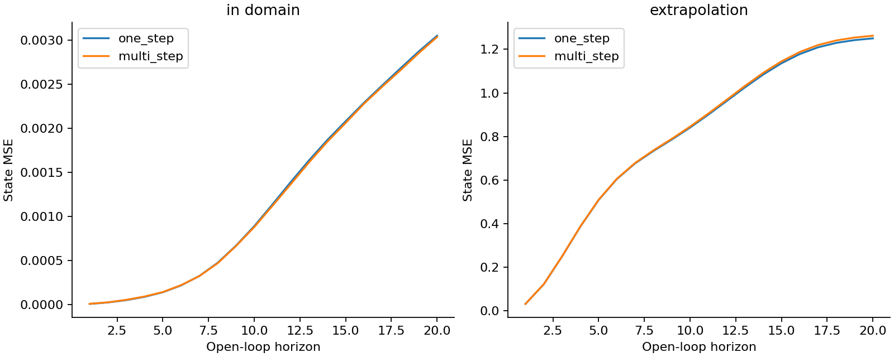
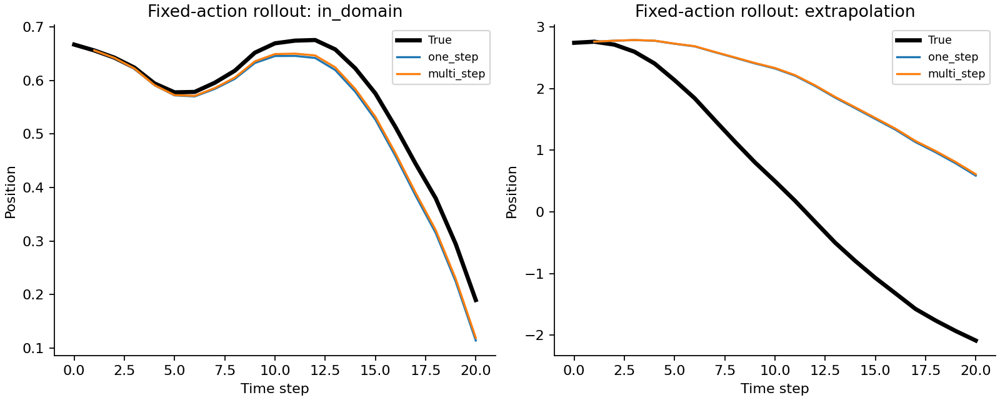
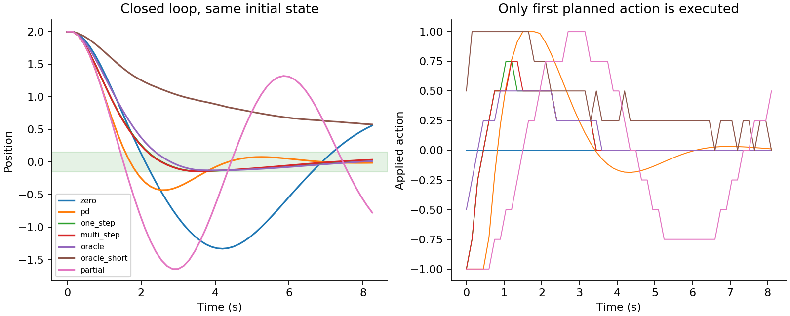
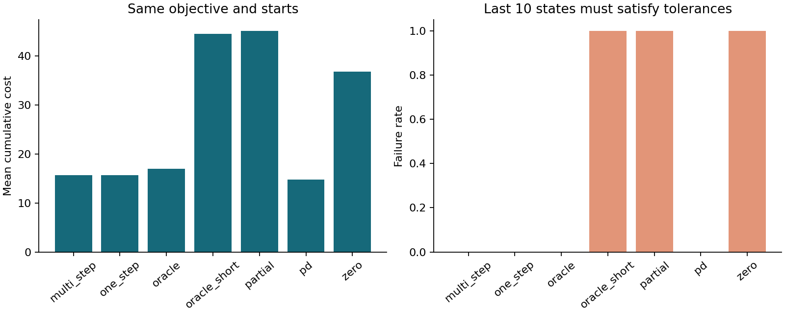
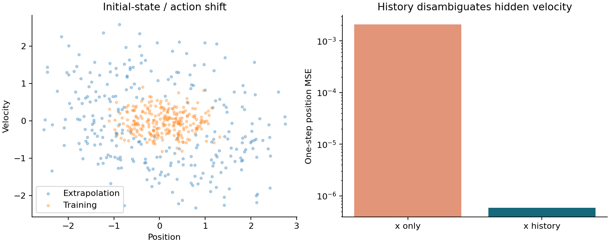
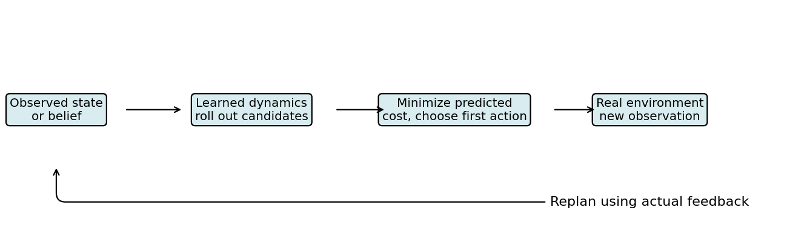

# DL091 预测世界模型与模型式决策

对应研究分支 M4。直接先修为 030、S3、L2。若以后使用扩散模型生成未来，再补 062；本讲不以扩散或大型视频模型为前提。目标是先弄清一件更基础的事：预测未来的误差很小，为什么仍可能作出失败的决定？

我们研究一个一维小车。车有位置和速度，可以施加有限推力，环境还包含阻尼、回中心的弹性力和非线性项。任务是在有限时间内回到原点并停稳。我们会用数据学习一步模型，再用五步展开损失继续训练，最后让模型参与滚动规划。全部实验在 CPU 上运行，依赖 NumPy 和 matplotlib，无权重下载、外部数据、付费 API 或真实硬件控制。

这是一堂世界模型的机制课。小车状态只有两个数，模型是仿射函数，故每个 shape、导数和动作都可核验。它没有模拟自然视频的复杂性，也没有声称一个二维实验可以评价前沿世界模型的通用能力。恰恰因为问题小，才能看清预测、规划、观测和评价各自承担的责任。

## 1 四个对象不能混为一谈

环境是真正产生下一时刻结果的系统；观测是传感器实际提供的输入；模型是我们学习到的近似；规划器是使用模型比较动作并选择行动的程序。四者可以分别正确或失败。

设状态 s_t=[x_t,v_t]，其中 x 是位置，v 是速度；动作 a_t 是施加的控制量。真实系统按照 s_{t+1}=F(s_t,a_t) 演化。学习模型给出预测 ŝ_{t+1}=f_θ(s_t,a_t)。规划器会尝试许多候选动作序列，用模型估计结果，再选择预测成本最低的一条。

在本课，环境函数 F 是我们写下的合成规律，因而可以计算“使用真实模型的规划器”作为诊断。现实机器通常没有这一便利。为了知道某次失败究竟由模型还是搜索引起，可能需要更昂贵的系统识别、仿真器或安全实验，而不是仅观察一条失败轨迹。

本课还故意保留一个传统 PD 控制器。复杂学习系统如果比简单反馈规则更差，应该如实报告。世界模型研究的目标是回答何时、为何以及以何种成本帮助决策，不是保证学习模型必须赢。

## 2 状态为什么需要速度

想象两辆车都在位置 x=1。一辆以 v=0.5 向右走，另一辆以 v=-0.5 向左走。即使现在施加相同动作，下一步位置也不同。只看到位置的模型无法把这两种情况完全区分。

一个状态表示若包含预测未来所需的全部历史信息，就具有我们希望的 Markov 性质：在给定当前状态和动作后，更早历史不再提供额外预测信息。这是相对于任务、时间尺度和建模假设而言的性质，并非任意向量都能因被命名为“state”而获得。

本课在完整观测实验中直接提供 [x,v]。在部分可观测实验中只提供 x，并另做包含历史位置与过去动作的基线。我们不把观测 x 当成真实状态 s，也不把补一个零速度的向量称为已经学会的信念状态。

如果传感器输出图像 o_t，通常还要编码器 z_t=e_φ(o_{≤t},a_{<t})。潜变量 z 的目标是保留对未来和任务有用的信息，未必对应某个可解释物理量。漂亮的重建图像可以保留背景纹理，却漏掉速度或接触状态；低维潜表示也可能舍弃决策所需的小物体。因此表示质量应通过预测和决策任务共同检查。

## 3 先把真实动力学写清楚

本课定义离散时间系统，时间步长 Δt=0.15：

$$
x_{t+1}=x_t+\Delta t\,v_t,
$$

$$
v_{t+1}=0.95v_t+\Delta t\left(a_t-0.25x_t-0.15x_t^3\right).
$$

0.95 表示每步保留的速度比例；-0.25x 是线性回中心项；-0.15x³ 在远离原点时更强；动作在闭环控制中限制为 [-1,1]。实验使用一致的任意物理单位，不声称这些参数来自某台真实小车。

这里的“真”指本合成任务的参考离散环境。若把式子理解成某个连续微分方程的数值近似，离散步长本身也有积分误差；本课没有验证该连续物理解释。因此评价以这个明确的离散 F 为准，不把模拟轨迹称为真实世界安全证据。

手算初始 s=[1,0]、动作 a=0：位置下一步仍为 1；速度为 0+0.15(-0.25-0.15)=-0.06。小车先受到回中心作用，下一步位置才会变化。这个一拍延迟是后面短视规划失败的重要原因。

若 s=[1,0.5]，下一位置为 1.075；若 s=[1,-0.5]，下一位置为 0.925。两者相差 0.15。给只观察 x=1 的预测器再多参数，也无法从同一个输入同时确定两个不同结果，除非额外利用历史或以概率分布表达不确定性。

## 4 数据的一行到底是什么

一条完整轨迹含 T+1 个状态和 T 个动作。以 48 条、每条 40 步训练轨迹为例，状态 shape 为 [48,41,2]，动作 shape 为 [48,40]。第 t 个动作必须和 s_t 配对，以 s_{t+1} 为标签；错移一位会训练出另一套关系。

训练初始位置均匀分布于 [-1,1]，速度于 [-0.4,0.4]，动作于 [-1,1]。验证有 16 条、同分布测试 32 条，均由独立生成种子产生；额外外推集 32 条从绝对位置 1.8–2.8 开始，且动作幅度扩大到 1.8。后者同时改变初始状态与行为策略，是预先指定的联合偏移，不能用它单独归因是哪一维变化造成失败。

同一轨迹中的相邻转移高度相关。应先按轨迹划分训练、验证和测试，再形成一步对或五步窗口。把所有转移行洗牌后切分，会把同一条演化过程分散到不同角色，有时还会让一个样本的标签成为另一个角色的输入。

本课的三个训练种子不控制随机神经网络初始化。一步拟合是确定的线性代数计算；我们在固定训练库上按整条轨迹有放回抽样，模拟数据组成变化。种子 11、23、37 对应三套训练轨迹重采样。这个变异来源必须写清，不能把它称为三份独立新环境数据。

## 5 一步模型的 shape 与闭式解

我们故意选一个不能精确包含 x³ 的仿射模型：

$$
\hat s_{t+1}=[x_t,v_t,a_t,1]W,\qquad W\in\mathbb R^{4\times2}.
$$

一行特征长度为 4；最后一个 1 对应偏置。将所有训练转移展平后，设计矩阵 Z 的 shape 为 [1920,4]，标签 Y 为 [1920,2]。模型有 8 个标量参数。更大的模型可能减少近似误差，却也会引入优化、数据与计算问题；本课先利用小模型让不同误差来源可见。

一步平方误差为 ||ZW-Y||²_F，F 表示把矩阵中所有元素平方求和的 Frobenius 范数。加微小岭项 ρ||W||²_F 后，一阶条件为 Zᵀ(ZW-Y)+ρW=0，于是

$$
W=(Z^TZ+\rho I)^{-1}Z^TY.
$$

代码使用 solve 解线性系统，不显式计算逆矩阵；ρ=10^-6。公式中的单位、参数缩放和正则作用应一起理解。本课状态量级接近 1，未另做标准化；换成米、毫米混合的真实数据时，直接沿用相同 ρ 可能产生完全不同的约束效果。

为什么模型会错？如果完整特征包含 x³，真实关系在该特征空间中就是线性的；当前只使用 x，无法在全部位置范围精确表达立方项。因此这是明确的模型类失配。增加同一区间的训练样本可以改善估计，却不保证消除外推时的结构误差。

## 6 一步误差为什么容易让人过于乐观

一步评估每次都从真实状态 s_t 开始预测 s_{t+1}。即使模型上一时刻犯错，下一次输入仍被真实数据纠正。它测量的是“在这些真实状态和动作上，转移函数近似得怎样”。

开放环多步评估只在起点提供真实状态，然后不断把模型输出喂回自己：ŝ_{t+1}=f(ŝ_t,a_t)。从第二步开始，输入已经可能偏离训练状态。它测量“在指定动作序列下，误差如何随递推传播”。

设 e_t=||ŝ_t-s_t||，若 f 在相关区域对状态满足 Lipschitz 常数 L，且真实轨迹上的单步失配最多为 ε，则可得到形式上的界

$$
e_{t+1}\le L e_t+\varepsilon.
$$

从相同初始状态 e_0=0 出发，e_H≤εΣ_{j=0}^{H-1}L^j。L<1 时几何和有界；L=1 时界随 H 线性增长；L>1 时可能迅速放大。这里需要区域内的一致条件，平均测试 MSE 很小并不能提供这样的统一 ε。

手算 ε=0.01、L=1.2、H=5，上界为 0.01(1+1.2+1.44+1.728+2.0736)=0.074416。这个上界通常很保守，不等于实际误差；其作用是解释误差积累为何需要额外条件。若模型离开可控区域，原先估计的 L 和 ε 还可能不再适用。

## 7 五步损失到底改变了什么

只拟合一步可能偏爱短期平均误差最小的参数，未必最适合递归使用。我们从一步闭式解初始化 W，在长度 H=5 的窗口中自主展开，不把中间真实状态重新喂给模型：

$$
L_5(W)=\frac1{2NH}\sum_{i=1}^N\sum_{h=1}^{H}\|\hat s_{i,h}(W)-s_{i,h}\|_2^2.
$$

式子中的 2 来自状态维度为 2，恰与代码对 [N,H,2] 全部元素取平均一致。每个窗口的初始真实状态 shape 是 [N,2]；动作是 [N,5]；目标是 [N,5,2]。一个长度 40 的轨迹提供 36 个五步窗口，48 条提供 1728 个，窗口之间重叠而非独立。

五步训练让参数直接面对自身输出引起的输入变化，但仍只优化五步范围内的平均状态误差。它不自动优化 20 步预测，也不直接优化控制成本、稳定性、碰撞率或规划器搜索质量。把“多步损失”写成“可靠规划保证”跨越了尚未证明的逻辑步骤。

还可以采用不同时间权重 γ_h，例如更重视远期或更近的步数；也可以使用任务相关状态权重。然而改变权重就是改变目标，必须明示。位置以米计、速度以米每秒计时，把两者误差直接相加需要隐含尺度选择；本文只在固定模拟单位下比较相同定义。

## 8 不依赖自动微分也能核对反传

令 z_h=[ŝ_{h-1},a_{h-1},1]，ŝ_h=z_hW。输出误差对 ŝ_h 的直接导数为 2(ŝ_h-s_h)/(2NH)。但 ŝ_h 还会影响后续每一步，因此需加上从未来传回的导数。

把总伴随量记为 g_h，则从最后一步向前递推：

$$
g_h=\frac{2(\hat s_h-s_h)}{2NH}+g_{h+1}W_s^T,
$$

其中 W_s 是 W 的前两行，shape 为 [2,2]，表示状态对下一状态的线性映射；g_h 的 shape 为 [N,2]。参数梯度累加为 Σ_h z_hᵀg_h，得到 [4,2]。最后一步没有未来贡献，初始化 g_{H+1}=0。

代码实现完整的反向时间传播，不能只对每一步损失单独计算一个回归梯度再相加，因为后者会漏掉预测状态随 W 变化的路径。对每个参数用中心有限差分 [L(W+δ)-L(W-δ)]/(2δ) 检查，δ=10^-6，测试容许绝对误差 10^-7、相对误差 10^-4。

有限差分检查也有条件：δ 太大有截断误差，太小有消减误差；不光滑裁剪点附近难以用同一容差判断；仅检查一组输入不能验证全部程序。本课动力学模型在梯度检查区域是光滑的，检查通过构成强局部证据，但不是通用形式证明。

优化采用 Adam，350 次全批更新、学习率 0.003，并将梯度范数截到不超过 10。所有配置固定；没有从测试误差选取最佳迭代。训练曲线只记录部分步数，最终权重单独保存，以免读者把曲线最后一次采样误当成更新前后完全一致的最终目标。

## 9 预测目标与决策目标是两份合同

控制任务希望接近原点、减少速度、不过度施力。一步成本为

$$
c(s,a)=x^2+0.1v^2+0.03a^2.
$$

规划用长度 H=16 的预测路径，总目标为预测下一状态的逐步成本之和，再加终端惩罚 8x_H²+0.5v_H²。位置越远，代价越高；速度惩罚抑制高速穿过原点；动作惩罚限制无必要的推力。这个目标是教学选择，并不对应真实乘客舒适度或设备安全标准。

候选动作也不是全部可能控制序列。我们让前半段动作保持一个值、后半段另一个值，各从 9 个等距值中选择，共 81 条长度 16 的序列。规划器对所有候选做模拟，选成本最小的第一步动作。它是有限候选的随机射击思想的确定网格版本，而不是求得连续空间全局最优。

为什么成本定义重要？一个预测器可能把无关背景预测得很好，却错估制动距离；另一模型在像素上不够精细，却正确预测是否越过边界。对决策有用的误差往往集中在特定方向和时点。状态平均 MSE 是方便的诊断指标，不能单独代表任务效用。

模型还可能被规划器“利用”：搜索倾向于选择模型预测过于乐观的动作区域，而这些动作未在训练数据中充分出现。于是离线平均误差不大，真正被选择的动作却恰好位于误差尾部。这是把模型接入决策后才出现的选择偏差，不能只用训练集拟合度排除。

## 10 开放环计划与闭环执行

开放环执行一次计划后不再看环境反馈，连续执行全部动作。闭环滚动规划则只执行第一步，读取真实新状态，再重新规划。本文采用后者，常称模型预测控制或 receding-horizon control。

这种重新观察可以纠正累计误差：模型预测车到了 0.8，真实车只有 0.9，下一轮从真实 0.9 重新开始。它不能保证安全；如果第一步已经越过不可恢复的边界，后面观察再准确也来不及。如果观测本身错了、延迟很大或规划目标不合适，反馈也无法自动补救。

本课每个控制回合执行 55 步，约 8.25 秒；所有控制器使用同一组 12 个起点，位置取 -2、-1、1、2，速度取 -0.4、0、0.4。执行时的环境始终是真实 F，不能用模型自己产生的轨迹给自己打分。

失败定义是最后 10 个真实状态中，任一个位置绝对值大于 0.15，或速度绝对值大于 0.15。这比“最后一帧恰巧经过原点”更严格，但仍只是一个有限时段的收敛指标，不证明之后永远不会偏离。累计成本与失败率分别报告，不把两者混成一个没有解释的分数。

## 11 怎样把失败来源拆开

zero 不施加任何控制，检验系统本身的阻尼与回中心力能做到什么。pd 使用 a=clip(-1.4x-1.1v,-1,1)，是无需训练的传统反馈基线。one_step 和 multi_step 用各自学到的模型及相同 16 步、81 候选规划器。

oracle 用真实 F 进行同样的候选搜索，它消除了动力学近似误差，却保留有限时域、候选限制和目标设计。oracle_short 也使用真实 F，但规划只看一步、候选为 9 个单动作。partial 使用五步训练模型，但每次观测时把速度强行设为 0，模拟一个粗糙的缺状态处理。

这个矩阵提供了可解释对照。若 oracle_short 失败，不能把失败归为学习模型不准，因为它的模型是准确的；更可能是规划时域和目标对延迟效应处理不足。若 partial 失败而完整状态模型成功，说明忽略速度的策略在这些条件下有代价，但并未评估一个训练良好的概率滤波器。

oracle 也不保证成本最低。真模型只保证每个被评估候选的模拟正确，不保证候选集合足够丰富，也不保证有限时域目标与整个 55 步回合的累计指标完全一致。其他模型的偏差偶尔会诱导一个在当前有限搜索下更好的闭环选择；这不是“错误物理优于正确物理”的一般定理。

## 12 实测的预测结果：没有制造胜利

以种子 11 为例，一步模型在同分布测试全部真实状态上的一步 MSE 约为 1.2936×10^-5；从轨迹起点开放环展开，五步处 MSE 约 1.3740×10^-4，20 步处约 0.003019。输入真实状态的单步评估和递归评估已经表现出明显差别。

外推集对应数字约为 0.004940、0.508160、1.248464。尤其应注意一步指标是在整个外推轨迹上平均，而五步与 20 步指标从原始起点展开；二者评估的状态分布不同，不能仅用数值比值推断某个普遍“误差放大倍数”。

五步训练模型在种子 11 的同分布一步、五步、20 步误差约为 1.3452×10^-5、1.4248×10^-4、0.003069，反而略差；种子 23 与 37 在部分较远期指标上略有改善，整体没有稳定优势。这不是程序失败的自动证据。固定模型类失配、有限样本、不同评价时域和目标之间，本来就可能存在权衡。

训练本身确实发生了改变：种子 11 的训练五步平均误差从约 0.000103971 降到 0.000102884；另外两个重采样也略降。由此只能说当前优化改善了训练目标，不能说测试预测或控制必然改善。本讲保留这一负结果，不重选种子或改变非线性强度来使故事更整齐。

## 13 实测的控制结果：模型准确仍可失败

12 个固定起点上，PD 的平均累计成本约 14.80，一步模型规划约 15.65，五步模型规划约 15.63，真实模型的有限候选规划约 16.96。这四类的失败率均为 0。五步模型相对一步的成本差很小，不足以支持广泛优越性结论；更不应忽略更便宜的 PD 基线。

真实模型短视规划的平均成本约 44.53，失败率 100%；忽略速度的 partial 约 45.16，失败率 100%；零控制约 36.80，也全部未通过设定的最后十步容差。由此可见：正确动力学不够，规划时域、可观测状态和执行策略会决定结果。

“0 次失败”同样不能写成稳定性证书。只有 12 个起点，且是确定性环境、固定参数、无执行延迟、无观测噪声。没有做全状态空间证明，没有覆盖地面摩擦变化、传感器失灵或执行器饱和之外的故障。本课的稳定表述是“在这些起点和这一有限时段通过了预定容差”。

控制实验只使用模型种子 11，三个训练数据重采样用于预测比较。这样可以控制教学预算，但限制了控制结论的稳健性。扩展研究应在多个模型种子、更多独立起点及预定扰动条件下复验，报告配对成本差与失败位置，而不是只展示一条最平滑轨迹。

## 14 部分可观测性怎样用历史补回来

只输入 x_t 和当前动作 a_t 来预测 x_{t+1}，会漏掉 v_t。我们拟合一个三维设计向量 [x_t,a_t,1]，同分布测试下一位置 MSE 约为 0.002083。再加入前一位置及前一动作，使用 [x_t,x_{t-1},a_{t-1},1]，误差降到约 5.912×10^-7。

注意动作时间下标。由 x_t=x_{t-1}+Δt v_{t-1} 可得到 v_{t-1}，再用过去动作 a_{t-1} 推到 v_t；不是用尚未影响当前速度的 a_t。把当前动作当过去动作，模型也可能得到一个看似还不错的拟合，但语义已经错位。

将真实方程代入，可以得到精确的两位置历史关系：

$$
x_{t+1}=1.95x_t-0.95x_{t-1}+\Delta t^2\left(a_{t-1}-0.25x_{t-1}-0.15x_{t-1}^3\right).
$$

本课历史回归仍未包含立方特征，因此不是精确模型；大幅改善来自历史消除了关键隐藏速度歧义，剩余误差仍有结构失配。单元测试直接验证上述解析恒等式，区分“历史足够的信息论事实”与“选定线性回归是否能精确表示”的两个问题。

现实中有限差分估计速度还会放大位置噪声：两个带噪位置相减再除以 Δt，步长越小，噪声影响可能越大。可以采用滤波、状态空间模型或学习到的历史编码器，但都要评价估计延迟与不确定性。简单把历史窗口拉长，不自动解决长期遮挡或不可辨识性。

## 15 潜变量动力学如何连接到大型世界模型

当输入是图像、声音或多传感器数据，直接预测原始像素通常代价高，而且原始空间中的误差未必对控制最有意义。一条路线是编码观测形成潜状态 z_t，在潜空间学习 p_θ(z_{t+1}|z_t,a_t)，再通过解码器重建观测或预测奖励。

若环境部分可观测，常需区分根据历史得到的状态估计分布与依据动力学得到的预测分布。一个典型训练框架可能包括观测重建项、奖励预测项和潜分布之间的 KL 项；具体模型如何定义随机与确定部分、在哪个时刻进行推断，需要阅读原文，不能把所有世界模型写成同一个公式。

World Models 展示了压缩表示、递归动态建模和控制相结合的研究思路。[1] PlaNet 研究从像素学习潜在动力学并在潜空间规划，强调多步训练与部分可观测环境中的决策。[2] 本课借用“表示、动力学、规划”三层区分，但没有复现这些模型的架构或性能。

PETS 研究利用概率动力学模型进行数据高效控制，为区分模型不确定性与环境随机性提供了重要背景。[3] Dreamer 系列则探索利用学到的世界模型中的想象轨迹训练行为。[4] 在模型里优化策略与每一步在线搜索候选动作是不同计算分工，不能仅因都叫 world model 就忽略差异。

本文不提供任何前沿模型排名。论文名称相同的不同版本、训练规模、评价协议都可能变化；这里仅引用已核对的一手资料解释方法谱系。关于具体系统的当前性能，需要重新检索其论文版本、官方代码与评价设置。

## 16 不确定性不能被一条平均轨迹替代

若同一可见历史对应多个可能未来，输出平均状态可能不是任何真实可行的结果。例如路口向左和向右各有一半概率，均值可能指向路中央。概率模型、混合分布或多样本预测可表达多峰未来，但生成多个看起来不同的样本不证明概率经过校准。

至少区分环境随机性与知识不足：前者即使知道真实规律也可能存在，后者来自有限数据、模型类限制或训练不充分。多个模型预测不同可以作为知识不确定性的线索，但模型若共享同一错误结构，集成成员可能一致且都错。

本课没有训练概率世界模型。三次训练轨迹重采样只显示部分数据敏感性，不能被包装成完整后验。若要加入不确定性规划，应先决定如何评估：预测区间覆盖、分组校准、低数据区域误差，以及不同风险偏好下的成本与失败率。

对高后果控制，选择平均预测成本最低的动作可能不合适。可考虑约束违反概率、最坏情形或风险敏感目标，但每种方法都需要假设和验证。一个未经校准的“安全概率 99%”不能用来替代真实约束或人工安全机制。本课只在离线合成环境内运行，不连接任何实际控制器。

## 17 外推、分布变化与模型利用

训练数据由均匀随机动作生成，而规划后的动作往往有明显结构，例如持续制动或反复饱和。即使初始状态来自同一区间，模型在闭环中访问的状态动作联合分布也可能改变。这是策略引起的分布变化，与普通分类的随机保留集不同。

我们的外推集同时增大初始位置和动作幅度。在 |x| 更大时，x³ 项迅速增长，所以仿射模型偏差显著。若只改变背景颜色而保留动力学，可能是另一类观测偏移；若质量或阻尼变了，则是转移规律改变。不要用一次外推实验把所有分布外能力归为已验证。

一种有价值的后续诊断是画出误差随 |x|、|v| 和 |a| 的分组曲线，再检查规划器实际选择了哪些区域。若高错误区域恰好是高访问区域，应将它提升为决策风险。仅报告全数据平均 MSE 可能让大量容易的近原点状态稀释少数关键远端错误。

数据再收集也需谨慎。现实中让系统主动去陌生区域“探索误差”可能危险；教学环境可直接重采样，真实系统则需要安全约束、授权、审查和回退方案。机制实验的可复现性不等于部署的可接受性。

## 18 一个能接受反驳的验收方案

先写清任务的状态、观测、动作界、时间步长、目标与失败条件。再固定数据生成方式、轨迹拆分、训练目标与搜索预算。预测比较至少同时包含一步、多个开放环时域和预定外推；控制比较至少有无控制、传统反馈、真实模型规划和学习模型规划。

必须用真实环境反馈计算控制指标，保存每一步状态与动作，确认 planner 执行的只有第一步。若把模型预测轨迹当实际轨迹评分，会把模型自己的幻想当作证据。也要检查测试函数是否每次错误地喂入真值，从而把本应开放环的多步评估变成 teacher forcing。

所有参数、权重、逐回合成本与失败标记均应可读取。test_experiment.py 检查手算一步、真实展开恒等、梯度、历史递推、候选数量与动作边界；verify_replay.py 根据保存状态和模型重新核对指标。通过测试不意味着解决了稳定性证明，只意味着交付中的若干关键计算可被独立重做。

研究报告最后应写一句足够窄的结论：“在预定二维离散系统、固定数据和有限起点上，多步训练小幅改善训练目标，但未稳定改善保留集预测；模型与传统反馈均可通过本次有限时段控制检查，而真实动力学的短视规划仍会失败。”这比“世界模型能预测未来，所以可可靠规划”更有信息量，也更容易被后续实验修正。

## 19 练习与扩展

1. 手算 s=[1,0]、a=0 的一步，以及 s=[1,0.5]、a=-1 的一步。
2. 48 条 40 步轨迹的一步设计矩阵、五步窗口初始状态和目标 shape 各是多少？
3. 为什么一步测试必须写明是否使用真实状态？给出错误多步评估的伪代码描述。
4. 设 L=1.2、ε=0.01，算五步误差上界，并列出该界不能由平均 MSE 直接推出的原因。
5. 推导五步目标的伴随递推，解释若忽略未来项会漏掉什么。
6. 真实模型的一步规划为何可能失败？为什么不能直接说“规划算法没有学好动力学”？
7. 真模型有限搜索的实测成本高于一个近似模型，能否宣布近似动力学更优？
8. 推导两位置历史公式，指出必须使用哪一个动作下标。
9. 多步训练降低训练目标却未稳定降低测试误差，你应怎样写研究结论？
10. 给出一个扩展实验，分别隔离初始状态外推、动作幅度外推和动力学参数变化。
11. 设计一个不以平均 MSE 为唯一指标的任务相关评价，并解释失败定义。
12. 若准备把本课方法搬到真实机器人，哪些证据和安全边界仍然缺失？

参考解答见 answers.md；操作手册和研究报告任务见 lab.md。

## 一手来源

[1] Ha 与 Schmidhuber，World Models：https://arxiv.org/abs/1803.10122 。

[2] Hafner 等，Learning Latent Dynamics for Planning from Pixels：https://arxiv.org/abs/1811.04551 。

[3] Chua 等，Deep Reinforcement Learning in a Handful of Trials using Probabilistic Dynamics Models：https://arxiv.org/abs/1805.12114 。

[4] Hafner 等，Mastering Diverse Domains through World Models：https://arxiv.org/abs/2301.04104 。

来源于 2026-10-19 核验。上述引用只支撑方法背景；本课的二维系统、代码、误差分析和实测比较为独立教学设计，不等同于上述方法的复现。具体范围见 sources.md。
