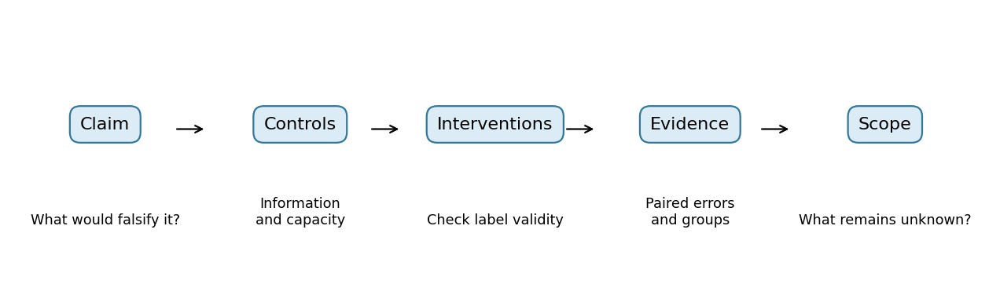
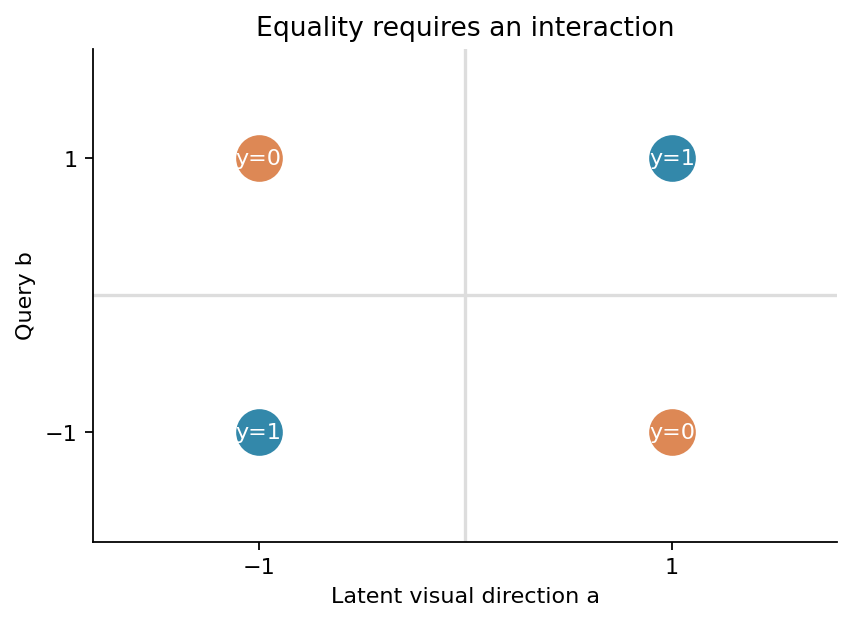
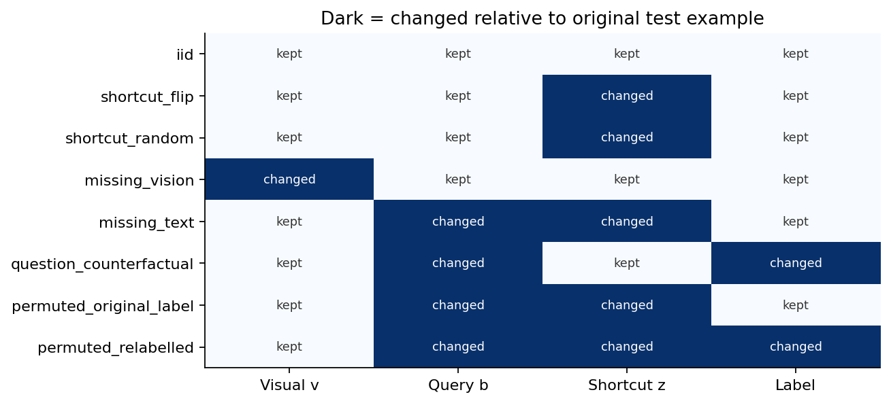
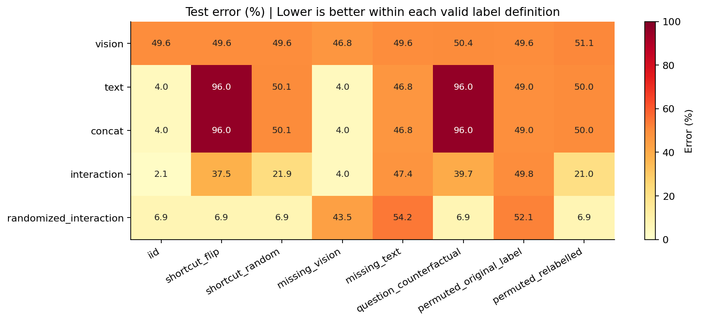
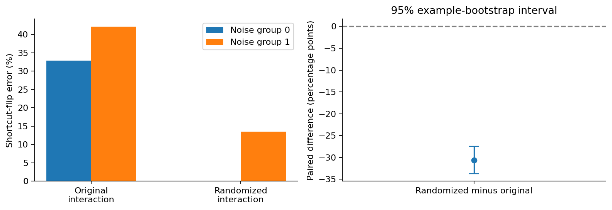

# DL092 多模态研究的证据与偏差

本讲是M分支的第五讲，先修022、071和088。前四讲已经讨论表示对齐、视觉语言融合、音视频时间结构与预测世界模型。现在需要回答一个更严格的问题：如果多模态系统分数提高，我们到底知道了什么？提高可能来自真实交互，也可能来自额外参数、更容易的文本提示、近重复样本、标签泄漏，甚至评测脚本的错误。

我们用一个能完全知道真相的合成任务贯穿全讲。图像侧提供一个带噪声的方向信号，文本侧提供一个要比较的方向，标签表示二者是否相同。文本还夹带一个与训练标签高度相关、却不属于任务定义的提示。读者将亲手训练五种小模型，检查八种输入条件，观察“原域很好”与“依赖可靠信息”之间的差别。本实验是证据设计练习，既不是大型视觉语言模型复现，也不把固定交互特征包装成新的深度学习结构。

学习终点不是记住“要做消融”这句话，而是能为一个具体主张写出对照、估计量、失败条件和结论边界。主讲义负责解释原理，lab.md带你重跑并主动植入故障，answers.md提供核对答案；数据、逐例概率和真实训练权重都在outputs中。

## 1 从准确率增长退回到研究问题

假设图像模型准确率80%，加文本后变成90%。这10个百分点不能直接叫作“跨模态理解提升”。新模型也许获得了更多训练步，文本也许直接包含答案，原图模型也许根本没调好，测试集也许来自训练图片的裁剪版本。每个解释都与同一组表面数字相容。

一个可检验的问题应更窄：在相同基础样本与训练预算下，模型能否利用图像方向与文本查询的关系，在标签提示关系反转时继续完成任务？这里“关系反转”是明确的预定测试域；“继续完成”有错误率定义；“相同预算”能从配置核对。我们不把这个问题扩张成“理解了所有多模态内容”。

相关工作已经提醒研究者检查语言先验：视觉问答模型可能只凭问题词汇猜答案，而没有充分利用图片。VQA-CP通过改变答案先验来检验这类问题[1]；后续视觉语言模型研究也发现，忽略图片的语言基线有时相当强[2]。这些研究启发本课设置文本基线，但本课没有复制它们的数据集或分数。

## 2 把“模态”落实成可检查的数据字段

真实图像可以是像素数组，文本可以是token序列，音频可以是波形。本课为了让证据逻辑可手算，把视觉表示压缩为一个实数v，把文本查询压缩为符号b，再加入文本提示z。v不是原始照片，而是给定的带噪视觉表示；我们没有训练图像编码器。因此本课结论只涉及给定表示上的融合与证据审计。

令真实方向a取-1或+1，查询b也独立取-1或+1。标签y为相同取1、不同取0。我们给模型的视觉输入为v=a+噪声。每个样本还属于一个合成噪声组g：g=0的标准差为0.25，g=1为0.9。这个组仅表示测量质量，不代表任何真实人口属性。

$$
y=\mathbf{1}[ab>0],\qquad v=a+\epsilon_g.
$$

文本提示z在95%的样本中等于2y-1，另外5%取相反符号。例如a=+1、b=-1时，正确标签是0；典型训练提示是z=-1。一个只读z的模型就可能得到约95%准确率，根本不用理解a与b的关系。

数据按独立生成种子分为1200训练、400验证和800测试。所有方法共享同一份基础数据；验证集被保留给学习者设计后续协议，本课默认训练不做超参数搜索或早停，也不拿测试集选参数。三种训练种子11、23、37只改变初始化和训练时提示随机化，不改变基础训练或测试样本。

|字段|维度|含义|是否送入模型|
|---|---|---|---|
|v|N×1|带噪视觉表示|是|
|b|N×1|文本查询方向|是|
|z|N×1|可能不可靠的文本提示|是|
|a|N×1|真实视觉方向|否，仅生成标签与反事实|
|g|N×1|合成测量噪声组|否，仅分组审计|
|y|N×1|相同或不同|训练监督及评价|

这里a不能悄悄进入模型特征。如果把a与b的乘积直接当成输入，任务会被答案泄漏解决。代码的交互特征是v乘b，仍带有视觉测量噪声。data.npz保留a是为了检查配对置乱后正确标签如何变化，不是授权模型在推理时读它。

## 3 为什么单模态强基线不可省略

若没有提示z，单看a或单看b都不能知道y。给定a=+1，b仍有一半概率为+1、一半为-1；所以y仍均匀。单模态缺少的是决定标签所需的信息，而不只是模型不够大。

有提示z后，文本单模态却可以很强。这不违反上面的推理，因为文本输入已经从b变成了(b,z)。研究报告若只说“文本基线”，却不列出它看见哪些字段，会把两个不同的信息条件混在一起。

本课设置五种方法。vision只看v与常数项；text看b、z与常数项；concat看v、b、z与常数项；interaction额外看v×b；randomized_interaction在相同交互模型训练时将z替换为独立随机符号。常数项对应偏置，让决策边界不必通过原点。

这些模型都是逻辑回归，交互模型的非线性来自手工乘积特征。这样做的目的，是把“是否存在交互”和“是否依赖捷径”从大模型工程噪声中分离。不能据此断言手工特征优于Transformer，也不能把text视为现实任务中经过充分调参的最强语言模型。它只是这个已知生成机制下足够解释文本捷径的强基线。

另一个容易遗漏的公平性问题是容量。vision有2个参数、text有3个、concat有4个、两个交互模型各5个；它们不完全参数匹配。最有力的干预比较因此是两个交互模型：特征维度、初始化分布、步数和优化器相同，只改变训练提示的生成关系。跨模型比较是机制诊断的辅助证据。

## 4 手算线性拼接为何不能表达相等关系

先忽略视觉噪声和提示，只看四个(a,b)组合。相等标签为1的点是(+1,+1)和(-1,-1)，不同标签为0的点是(+1,-1)和(-1,+1)。这就是二维平面四个角上的异或式分类。

假设线性分数为w₁a+w₂b+c。两个正类需要w₁+w₂+c>0及-w₁-w₂+c>0，相加得到2c>0。两个负类需要w₁-w₂+c<0及-w₁+w₂+c<0，相加得到2c<0。两者矛盾，所以不存在这样的线性分界线。

加入乘积ab后，正类的乘积为+1，负类为-1，只要使用分数k·ab且k>0即可区分。在真实实验里我们使用vb而不是ab，噪声使问题不再完全可分。这个推导说明拼接输入不等于已经实现了有效交互；融合层必须具备适合任务的函数表达能力。

从矩阵角度看，一批N个样本的交互特征矩阵F形状为N×5，每行依次为[v,b,z,vb,1]；权重w形状为5；Fw得到N个分数。这个shape核对能迅速发现把样本轴与特征轴搞反的代码错误。

## 5 从损失到更新 一次训练究竟改变了什么

逻辑回归把分数s=Fw压成概率p=1/(1+exp(-s))。对于标签y=1，损失希望p接近1；对于y=0，损失希望p接近0。二元交叉熵把两种情况写在一起：

$$
L(w)=-\frac{1}{N}\sum_i[y_i\log p_i+(1-y_i)\log(1-p_i)]+\frac{\lambda}{2}\|w\|_2^2.
$$

逐个求导，交叉熵对分数的导数简化为p-y。再乘上分数对权重的导数，也就是对应特征，得到全批梯度：

$$
\nabla_w L=\frac{1}{N}F^T(p-y)+\lambda w,\qquad w\leftarrow w-\eta\nabla_w L.
$$

本课使用600次全批更新，学习率0.12，λ=0.0001。例子：某样本y=1但p=0.7，误差信号p-y=-0.3；若该样本vb=2，则其对交互权重梯度的未平均贡献为-0.6，梯度下降会增大交互权重，从而提高该样本分数。这能把抽象导数与模型行为连接起来。

代码对sigmoid输入裁剪到[-35,35]避免指数溢出，并在对数中加微小常数防止log(0)。本数据没有极端输入，裁剪主要是数值防护；若你把输入放大千倍，应额外检查梯度与所写稳定损失是否一致，而不是默认任何裁剪都保持数学等价。

训练时提示随机化优化的是另一个经验目标。每次更新独立给每个样本抽取z′，让z′与y不相关，再计算梯度。其直觉是：只靠提示无法在很多次随机替换中持续降低损失，模型会更依赖vb。在有限样本、有限步数和优化误差下，这不保证z权重严格为0，更不保证所有分布外场景都安全。

## 6 干预矩阵 每一行都对应不同问题

消融不是把输入随便删掉后看数字。必须先写清：改变了哪个变量、保留了哪些变量、标签应否改变，以及这个条件在现实里是否可能出现。本实验的八行诊断都从同一组800测试样本产生，因此可以逐例配对，但不能当作八个独立数据集。

|条件|操作|评价标签|主要检查|
|---|---|---|---|
|iid|不变|原标签|原训练关系下表现|
|shortcut_flip|只把z取反|原标签|提示相关性反转|
|shortcut_random|z独立重采样|原标签|提示不再提供可靠线索|
|missing_vision|v设为0|原标签|当前模型缺视觉时行为|
|missing_text|b与z设为0|原标签|当前模型缺文本时行为|
|question_counterfactual|b取反，z保留|1-y|是否响应真实问题变化|
|permuted_original_label|置乱整组文本(b,z)|原标签|原任务标签保持率，非新任务准确率|
|permuted_relabelled|相同置乱输入|按a与新b重标|重组任务准确率|

为什么缺模态与单模态基线要同时存在？缺模态把一个已经训练的模型送入它未必见过的输入分布；单模态基线从训练开始就适应只有一种信息的条件。前者回答当前系统对某输入的依赖，后者回答在给定学习规则下只靠该模态能做到什么。把二者当成一回事，会误把分布外失配解释成信息不可替代。

0在本任务中是合理的无方向占位，但它仍不等于所有现实系统的“缺失”。大模型也许有专门的缺图token、掩码和缺失模态训练。若研究真实产品，应同时考虑自然缺失、显式缺失标记和训练时缺失模拟，而不能只用一张全黑图概括所有情况。

## 7 配对置乱最容易被误读的地方

假设原样本视觉方向a=+1、文本查询b=+1，标签y=1。置乱后换来另一条文本b=-1，那么新问题的正确答案是0。若坚持用原标签1评价，一个真正按图像和新问题作答的模型反而会被判错。

因此本课同时保存两种置乱评价。original_label衡量“原标签保持情况”，用于观察打乱配对后原任务证据怎样变化；relabelled则利用合成数据中已知的a重新计算新任务标签。只有后一种可以叫重组后任务的准确率。它们即便差异很大，也不是统计矛盾，而是在回答不同问题。

现实数据可能无法自动重标。比如一张街景配了另一段说明，新说明可能部分正确、无法判断或定义了另一个问题。这时可以人工标注一小组受控反事实，或把置乱实验明确限制为敏感性诊断。不能为了“证明融合有效”把没有有效标签的输入强行计入普通准确率。

冲突模态也有类似困难。若图像中的路灯是红色，文字说“绿灯”，谁是权威取决于任务：识别图中颜色应相信图像；总结用户陈述也许应报告文字内容及冲突。真实系统的权限与证据优先级必须先定义，否则“听图还是听文本”没有唯一正确答案。

## 8 逐例配对如何让误差比较更可信

记模型A与B在同一个测试例i上的错误指示分别为eᴀᵢ和eʙᵢ，错误为1、正确为0。配对差dᵢ=eᴀᵢ-eʙᵢ只会取-1、0、+1。平均差为负意味着A的错误率更低。

$$
\widehat\Delta=\frac{1}{N}\sum_i(e_{A,i}-e_{B,i}).
$$

举一个十题例子：两模型都对6题、都错1题，A独对2题、B独对1题。A错误2/10，B错误3/10，差为-0.1。真正决定差异的是那三道不一致题；共同错误仍然重要，但不是差值的来源。独立地给两模型各抽一批题，会额外引入题目组成差异。

本课在shortcut_flip域比较randomized_interaction与interaction。先对三种子各算逐例错误差，再在每个测试例上取种子平均；随后对800个样本索引有放回抽样2000次，取均值分布的2.5%和97.5%分位数。它是固定训练数据、有限三种子平均后的测试例bootstrap区间，不是完整覆盖训练数据与未来现实环境的不确定性区间。

若同一用户提供很多图片，样本之间可能相关；这时按图片独立bootstrap会夸大有效样本量，应按用户或拍摄源分组重采样。我们用完全合成独立样本，因此样本层面重采样有明确生成依据。现实项目仍要重新审查相关结构，不能机械复制脚本。

## 9 实际结果应该怎样读

下表由固定outputs/results.json生成，保留全部方法与预设测试条件，不按结果好坏删行。数值单位为错误率百分比。训练种子间的变化只表示该固定数据下的优化随机性。

|方法|原域错误率|提示反转|反事实问题|重标置乱|
|---|---:|---:|---:|---:|
|vision|49.62%|49.62%|50.38%|51.12%|
|text|4.00%|96.00%|96.00%|50.00%|
|concat|4.00%|96.00%|96.00%|50.00%|
|interaction|2.12%|37.54%|39.71%|21.00%|
|randomized_interaction|6.88%|6.88%|6.88%|6.88%|

本次实测，随机化交互模型减去原交互模型的提示反转域错误率差为-30.67个百分点；固定样本层面bootstrap的95%区间为[-33.75, -27.50]个百分点。这个区间不包含全部训练数据或未来环境不确定性。完整15次训练耗时约0.71秒，权重重载最大差为0。

结果中应优先观察关系：文本模型是否在原域很强、提示反转时是否明显下降；拼接模型是否受限于表达能力；加入交互是否有帮助；训练随机化是否带来域间取舍。不要把某一行好看就升级为“模型学会了理解”。

## 10 群体表现与测量质量

总体错误率是加权平均。若80%的样本来自组0、20%来自组1，平均错误较低可能掩盖组1很差的表现。本课两组由随机生成，比例接近一半，但仍输出每组错误率，避免只凭总分判断模型行为。

这不等于本课完成了人口公平性研究。g只表示合成视觉噪声强弱，不能被称为年龄、性别或其他真实人群。真实群体审计涉及合法的数据来源、群体定义、标签质量、交叉分组、小样本不稳定、个体隐私和任务损害，不能把一个玩具分组图直接套成公平性保证。

尤其要防止把组间差异解释为模型造成的全部差异。本实验组1的测量本来更差，模型、测量误差与任务信息量共同决定结果。研究者可以比较不同方法对组差距的影响，但若没有合适干预和识别条件，不能简单写成“模型歧视了某组”。

## 11 参数预算 运行预算与信息预算

多模态模型常常更大，所以比较应至少列出参数、更新次数、样本数与输入信息。本实验每种方法训练600步，每步读1200个样本，三种子，五方法，总计9000次更新；每种子每方法的样本呈现次数为720000。没有批间重复采样差异，也没有验证集调参成本。

但相同步数不是相同FLOPs。五维特征比二维特征多做乘加，随机化还有抽样成本。对于本课微型模型，这些差异很小，仍应如实记录，而不是把“相同步数”写成“严格相同计算量”。两种交互模型容量相同，所以它们提供更清楚的干预对照。

运行秒数是本次机器的观察，可能随BLAS线程、系统负载和Python版本变化；它不是算法固有常数。我们保存Python和NumPy版本，并建议OPENBLAS_NUM_THREADS=1以降低小矩阵多线程波动。每个方法的全部权重保存为.npz，重载后逐参数差为0，便于独立复查。

信息预算也很重要。提示随机化知道z是无关干扰字段，这是一种强先验；未知真实图文任务里未必知道该改哪里。方法使用了这份结构知识，报告就必须承认。不能把人工知道干扰位置的结果宣传成自动发现所有捷径。

## 12 许可 隐私与权限不应放到最后才想

本课所有数据由脚本生成，没有真人图像、录音、私密文本或外部数据下载，生成算法与课程材料的许可在DATA_LICENSE.md中说明。这降低了教学重跑成本，但也缩小了结论适用范围：没有复杂自然语义、真实传感器偏差、罕见事件或数据收集权利冲突。

真实多模态研究需要逐模态核对许可。图片可公开浏览，不等于能随意训练；音频可下载，不等于说话者同意声纹分析；视频里可能出现未同意的旁观者；文档截图可能含地址或账号。模态组合还可能暴露单独看不明显的信息，例如位置与照片时间联合揭示活动轨迹。

数据卡至少列明来源、许可版本、收集目的、允许用途、个人信息处理、删除机制与保存期限。实验日志也要最小化：能保存去标识化统计就不重复保存完整私密内容；需要逐例审计时，用受控访问和必要字段。模型输出可能重现训练内容，所以发布模型也应评估记忆与提取风险[3]。

权限边界同样属于系统评价。一个视觉语言助手读到截图里的“把文件发给某人”不等于获得用户授权；图像文字可能是不可信外部指令。若研究场景涉及工具，评价应区分感知是否正确、指令来源是否可信、动作是否在授权范围内。高任务成功率不能抵消越权操作。

## 13 从诊断到结论 需要停止在哪一层

证据可以分为四层。第一层是描述：固定测试集上错误率多少。第二层是干预响应：只改变预定字段后预测如何变化。第三层是机制解释：结合任务生成知识与对照，某种输入依赖是否足以解释现象。第四层是跨环境概括：在更多真实任务与数据来源上是否成立。

本课可以较强地达到前两层，并在已知生成机制内支持有限的第三层。由于只有一个合成二元任务，它没有达到广泛现实概括。不要用“显著”“因果”“理解”“安全”四个词替代尚未完成的实验。

即使随机化在反转域有效，也不能宣布在任何偏移下都有效。本课噪声组揭示视觉输入可能不可靠；若真实环境里文本恰好更可信，完全压低文字提示也可能损害性能。稳健系统应明确目标域和证据来源，而不是把某一模态永远设为正确。

有用的结论范式是：“在指定合成任务、固定表示和训练预算下，提示随机化相对相同交互模型降低了预定提示反转域错误；原域及高噪声组结果同时报告。该比较使用已知干扰位置，没有证明自然图文任务的普遍鲁棒性。”这样写并不削弱研究，而是让读者知道应该在哪些地方继续检验。

## 14 将本讲迁移到自己的研究

第一步先定义任务与标签。例如“判断图片里物体颜色”与“判断文本描述是否与图片一致”需要不同标签规则。第二步列出每个模型实际看到的信息，包括文件名、顺序、提示模板、元数据与检索结果。第三步设计能竞争的单模态基线，而不是随便训练一个弱网络当陪衬。

第四步写干预表，逐项判断标签是否保持。遮挡不一定保标签，因为遮挡可能删除辨认目标所需信息；换问题通常改变标签；换无关背景也可能使样本不自然。第五步提前固定数据划分、种子、主要指标与结论阈值，完整保存不利结果和失败运行。

第六步检查预算与容量：如果新模型更大，增加参数匹配或计算匹配基线；如果数据更多，增加相同数据量基线。第七步对错误做逐例审查，区分感知、对齐、推理、标签歧义和权限问题。第八步只把证据支持的范围写进结论，明确下一次研究要排除的替代解释。

实验做得小并不意味着问题可以含糊。相反，小型可核验实验最适合练习“提出可能失败的主张、留下能反驳自己的证据”。当你将来使用大模型和大数据时，这种习惯比记住某个排行榜分数更可迁移。

## 15 本讲完成标准与练习入口

完成本讲时，你应能不看代码解释四点：单模态强分数为何可能来自捷径；缺失模态与重训单模态基线为何不同；配对置乱后为何有时必须重标；固定样本bootstrap为何不代表现实分布保证。还应能复跑15次训练、重建五张图、核对逐例概率与汇总指标，并明确报告一种不利结果。

lab.md安排了手算、重跑、故障注入和研究报告四部分。answers.md不仅给数字，还说明错误推理为何不成立。读答案前请先写出自己的标签规则；多模态实验里，很多看起来是统计问题的争论，最终源于任务定义没有说清楚。

## 参考来源

[1] Agrawal 等，Don't Just Assume; Look and Answer: Overcoming Priors for Visual Question Answering，CVPR 2018。https://openaccess.thecvf.com/content_cvpr_2018/papers/Agrawal_Dont_Just_Assume_CVPR_2018_paper.pdf

[2] Lin 等，Revisiting the Role of Language Priors in Vision-Language Models，ICML 2024。https://proceedings.mlr.press/v235/lin24c.html

[3] Pinto 等，Extracting Training Data From Document-Based VQA Models，ICML 2024。https://proceedings.mlr.press/v235/pinto24a.html

上述来源用于动机与风险背景，公式、图和小型实验为本讲原创教学推导，不声称复现论文实验。来源核对日期为2026-10-19。
