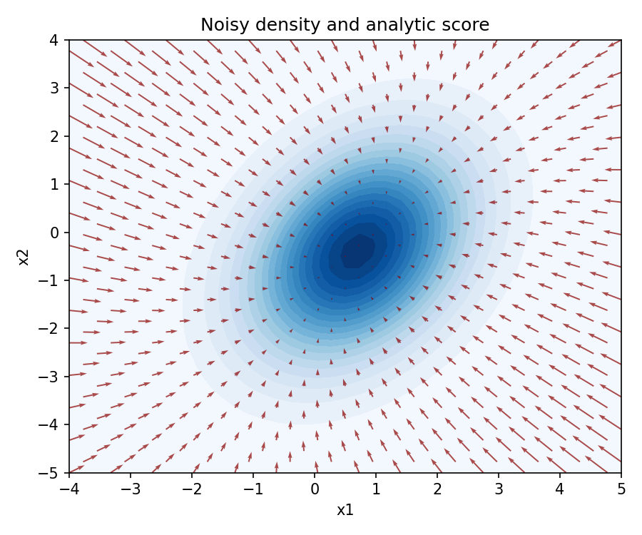
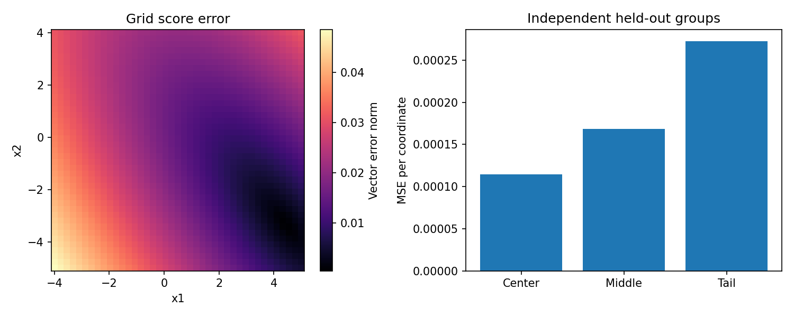
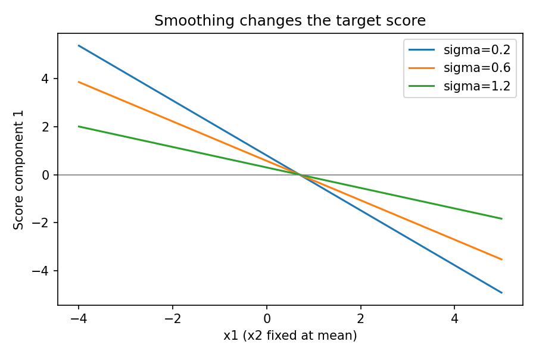

# DL093 / G1 分数匹配与去噪关系

本讲直接先修为011、017、019、062。读者需要能对一个实函数求导、理解二维向量与矩阵乘法、知道概率密度和期望的含义，并见过带噪观测。若其中一项生疏，不必先学习整本随机过程教材：以下会把真正使用的计算逐步展开。预计主讲义学习90分钟，实验60分钟，习题45分钟。

本讲解决一个具体问题：我们想学习数据分布，却不知道每个训练样本的概率密度，能否改为学习一个方向场？答案是可以学习对数密度关于输入的梯度，通常称为score，中文译作分数。这里的“分数”不是分类置信分数，也不是样本得到多少分。我们将从密度出发推导分数匹配，再解释为什么一个带噪声的监督标签能训练出未知边缘密度的score。最后用一个完全可解析的二维高斯检验公式与代码。

::: {.concept}
学习目标：能够从高斯密度亲手求出score；说清归一化常数何时消失；写出积分分部的边界项；区分条件score、加噪边缘score和干净数据score；以独立测试数据检查误差，而不是只展示训练损失。
:::

## 1 密度的高度与密度变化的方向

一维概率密度p(x)的纵轴不是“取到这个精确实数的概率”。连续分布在单点的概率一般为零，小区间的概率约为密度乘区间宽度。密度可以大于1，但积分必须等于1。二维密度则把概率质量分配到小面积上。

现在想象站在密度曲面上的一点。密度p(x)告诉我们当前位置有多高，梯度告诉我们往哪个方向上升最快。为什么对log p求梯度？首先，乘法缩放在对数中变成加法常数，对输入求导后常数消失。其次，梯度被密度自身缩放，得到相对变化率，而不只是曲面高度的绝对变化。

$$
s_p(x)=\nabla_x\log p(x)=\frac{\nabla_xp(x)}{p(x)}.
$$

这里x是d维列向量，score也是d维向量；分母除法表示用同一个标量除每一个梯度分量。定义需要在p(x)>0且可微的位置使用。若密度有零点、硬边界或不光滑点，公式必须限制在适当区域，不能机械代入。

取一维标准正态，log p(x)=常数−x²/2，所以s(x)=−x。x=2时score为−2，指向左；x=−2时score为2，指向右；中心x=0处score为0。这不表示中心概率最低，恰恰相反，中心是密度最大的位置。由此立刻得到一个重要区分：score的长度衡量局部对数密度坡度，不衡量样本出现频率。

::: {.warning}
“score很大，所以样本很可能出现”是错误推断。高斯尾部的密度很低，score的绝对值却很大。score为零也未必是最大值，在复杂分布中还可能是最小值或鞍点。
:::

## 2 归一化常数消失，但合法密度仍是前提

假设模型给出未归一化函数qθ(x)=exp(−Eθ(x))。若Zθ=∫qθ(x)dx有限且非零，就可定义pθ=qθ/Zθ。于是log pθ=−Eθ−log Zθ，对x求导得到sθ=−∇xEθ。Zθ可以依赖模型参数θ，但与输入x无关，因此在输入梯度中消失。这里绝不能把∇x和∇θ混用：求参数梯度时，Zθ一般不会消失。

这降低了学习的一个困难，却没有保证任意向量场都对应合法密度。例如一维候选score s(x)=x，积分得到log p(x)=x²/2+C，指数随两端增长，无法在实数轴上归一化。二维场s(x1,x2)=(−x2,x1)在平面上旋转，两个交叉偏导不一致，不可能是光滑标量势的梯度。神经网络直接输出向量时，也可能产生非保守场；训练目标降低并不自动给出全局可积性证明。

如果两个严格正、光滑密度在一个连通区域内具有相同score，则它们对数之差的梯度为零，因此只差常数；再用归一化约束可确定常数。这说明score在适当条件下保留分布信息。若支持集不连通，各连通分量可以具有不同的常数，单靠分量内部梯度未必恢复混合权重。因此“score总能唯一决定一切分布”也过于宽泛。

## 3 二维高斯的解析答案

本实验干净数据X服从均值μ=(0.7,−0.4)、协方差Σ的二维高斯：

$$
\Sigma=\begin{pmatrix}1&0.55\\0.55&1.8\end{pmatrix},\qquad
\log p(x)=C-\tfrac12(x-\mu)^\top\Sigma^{-1}(x-\mu).
$$

对称矩阵的二次型求导给出∇x[(x−μ)ᵀΣ⁻¹(x−μ)]=2Σ⁻¹(x−μ)，所以s(x)=−Σ⁻¹(x−μ)。协方差的逆通常称为精度矩阵。它既改变方向也改变长度：在变化缓慢的方向，精度小，score更弱；在分布狭窄的方向，精度大，score更强。相关性让等密度线旋转，score不能简单写成各坐标独立的负偏差。

手算一个更简单的例子：μ=(0,0)，Σ=diag(1,4)，在x=(1,2)处score=(−1,−1/2)。第二个坐标偏离2，但该方向标准差也较大，因此回拉的局部对数梯度较弱。这解释了为何“箭头必须直接指向欧氏距离最近的中心”并不准确。

代码使用每行一个样本的约定，x形状为N×2，因此写成−(x−μ) @ Σ⁻¹。数学推导的列向量形式与实现的行向量形式看起来顺序不同，实际上是转置后的同一个公式。后续若换成非对称矩阵，应重新核对转置，不能凭形状碰巧相容就认定正确。

## 4 监督目标不可见，怎么办

最直接的分数匹配损失是Fisher型平方误差：

$$
J(\theta)=\tfrac12\mathbb E_{X\sim p}\|s_\theta(X)-s_p(X)\|^2.
$$

如果真正知道sp，普通回归就足够了。现实中我们只有样本，不知道p及其导数。展开平方：第一项是模型向量长度的平方；第二项是模型与真实score的内积；第三项不含θ，可并入常数。问题集中到交叉项。

在一维，交叉项的积分是∫sθ(x)p′(x)dx。积分分部得到：

$$
\int_a^b s_\theta(x)p'(x)\,dx
=[s_\theta(x)p(x)]_a^b-\int_a^b p(x)s_\theta'(x)\,dx.
$$

在实数轴上需要两端的乘积极限消失，在有界区间则必须处理端点值。在多维区域Ω，边界项变为∫∂Ωp(x)sθ(x)·n(x)dS，n是向外单位法向量。只有该项为零或得到正确校正，并且有关积分存在、导数交换合法时，才能推出通常形式：

$$
J(\theta)=\mathbb E_p\left[\tfrac12\|s_\theta(X)\|^2+\nabla\cdot s_\theta(X)\right]+C.
$$

散度∇·s是每个分量对自身坐标偏导的和，即∑j∂sj/∂xj，不是全部矩阵元素之和。这个目标不再包含未知sp，可以在训练样本上取平均。但它涉及输入导数，高维神经网络可能计算昂贵；此外，边界与正则性假设是真正的数学条件，不是排版装饰。

举一个不能忽略边界的例子：在[0,1]上均匀密度内部p′=0，取sθ(x)=a x。交叉项应当为零，而散度期望为a；积分分部的边界项也恰好为a，两者抵消。如果直接丢掉边界，就凭空产生了一个a项，得到错误目标。这个反例能帮助读者记住：密度“简单”不等于边界条件自动满足。

::: {.concept}
分数匹配不是“假装知道真实梯度”。它把未知梯度所在的交叉项，通过积分分部移到模型上。边界项能否去掉，决定这个替换是否合法。
:::

## 5 把去噪改写成一个有标签的回归问题

现在向干净样本加入独立高斯噪声。令Z服从标准正态，Y=X+σZ，其中σ>0固定。条件分布qσ(y|x)是均值x、协方差σ²I的高斯，因此其关于y的score完全可知：

$$
\nabla_y\log q_\sigma(y|x)=-\frac{y-x}{\sigma^2}=-\frac z\sigma.
$$

注意这个标签依赖干净X与随机Z，训练时我们恰好知道它们。模型输入只有Y，不会直接得到X或Z。定义DSM目标：

$$
L_{DSM}(\theta)=\tfrac12\mathbb E_{X,Z}
\left\|s_\theta(X+\sigma Z)+\frac Z\sigma\right\|^2.
$$

为什么这不是在学一个噪声随机数？平方损失回归的最优解是给定输入后的标签条件期望。令T=−Z/σ，则最优预测为E[T|Y=y]。不同干净样本与不同噪声可能产生相似的Y，模型不应记住某次噪声，而应学会这些可能标签的条件平均。

设pσ(y)=∫p(x)qσ(y|x)dx。在可把导数移入积分的条件下，逐步计算：

$$
\begin{aligned}
\nabla_y p_\sigma(y)
&=\int p(x)\nabla_yq_\sigma(y|x)dx\\
&=\int p(x)q_\sigma(y|x)\nabla_y\log q_\sigma(y|x)dx.
\end{aligned}
$$

两边除以pσ(y)，积分权重变为后验p(x|y)，因此：

$$
\nabla_y\log p_\sigma(y)=
\mathbb E\left[-\frac{Y-X}{\sigma^2}\mid Y=y\right].
$$

这就是DSM与加噪边缘score相连的关键。还可由条件方差分解得到E‖s(Y)−T‖²=E‖s(Y)−E[T|Y]‖²+E‖T−E[T|Y]‖²，第二项与模型无关。因此最小化可见的DSM损失，等价于最小化对未知边缘score的平方误差，而不要求每个随机标签本身都等于真实score。

这个推导利用的是条件期望和微分积分交换，不是刚才那种丢掉边界项的推导。它仍需相应正则性与有限二阶矩。不能把“DSM不显式计算散度”误解成“DSM对任何噪声、任何密度都无需条件”。若换用非高斯噪声，条件score标签也必须按该噪声密度重新求导。

## 6 去噪器、score与噪声预测的换算

将上面的恒等式整理，可得到平方误差下的最优去噪器：

$$
D^*(y)=\mathbb E[X\mid Y=y]=y+\sigma^2s_{p_\sigma}(y).
$$

若网络输出噪声预测εθ(y)，对应score是sθ(y)=−εθ(y)/σ。若网络输出去噪结果Dθ(y)，对应score为(Dθ(y)−y)/σ²。这三个参数化对固定σ具有直接关系，但原始损失的数值尺度会变化；多噪声尺度训练时，不能遗漏随σ变化的权重。

手算例子：X服从N(0,1)，σ=1，故Y服从N(0,2)。其score为−y/2，最优去噪结果为y+y的负一半，即y/2。观测y=2时，后验均值是1，而不是直接归零或完全保留2。这体现了信号先验和噪声不确定性的平衡。若σ趋向0，去噪器趋向恒等映射，但噪声score标签−Z/σ方差变大，有限样本训练反而可能更不稳定。

::: {.warning}
本讲固定σ=0.6，学习的是pσ的score，不是原始p的score。即使训练完全成功，直接与干净分布解析score比较仍会产生系统差异，那是目标定义变化，而非纯粹训练失败。
:::

## 7 本实验究竟学习了什么

为了让每个误差来源都能核对，我们采用仿射函数sθ(y)=Ay+b，用线性最小二乘求解。因为高斯加高斯仍为高斯，pσ=N(μ,Σ+σ²I)，真实score恰好是仿射函数，模型类别包含正确答案。这不是深神经网络，也不是图像生成实验。它的价值是把公式、噪声标签、参数恢复与测试指标对应起来；不能据此宣称已经验证复杂多峰图像分布的生成能力。

训练数据60000个样本，测试数据30000个样本，由独立随机种子生成。训练只使用加噪输入和条件标签。解析边缘score只在评价与单元测试时使用，未进入拟合函数。最小二乘设计矩阵为N×3，前两列是输入，最后一列是全1偏置；输出标签是N×2，所以权重矩阵是3×2。函数np.linalg.lstsq在这里求得六个仿射系数。

## 8 为什么要专门检查低密度区域

训练平均损失按pσ加权，尾部样本少，局部错误容易被中心的大量样本掩盖。我们用马氏半径r²=(y−μ)ᵀ(Σ+σ²I)⁻¹(y−μ)分组：r²<2为中心，2≤r²<6为中间，r²≥6为尾部。这个分组使用密度结构，避免把旋转椭圆误当作普通圆。

固定种子真实运行中，整体每坐标score MSE约为0.0001395，中心约0.0001145，中间约0.0001685，尾部约0.0002727。尾部只有1452个测试点，中心有18925个。此处误差来自有限样本仿射系数偏差；远离均值后，微小斜率偏差被较大坐标放大。结果说明这个运行里尾部误差更高，不能据此断言所有模型、所有随机种子都会严格按此排序。

我们同时在均匀二维网格上评价误差。网格覆盖不是从pσ抽样，因此网格MSE与分布加权测试MSE回答不同问题：前者强调覆盖区域中的几何误差，后者强调自然数据分布下的平均误差。二者不能不加解释地放在同一排行榜里。

## 9 正确解释损失、噪声尺度和验收结果

本次运行DSM测试MSE约为2.08279，而模型对解析score的MSE只有0.0001395。这不是矛盾。DSM监督标签包含条件随机性，即使把真实score代入，测试DSM MSE仍约为2.08275。优化目标的不可约噪声不能被当作模型估计误差。反过来，只看到DSM损失较小，也不足以证明所有位置的score都准确。

随着σ增加，加噪协方差增大，密度更平滑，score方向场通常更弱。图3固定第二坐标为均值，仅观察第一分量的截面；由于原始协方差存在相关性，它是二维场的一个截面，而不是单独的一维边缘score。多噪声尺度模型会把σ或时间作为额外输入，并平衡不同尺度损失，本讲暂不训练它，下一讲会把加噪尺度连接到连续时间。

验收包括四个互补检查：有限差分核对解析梯度；条件标签恒等式检查σ和σ²没有混淆；使用无噪声解析标签验证仿射回归实现；对真实训练输出检查独立测试误差与系数误差。任何单个测试通过都不能替代全部检查。例如仅检查数组形状无法发现错误负号，训练损失下降也无法发现把干净score当作加噪score的概念错误。

## 10 练习与下一步

1. 对N(2,9)写出score，并求x=5处的值。
2. 解释为何s(x)=x不能在整条实数轴上对应合法归一化密度。
3. 重做[0,1]均匀分布与s(x)=ax的积分分部，列出边界项。
4. 在X~N(0,4)、σ=1时，推导最优去噪器。
5. 说明训练标签−Z/σ为何可以很嘈杂，而最优score是确定函数。
6. 把训练样本减为600，预先写下你对总体和尾部误差的预测，再运行多个种子验证。不要先看结果再修改预测。
7. 把噪声换成拉普拉斯噪声后，原高斯标签能否继续使用？指出需要修改的公式与可微性问题。
8. 若测试集从干净p采样，但目标仍为spσ，应该如何描述这个评价协议？

本讲得到的是一个可估计的局部方向场。下一讲要回答的是：如何让这个方向场参与随时间变化的随机运动，从噪声边缘分布走回数据边缘分布？在那之前请确认，你能明确说出“关于哪个变量求导、哪一个分布的score、哪个噪声尺度、哪一种损失”。这四个问题比死记公式更能防止实现错误。

## 补充阅读：把一个样本从生成追到评价

假设一次随机抽样得到干净位置x=(1.0,−0.5)，抽到标准噪声z=(0.2,−1.0)，本讲σ=0.6。加噪后y=(1.12,−1.10)，条件标签为−z/σ=(−1/3,5/3)。从这一个例子无法判断标签是否“合理指向中心”，因为标签描述的是给定这一个干净点时，条件高斯密度的上升方向。若另一个干净点配上另一组噪声，同样可以得到接近y的观测，其条件标签可能完全不同。

拟合函数拿到y的两个坐标与这个二维标签，在最小二乘目标中贡献两项平方误差。它不知道解析协方差，也不使用原始密度值。很多样本共同决定一条平面上的仿射向量场；因此模型最终预测不必等于任何单个训练标签。它接近的是在同一个观测附近所有可能标签的平均。

评价阶段重新抽样，而不是把训练数组改一个名字。评价函数利用已知的合成分布参数计算精确边缘score。这里允许使用“答案”，因为它不参与参数求解，只用来审计结果。真实数据没有解析答案时，就需要其他诊断；本实验并不声称已经解决真实数据上的score评价难题。

如果实验代码偷偷把score(test)用于重新拟合，测试误差当然可能极小，但整个证据链失效。反之，有限差分测试调用解析score并不构成训练泄漏，因为它检查的是函数实现的数学恒等式，而不是选择模型。区别取决于信息流向，而不是文件名里是否出现test这个词。

## 补充阅读：矩阵求解和模型限制

仿射DSM的最小二乘解满足设计矩阵转置乘残差近似为零。这意味着每个输入特征与残差在训练集合中的线性相关被压低，并不意味着每个残差都为零。在有噪声监督的情况下，逐样本残差保留很大数值是正常现象。若为了追求零训练误差增加到几万个自由参数，可能是在记住噪声，而不是更好地估计条件平均。

本讲没有显式形成正规方程的逆，而使用数值库的最小二乘分解。这是因为直接计算逆矩阵通常更容易放大病态性。当前二维高斯设计矩阵很温和，二者可能给出接近结果，但一个教材实现仍应示范更稳妥的路径。读者可以额外输出设计矩阵奇异值，用来理解某些方向缺少数据时系数为何不稳定。

真实score在线性模型类别内，是本实验的重要优势，也是它的限制。换成两个高斯组成的混合分布，score通常是随位置改变权重的组合，单个仿射场无法表达多个模式之间的曲率。此时增加训练样本可能减少方差，却不能消除模型偏差。如果想扩展实验，应先写出混合密度与解析score，再比较线性、固定多项式特征、小神经网络的容量，而不要只宣布神经网络必然更好。

## 补充阅读：如何写一段诚实的实验结论

不合格的结论是“去噪成功，因此学会了数据分布”。它没有说出密度类别、噪声尺度、模型容量、测试数量或错误位置。一个可检查的结论应写为：在给定二维高斯、固定高斯噪声尺度和仿射函数类别下，使用六万个独立训练样本的DSM最小二乘，得到约万分之一量级的每坐标边缘score测试误差；尾部组误差高于中心组；这些结果由独立测试和解析解对照支持。

还应接着写出尚不能推出什么：它不能证明未知复杂密度上的采样质量，不能保证任意向量场可归一化，也没有比较神经网络或多噪声尺度训练。结论范围写得窄不是实验价值低，而是把真正建立的知识与下一步猜想分开。对科研初学者而言，这往往比再加一张更漂亮的图更重要。

阅读检查：合上讲义后，请用自己的话解释一个核心公式，并逐一给出每个符号的含义。如果只能复述结论而不能说明假设，回到对应手算；如果能说明假设却无法找到代码中的实现位置，回到实验步骤。把概念、推导、程序和观测结果连在一起，才算完成本讲。

## 参考与来源边界

- 课程定位依据：[公开课程目录G1](https://github.com/hrqz007/deep-learning-research-course/blob/main/catalog/units.md)。本讲文字、代码、合成数据与图均为本批原创。
- 分数匹配原始研究：[Hyvärinen, 2005, Estimation of Non-Normalized Statistical Models by Score Matching](https://www.jmlr.org/papers/v6/hyvarinen05a.html)。上文完整计算为教学推导，并未复制论文正文。
- 去噪联系：[Vincent, 2011, A Connection Between Score Matching and Denoising Autoencoders](https://doi.org/10.1162/NECO_a_00142)。本讲以条件期望自行展开高斯特例；未声称复现论文实验。
