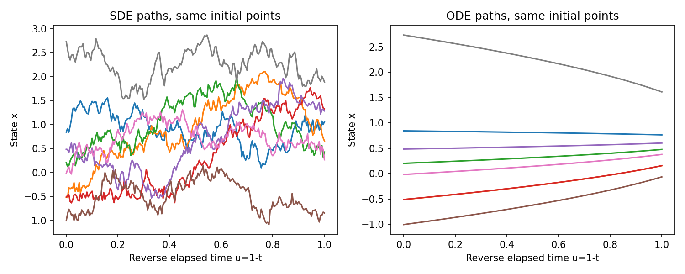
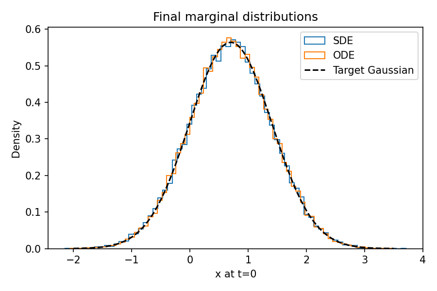
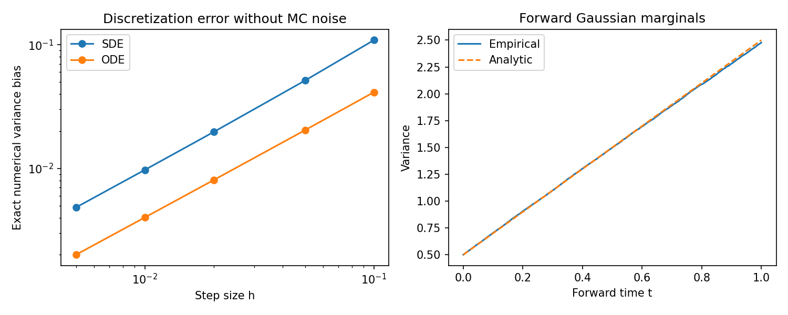

# DL094 / G2 连续扩散与随机微分方程

本讲直接先修为S3与G1。G1已经说明score是对数密度关于位置的梯度，并用加噪回归学习它；S3（发行080）对应微分方程与可微模拟基础，涵盖ODE、稳定性和Euler等内容，而不是随机过程先修。本讲仍会分段补充Brownian运动、Itô规则、散度和Fokker–Planck方程，以免读者只会抄写反向SDE。预计主讲义100分钟，实验60分钟，习题45分钟。

我们采用最容易核对的连续扩散：一维高斯数据，不含漂移，扩散强度为常数。这里所有边缘密度、score、概率流ODE解都可解析计算，因此可以把“公式是否正确”和“数值步长是否足够小”分开。实验使用解析score，不训练神经网络，也不验证真实图片生成质量。它验证的是解析特例中的时间方向、边缘分布与离散误差。

::: {.concept}
学习终点：能够解释Brownian增量为何按步长平方根缩放；在一维高斯上检验Fokker–Planck方程；在反向时间u=T−t中写出无歧义的更新；区分反向SDE与概率流ODE的路径和边缘；把步长偏差与有限样本误差分开。
:::

## 1 从许多小噪声到连续时间

离散加噪常写成x下一步=x当前+随机扰动。如果每一步噪声标准差固定，步数越多，总方差越大，无法得到固定时间区间上的合理极限。为得到连续过程，把时间切成宽度h的小段，每段加入标准差为√h的独立噪声。经过约T/h步，总方差为(T/h)h=T，既不消失也不爆炸。

标准Brownian运动Wt满足W0=0、连续路径、独立增量，并且Wt−Ws服从N(0,t−s)。这四个描述很重要：“连续”不等于“可微”，Brownian路径几乎处处没有普通导数，不能把dWt/dt当作普通函数代入常微分方程。我们可以模拟每个离散增量，却不应因此想象其连续极限是一条平滑折线。

对于h=0.01，Brownian增量的标准差是0.1，不是0.01。若误写成hZ，经过1/h步，总方差为h，随着网格加密趋近0，随机运动被错误地消除了。这是扩散实验中很容易通过均值测试、却无法通过方差测试的程序错误。

## 2 SDE里的漂移与扩散各做什么

一般的Itô随机微分方程写成：

$$
dX_t=f(X_t,t)dt+g(t)dW_t.
$$

f是漂移，控制短时间条件平均位移；g是扩散系数，控制随机增量标准差。这里为简明只讨论状态无关、各方向相同的标量g(t)。如果扩散系数依赖x，或者是矩阵，后续反向公式需要更一般的形式，不能直接沿用本讲的简式。

Euler–Maruyama离散化为Xk+1=Xk+f(Xk,tk)h+g(tk)√h Zk，其中Zk独立服从标准正态。注意方差增量是g²h，因此“扩散系数g”与“方差增长率g²”不是同一个量。许多论文把β定义成g²，若阅读时不检查定义，代码中很容易多开或少开一个平方根。

本讲选择常数β=2，g=√β，f=0：

$$
dX_t=\sqrt\beta\,dW_t,\qquad X_0\sim N(\mu,v_0),
\quad\mu=0.7,\ v_0=0.5,\ 0\le t\le1.
$$

初值X0与Brownian运动独立。于是Xt=X0+√βWt，边缘分布为N(μ,v(t))，其中v(t)=v0+βt。这个过程是一个简单的variance-exploding型过程，即方差随时间增加；“exploding”是该类过程的惯用名称，不表示在有限区间中数值必定爆炸。

在t=0.5时，方差为1.5，标准差为√1.5；在t=1时，方差为2.5。终点分布仍含有数据均值与初始方差，不能随意把它替换成标准正态。为了只研究数值方法，我们从精确终点N(0.7,2.5)初始化反向模拟，把终端近似误差暂时排除。

## 3 Itô公式：为何多出二阶项

普通微积分链式法则告诉我们dφ(X)=φ′(X)dX。但Brownian增量的平方在累加后不会消失：每段(ΔW)²的典型大小是h，约1/h段合计为常数量级。三阶及更高项在适当条件下消失，所以Itô公式保留一个二阶修正。

对一维足够光滑函数φ(x,t)，有：

$$
d\phi(X_t,t)=\left(\partial_t\phi+f\partial_x\phi+
\tfrac12g^2\partial_{xx}\phi\right)dt
+g\partial_x\phi\,dW_t.
$$

这不是完整的随机积分构造证明，而是解释二阶项来源的局部展开。严格理论还需要适应性、可积性与极限收敛概念。读者应知道我们补足了计算规则的动机，并未在几页中证明全部Itô理论。

取φ(x)=x²，则d(Xt²)=2Xt fdt+g²dt+2Xt g dWt。对本讲零漂移过程取期望，随机积分在适当平方可积条件下均值为零，得到dE[Xt²]/dt=β。均值保持μ，所以方差也以β增长。若遗漏Itô二阶项，就会错误预测方差不变；这是一个能立即检验推导的简单特例。

::: {.warning}
Itô积分与Stratonovich积分有不同的链式法则。本文所有SDE及数值规则均按Itô解释。当前g与状态无关时两种描述的漂移修正为零，但这不能推广为二者总是相同。
:::

## 4 从样本路径转到密度演化

样本路径回答“某一个粒子怎样走”，密度方程回答“一大群粒子的分布怎样变”。它们描述同一随机模型的不同层次。假设pt足够光滑，边界衰减足以使积分分部合法。对任意光滑、合适支撑的测试函数φ，用Itô公式可得：

$$
\frac d{dt}\int\phi(x)p_t(x)dx
=\int\left[f\phi'(x)+\tfrac12g^2\phi''(x)\right]p_t(x)dx.
$$

把导数通过积分分部转移到密度一侧，因测试函数可任意选择，得到一维Fokker–Planck方程：

$$
\partial_t p_t=-\partial_x(fp_t)+\tfrac12g^2\partial_{xx}p_t.
$$

多维时，第一项变为−∇·(fpt)，第二项在标量、状态无关扩散下为g²Δpt/2。散度是向量流各分量对各自坐标的偏导和；拉普拉斯Δp是各坐标二阶偏导和。它们描述概率质量从一个小区域的边界流入流出，并不是给每个点凭空创造概率。

对于本讲f=0、g²=β，方程成为热方程∂t p=β∂xxp/2。让z=x−μ，代入高斯密度可得：

$$
\frac{\partial_t p}{p}=\frac{\beta}{2}\left(\frac{z^2}{v^2}-\frac1v\right),\qquad
\frac{\partial_{xx}p}{p}=\frac{z^2}{v^2}-\frac1v.
$$

两边确实相等。这一步比只在图上观察“越来越散”更严格：我们直接验证了解析密度满足密度演化方程。自然还应同时检查初值与归一化，单独满足某个偏微分方程不意味着已经确定唯一解。

## 5 反向扩散为何需要score

加噪会把分布变宽。若只是把正向漂移f取反，而仍加入噪声，方差还会继续增加，无法恢复原分布。反向过程需要一个指向较高密度区域的额外漂移，它依赖当前时间边缘pt的score。

在状态无关的标量扩散、足够光滑正密度、非退化扩散及适当增长/存在条件下，可引用反向时间SDE结果：

$$
dX_t=[f(X_t,t)-g(t)^2\nabla_x\log p_t(X_t)]dt
+g(t)d\overline W_t,\qquad t:T\downarrow0.
$$

此处dt为负，反向Brownian增量的方差按|dt|计算。我们引用一般定理而不完整证明其所有条件；本讲会在可解析高斯中验证它的结果。反向噪声也不是把正向生成的每个噪声符号取反。反向过程由反向时间的概率结构定义，用独立增量模拟即可检验其边缘；它不要求恢复某个粒子当初的同一条路径。

为了彻底消除负dt的歧义，定义反向经过时间u=T−t，并令Yu=XT−u。此时u从0增加到T，公式变成：

$$
dY_u=[-f(Y_u,T-u)+g(T-u)^2s(Y_u,T-u)]du
+g(T-u)dB_u.
$$

本讲score为s(x,t)=−(x−μ)/v(t)，因此反向漂移是−β(Yu−μ)/v(T−u)，确实指向均值。实现用正步长h，先在当前t=T−kh计算score，然后更新：

$$
y_{k+1}=y_k+\beta s(y_k,t_k)h+\sqrt{\beta h}\,z_k.
$$

逐项检查符号：score在均值右侧为负；βh为正；确定性更新向左；随机项仍可向左右任意方向。这说明“去噪过程”并非每一步、每个样本都靠近均值，更不保证所有路径的距离单调下降。

## 6 用均值和方差检验反向公式

设反向过程的方差为w(u)，且初始化w(0)=v(T)。由Itô公式，线性漂移的方差方程为：

$$
w'(u)=-\frac{2\beta}{v(T-u)}w(u)+\beta.
$$

如果w(u)=v(T−u)，右边为−2β+β=−β，左边也为−β，因此该边缘方差满足方程。均值方程为m′=−β(m−μ)/v，初值m(0)=μ意味着始终保持μ。线性SDE与高斯初值保证边缘仍是高斯，因此均值和方差在这个特例中足以确定整个边缘分布。

这里的“足以”依赖已知高斯结构。在一般多峰分布中，仅均值和方差一致完全不够，两个分布可以有同样的一二阶矩却有截然不同的形状。实验仍额外计算经验CDF与目标CDF的最大距离，并画直方图，帮助读者养成分布验证习惯。

一个故障反例：若把反向经过时间更新写成−βs h，漂移会朝远离均值的方向推，方差方程变成正的放大项加β，分布迅速变宽。如果错误地删去随机项，但保留完整βs漂移，则方差缩得太快，得到的是另一个ODE，也不是下一节的概率流ODE。

## 7 概率流ODE为什么恰好有二分之一

把Fokker–Planck方程写成概率守恒形式。利用∇p=p∇log p，可得：

$$
\partial_t p=-\nabla\cdot\left[\left(f-\tfrac12g^2s\right)p\right].
$$

这正是速度场b=f−g²s/2下的连续性方程。因此对应的确定性概率流ODE为dX/dt=f−g²s/2。它与前向SDE共享同一组时间边缘密度，但路径分布不同。反向经过时间u下则是：

$$
\frac{dY_u}{du}=-f(Y_u,T-u)+\tfrac12g(T-u)^2s(Y_u,T-u).
$$

对于本讲，d(Y−μ)/du=−β(Y−μ)/(2v(T−u))。积分得到一个精确缩放映射：

$$
Y_u=\mu+(Y_0-\mu)\sqrt{\frac{v(T-u)}{v(T)}}.
$$

若初值来自终点高斯，方差乘以v(T−u)/v(T)，刚好得到目标边缘v(T−u)。在终点u=T，Y=μ+(Y0−μ)√(v0/v(T))。给定初始点后ODE轨迹完全确定；SDE即使起点相同，仍会产生许多随机路径。

::: {.concept}
“概率流ODE与SDE等价”在本讲指每个时间点的边缘分布一致，不表示路径相同、联合时间分布相同或逐点输出相同。ODE去掉随机项时必须同时把score漂移系数减半，不能只删除噪声。
:::

## 8 数值误差：分布正确的公式也可能跑出错误结果

真实计算只能用有限步。令h=T/K，当前时间tk=T−kh，vk=v(tk)。反向SDE的Euler更新是线性变换加高斯噪声，因此数值分布也保持高斯，其方差严格满足递推：

$$
q_{k+1}=\left(1-\frac{\beta h}{v_k}\right)^2q_k+\beta h.
$$

ODE显式Euler的数值方差则满足：

$$
q_{k+1}=\left(1-\frac{\beta h}{2v_k}\right)^2q_k.
$$

从q0=v(T)出发，递推可精确计算“这个数值方法”应该得到的总体方差。它与v0的差是离散偏差，不含Monte Carlo抽样噪声。真实模拟样本方差与这个递推值之间的差才主要反映有限样本波动。这种拆分比只画样本方差随步数变化更可靠。

本实验使用40000个初始样本，分别运行10、20、50、100、200步。不同方法共享相同初始样本，SDE不同步数使用不同随机种子，因此不能用这些样本直接估计强路径收敛阶；它们用于边缘分布与弱量误差比较。若想研究强误差，应让粗细网格共享同一Brownian路径的嵌套增量。

对于200步ODE，精确数值方差约为0.502004，目标为0.5；实际样本方差约为0.498870。实际样本方差看起来比目标略小，不代表数值方法没有正偏差，因为这批初始样本方差略小于总体方差，抽样偏差叠加后可能改变符号。实验还直接比较数值ODE终点与同一初值的解析映射，得到不受初值分布抽样误差混淆的逐点RMSE。

## 9 验收、误差条与实验结论的范围

代码记录终点均值、方差、Kolmogorov型经验CDF最大距离，以及理论离散方差偏差。这里的CDF距离作为描述性指标，没有报告经过多重比较校正的统计检验p值。不能把“距离小于0.02”说成严格证明分布完全相同；它只是预设教学验收阈值。

步长图使用精确递推的方差偏差，因此随着h减小更清晰地显示收敛趋势。样本直方图和经验CDF仍会受有限样本波动影响，步数翻倍不保证每一个经验指标都严格改善。当离散偏差降到抽样噪声量级以下，继续增加步数可能花费更多计算，却难以在固定样本量的图上看出收益。

本实验正向过程是加性常系数噪声，Euler在网格点的分布更新本身就是精确高斯增量。因此正向方差曲线与解析线的差主要为抽样波动，不应把它误报为一般SDE求解器的离散误差。真正的步长实验集中在反向时变漂移和概率流ODE。

验收测试分别检查score方向、一步方差递推、ODE对解析映射的收敛、两类方法离散方差的收敛，以及保存数据的均值/方差/CDF指标。我们没有证明一般反向时间定理，没有训练近似score，没有测试非高斯终端先验近似，也没有讨论高维刚性求解器。这些是清楚划定的范围，而非可以隐藏在漂亮路径图后面的细节。

## 10 练习与研究习惯

1. h从0.01变成0.0025时，Brownian增量标准差变化几倍？
2. 用Itô公式重新推导本讲正向方差增长率。
3. 对反向经过时间u写出SDE与ODE，并解释两个score系数为什么不同。
4. 在μ=0、v0=1、β=3、T=1时，求概率流ODE的精确终点映射。
5. 为什么“没有随机项”不等于“输出没有分布”？
6. 若将精确终点分布换为N(0,1)，步长趋于零能否自动修复终端分布失配？
7. 为什么独立粗细网格模拟不能直接用逐样本差证明强收敛？
8. 给出一个均值和方差相同、但分布不同的例子，并说明它如何提醒我们改进实验。

每次使用一条扩散公式，都先写明时间朝哪个方向增加、噪声增量的方差、score对应哪个时间边缘、当前终端分布如何获得。每次给出误差表，都写明它是训练误差、score近似误差、终端近似误差、离散误差还是抽样误差。把这些误差混成一个数值，很难找到失败原因；把它们拆开，简单高斯实验就能成为复杂模型的可靠单元测试。

## 补充阅读：用一个粒子手算第一步

取反向初始粒子y=1.7，本讲均值0.7，所以偏差为1。当前t=1，方差v=2.5，score为−0.4。若h=0.1，反向SDE的确定性位移为2乘−0.4乘0.1，即−0.08；随机位移标准差为根号0.2，约0.447。即使确定性部分向均值移动，抽到正向随机噪声仍可能使粒子暂时远离均值。

同一点的概率流ODE第一步确定性位移为−0.04，恰好是SDE漂移的一半，没有额外噪声。单个粒子看起来ODE收缩更慢，但整个粒子群在连续极限中具有相同的边缘方差。原因是SDE更强的收缩还要抵消不断增加的随机扩散。只比较漂移箭头大小而不计随机扩散，是理解二分之一系数时常见的障碍。

这个手算也说明更新次序。当前score使用当前时间t与尚未更新的位置；先更新位置、再把它代回同一步score，得到的是另一种离散方法。先减时间再算score则改成右端点评估，也不是当前实现。它们未必永远错误，但应明确命名与分析，不能混写在一个Euler程序中。

## 补充阅读：噪声并不是“被原样撤销”

从一个含噪观测通常无法确定原来的干净样本，因为许多干净样本与噪声组合都能产生它。反向扩散的任务是恢复分布，而不是识别每一个正向粒子的唯一历史。当我们把精确终点分布中的一批样本送入反向SDE，最终得到正确的起点边缘，并不代表第十个生成样本等于当初正向模拟的第十个样本。

概率流ODE则在给定速度场和初值时给出确定的轨迹。只要初始化是随机的，输出仍然是随机变量，具有分布。确定性生成映射与随机输出分布并不矛盾：普通函数把随机输入映射为随机输出，正是许多生成模型的共同结构。这里的随机性来源应与每一步注入的新噪声分开讨论。

两种过程不同的跨时间相关性会影响插值、条件路径与数值分析。一个时刻的边缘直方图无法告诉我们路径是否粗糙，也无法证明相邻时刻样本的耦合方式相同。图1和图2因此回答互补问题，不能用其中一个替代另一个。

## 补充阅读：从可解析实验走向近似score

若把真实score替换成估计函数，生成误差不再只是步长误差。举例说，模型把score幅度低估百分之十，即使把步长缩到非常小，反向漂移也会长期偏弱，终点方差仍可能过大。这是连续方程本身被改动造成的偏差，求解器更精细无法自动修复。

另一个误差来自初始终端分布。某些实际模型希望高噪声边缘接近便于采样的先验，但“接近”需要证据。我们选择精确高斯终点是为了隔离变量，并没有证明任意扩散在有限时间都已经忘掉数据。将本讲初始方差2.5误写成1，会让ODE精确终点方差变成0.2而非0.5；这个错误不会随着步数增大而消失。

设计下一个实验时，可一次只加入一个误差源：先固定正确终点，把score乘以已知比例；再固定正确score，改变终点均值或方差；最后才叠加两者并调整步长。这样能区分模型偏差、先验失配和数值偏差。若从第一天就混入神经网络、复杂数据和未知先验，看到异常结果时很难定位原因。

## 补充阅读：如何理解验收中的容差

测试里允许样本方差与数值总体方差存在一个小差值，因为有限样本估计不可能精确等于总体参数。容差在实验运行前按样本规模和教学目的设定；它不是根据结果临时调到刚好通过。测试中的精确代数恒等式则使用更严格的浮点容差，因为它们没有同样的抽样不确定性。

改变随机种子后，某个经验距离可能增大，不能立刻宣布算法失效；也不能为了得到更好图形只保留最漂亮的种子。如果要报告稳定性，应预先列出多个种子，汇总均值和波动，并保留所有输出。本讲单次固定种子运行负责可复现的机制教学，不能替代多种子性能研究。

阅读检查：合上讲义后，请用自己的话解释一个核心公式，并逐一给出每个符号的含义。如果只能复述结论而不能说明假设，回到对应手算；如果能说明假设却无法找到代码中的实现位置，回到实验步骤。把概念、推导、程序和观测结果连在一起，才算完成本讲。

## 参考与来源边界

- 课程定位：[公开目录G2](https://github.com/hrqz007/deep-learning-research-course/blob/main/catalog/units.md)。本讲推导、代码、数据、图为本批原创。
- 一般框架与反向SDE/概率流ODE研究：[Song等，Score-Based Generative Modeling through Stochastic Differential Equations](https://arxiv.org/abs/2011.13456)。本文只对所述高斯特例展开验证，没有复现该论文图像实验。
- 上文Brownian与Itô部分为必要基础的教学说明；“引用一般定理”和“证明本讲可解析特例”已分别标明。
