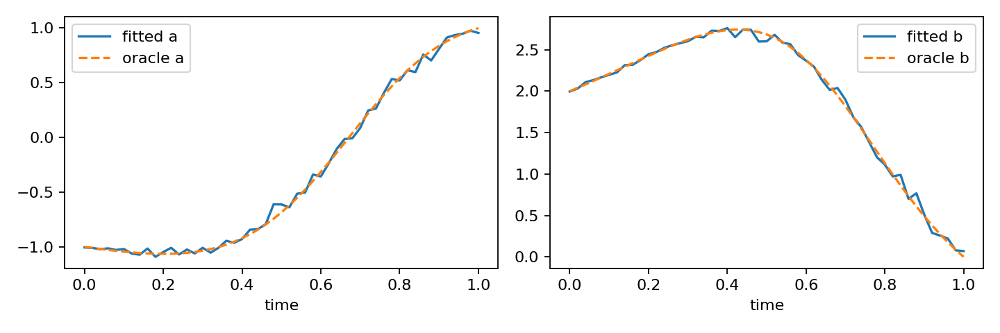
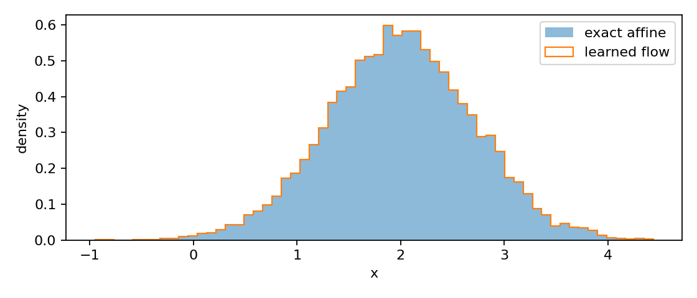
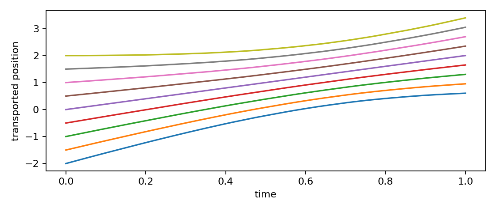

# 第095讲 / G3 流模型、流匹配与输运

## 学习地图：把一团随机数搬成另一团随机数

前面的生成课程已经问过“怎样学习概率密度”和“怎样逐步去噪”。本讲换一个入口：先抽一个容易产生的随机数，再用一个映射把它搬到我们需要的位置。我们关心的不只是某一个点被搬到哪里，还关心一整群点搬完之后的密度。这样，生成就成为概率质量的输运问题。

本讲对应原大纲G3，直接先修013、017与S3（发行080）。需要的行列式、变量替换、散度和连续性方程会在正文补齐。G1与G2提供有益对照，但不要把“flow”这个词当成某一种唯一算法：可逆流的最大似然、连续流的密度演化、流匹配的速度回归是三个相关而不同的对象。

贯穿案例是一条传感器读数：我们能轻松抽取标准正态随机数z，希望得到均值2、标准差0.7的读数x。这个问题故意可以解析求解。先用已知答案核验程序，再讨论学习速度场时新增了哪些误差，是科研训练里非常有效的顺序。本讲训练的是线性速度基线，不是高维图像生成模型，也没有声称线性模型能处理所有复杂分布。

学习后你应该能独立完成四件事：手算可逆映射的密度；解释为什么连续性方程包含散度；写出流匹配的监督数据；区分回归误差、求解误差和抽样误差。建议用90分钟读讲义，再用60分钟运行实验与回答练习。

::: {.concept}
蓝色重点：生成器把随机变量变成随机变量。判断生成是否正确，需要检查整体分布，不能只挑几条好看的轨迹。
:::

## 1 从函数开始，先把方向说清楚

设基础随机变量Z服从标准正态分布，生成映射为X=f(Z)=2+0.7Z。程序先抽z，再算x，方向是z到x。若要计算一个观测x的密度，方向却要倒过来：z=(x-2)/0.7。生成和密度评价在同一个函数的相反方向进行。

为什么要求可逆？因为若两个不相连的z都能被映到同一个x，算密度时必须把多个原像的贡献相加。最简单的正规化流设计选择一一映射，避免这个求和问题。一一映射还不够：为了使用微分公式，需要可微、逆映射适当可微，且相关位置的Jacobian行列式不为零。把绝对值函数直接当全实数上的可逆流就会失败，因为z与-z映到相同位置。

我们的仿射函数满足要求：导数恒为0.7，大于零；逆导数为1/0.7。对同样长度的目标区间，原像区间更宽，所以它收集了更多基础概率。这就是密度中出现缩放因子的原因。

## 2 手算变量替换：概率守恒先于公式

看z=0附近一个宽度0.01的小区间。标准正态在0附近的密度约为0.3989，因此区间质量约0.003989。映射后区间中心变成x=2，宽度变成0.007。如果概率质量没有丢失，新密度就应约为0.003989/0.007=0.5699。

一般地，微小概率质量满足p_X(x)dx=p_Z(z)dz，所以

$$p_X(x)=p_Z(f^{-1}(x))\left|\frac{d f^{-1}(x)}{dx}\right|.$$

本例代入后得到

$$p_X(x)=\frac{1}{0.7\sqrt{2\pi}}\exp\left[-\frac12\left(\frac{x-2}{0.7}\right)^2\right].$$

取对数有两个好处：很多小概率相乘会变成相加；避免指数过小导致下溢。对应的对数密度是基础对数密度减去log(0.7)。减号来自正向体积缩放。如果把正向Jacobian直接乘进密度而不取倒数，越拉伸反而越密集，就违反了质量守恒。

练习前先自检：将0.7改为2，中心密度应该更低还是更高？答案是更低，宽度翻大，质量被摊开了。这个定性检查比记忆正负号更稳健。

## 3 多维的体积尺：行列式究竟测什么

二维线性变换把单位正方形变成一个平行四边形。行列式的绝对值就是面积比例；在d维，它是体积比例。负行列式表示方向翻转，不表示负概率，所以密度公式使用绝对值。

例如A=diag(2,0.5)，第一方向拉长两倍，第二方向缩小一半，det(A)=1。形状改变了，但面积没变。若A=diag(2,3)，面积变为6倍，密度应除以6。若某一对角元为0，整个平面压成一条线，行列式为0，不再有通常意义的二维Lebesgue密度；不能继续机械套用除法。

一般可逆变换的公式为

$$\log p_X(x)=\log p_Z(z)-\log|\det J_f(z)|,\qquad z=f^{-1}(x).$$

J_f是局部线性化矩阵，不是把所有样本排成的训练矩阵。一个含N个样本、d维特征的批次会有N个d乘d的Jacobian。不要把批次维度和特征维度合并成一个巨大的密度变换。

真实高维流模型通常使用特殊结构降低Jacobian计算成本。例如三角Jacobian的行列式是对角线元素的乘积。这样的结构是工程设计的一部分；“有可逆网络”不自动意味着密度评价便宜。[1]介绍了正规化流的基本构造与局限。

## 4 从一次映射到一条连续轨迹

现在不一步搬完，而让位置随时间t从0走到1。每个粒子满足常微分方程

$$\frac{dx(t)}{dt}=v_t(x(t)).$$

v是速度场：输入时间与当前位置，输出下一瞬间该往哪走、多快走。速度不是最终位置。若v恒为2，走一个单位时间才增加2；若数值步长为0.01，每一步只增加0.02。

如果速度对空间局部Lipschitz，且轨迹在研究区间不爆炸，常见ODE存在唯一性结果允许我们讨论由起点到终点的流映射。唯一性直观上阻止不同轨迹在同一时刻真正相交之后又分开。这里引用这一结果而不完整证明；不连续速度、有限时间爆炸或不适当边界可能破坏结论。

图3里可以看到不同初始点怎样被搬运。曲线之间不交叉，不是绘图恰好漂亮，而是这个平滑一维仿射速度场的结构结果。数值求解器仍可能在过大步长下破坏近似映射的质量，因此理论流和离散程序需要分别验证。

## 5 散度与连续性方程：流进去多少，密度就增加多少

在一维位置x附近取一个小盒子。左边流入质量的速率约是p(x)v(x)，右边流出约是p(x+dx)v(x+dx)。盒子里的质量变化率等于流入减流出。除以宽度并令宽度趋近零，就得到

$$\partial_t p_t(x)=-\partial_x[p_t(x)v_t(x)].$$

多维中，对每个方向求同样的通量差并相加，这个求和运算称为散度：div(v)=各分量对自身坐标导数之和。因此连续性方程为

$$\partial_t p_t=-\nabla\cdot(p_t v_t).$$

散度为正意味着局部体积倾向膨胀，不是粒子“更喜欢”这里。沿着粒子轨迹，用链式法则展开log p可得到

$$\frac{d}{dt}\log p_t(x(t))=-\nabla\cdot v_t(x(t)).$$

这个结果连接连续流和密度计算：沿轨迹积分负散度，可以累计对数密度的变化。不过求解ODE和估计散度都要计算资源。流匹配训练不显式计算似然，并不意味着你在任何模型上都能免费拿到似然。

::: {.warning}
橙色误区：速度场v、score与概率密度是三类不同对象。速度的单位是位置/时间；score是对数密度对位置的导数。它们可以在特定模型中联系起来，但不能仅因都画成箭头就直接替换。
:::

## 6 流匹配的监督来自哪里

最简单的条件路径取一对独立样本x0与x1，令x_t=(1-t)x0+t x1。对固定样本对求时间导数，得到u_t=x1-x0。于是我们可以制造监督数据：(t,x_t)是输入，u_t是回归标签。

但同一个t和x_t可能由很多不同样本对产生，标签不唯一。这不意味着监督无效。平方损失的最优回归函数是条件均值：

$$v_t^*(x)=E[X_1-X_0\mid X_t=x].$$

证明只需把任意预测a与标签U的平方差写成条件方差加(a-E[U|x])²。条件方差是无论如何都消不掉的标签不确定性；第二项在预测条件均值时最小。因此训练损失不降到零完全正常。把不可约条件方差当成训练失败，会误导调参。

本讲在51个时间网格各生成2000对独立样本，用最小二乘拟合v=a(t)x+b(t)。不是每个粒子分别记一条线；模型看见的只有当前x和t。采样时也不需要目标样本x1，只有学好的系数与初始噪声。这一点将训练期条件路径和生成期边缘速度分开。[2]对一般流匹配目标作了系统说明。

## 7 为什么我们的线性模型能有解析答案

令X0服从N(0,1)，X1服从N(μ,σ²)，二者独立。则X_t的均值m_t=tμ，方差q_t=(1-t)²+t²σ²。线性组合仍为Gaussian，所以条件均值也是仿射的。

设U=X1-X0，则E[U]=μ，Cov(U,X_t)=-(1-t)+tσ²。Gaussian条件均值公式给出

$$a(t)=\frac{-(1-t)+t\sigma^2}{(1-t)^2+t^2\sigma^2},\quad b(t)=\mu-a(t)t\mu.$$

当t=0时，a=-1，b=μ：当前点偏离0越大，越应向中心回拉，同时整体向μ移动。当t=1时，a=1，b=0：条件于终点X1=x时，独立的X0均值为0，因此目标速度均值就是x。最后一刻速度不必为0；我们只在t=1停止积分。

这个一维Gaussian族中，精确边缘流终点是μ+σz，与最简单仿射生成器相同。不过中间轨迹不是简单直线z到μ+σz，因为独立配对路径的方差q_t先收缩后扩张。不同耦合可以有相同端点分布而有不同运输路径。不要从相同终点推断训练目标、路径或数值难度都一样。

## 8 程序逐层解读与真实实验

experiment.py分三层。velocity负责把时间插值成a和b，返回a*x+b；integrate负责Euler循环；main负责生成训练数据、拟合系数、抽独立测试点并保存输出。ROOT取脚本所在目录，所以从项目根或单元目录运行都不会误把输出写到当前shell目录。

每一步Euler计算x←x+h v_t(x)，这里h=1/steps。代码比较10、40、160步，使用相同10000个起始z，避免比较时偷偷更换样本。精确仿射结果作为逐点参考，输出均值、标准差、配对RMSE和目标中心95%区间覆盖率。

数据包含102000对训练样本的回归结果和10000个独立测试起点。为控制文件体积，保存训练损失与拟合系数，而非全部训练配对；训练配对可以由固定种子95重新生成。outputs/data.npz保留评估样本、系数和网格，outputs/training_loss.csv保存逐时间训练残差，outputs/metrics.json是本次真实结果的来源。

减小步长通常降低离散误差，却不能让有限数据拟合的速度变成解析速度。所以160步以后即使继续加步，结果也可能停在非零误差。这时应增加训练数据或换更好的拟合，而非盲目增加采样成本。

## 9 覆盖、误差与结论的边界

中心95%覆盖率定义为生成样本落在[μ-1.96σ, μ+1.96σ]的比例。正确Gaussian生成器应接近95%，但有限样本会有波动。覆盖率更接近100%并不更好：它可能说明生成结果过分集中、尾部缺失。这里的覆盖指目标区间内的样本比例，不是对复杂数据所有语义模式的全面覆盖。

配对RMSE利用了这个一维已知单调输运的特例。如果一般流模型与参考模型使用不同耦合，逐点误差可能很大而边缘分布完全相同。因此研究报告必须解释为什么该指标适用于此例，而不能把它推广成所有生成器的质量标准。

本讲确认的是：最小二乘可以从独立配对监督恢复这个Gaussian问题的线性条件速度；数值积分能近似生成目标边缘；可逆仿射模型能精确计算密度。没有验证图像逼真度、非Gaussian多模态、神经网络优化、GPU性能或真实部署。

## 10 练习与阅读

1. 对X=3+2Z计算x=3处密度，并解释为什么不是标准正态中心密度的两倍。
2. A=diag(2,0.5)与A=diag(2,0)哪个能用标准可逆密度公式？分别解释。
3. 手推t=0.5、μ=2、σ=0.7时q、a、b。
4. 为什么条件流匹配回归标签有噪声，损失仍然有意义？
5. 将训练每时间点样本改成200，再比较160与640步。写下你预期哪个误差会占主导。
6. 找出“我们生成结果的均值正确，因此模型学会了分布”这句话缺少的证据。

参考资料：[1] Papamakarios等，Normalizing Flows for Probabilistic Modeling and Inference，JMLR 2021，https://jmlr.org/papers/v22/19-1028.html 。[2] Lipman等，Flow Matching for Generative Modeling，ICLR 2023，https://arxiv.org/abs/2210.02747 。正文推导与数据为本课程原创教学实现；该实验没有复现论文的大规模神经网络结果。
