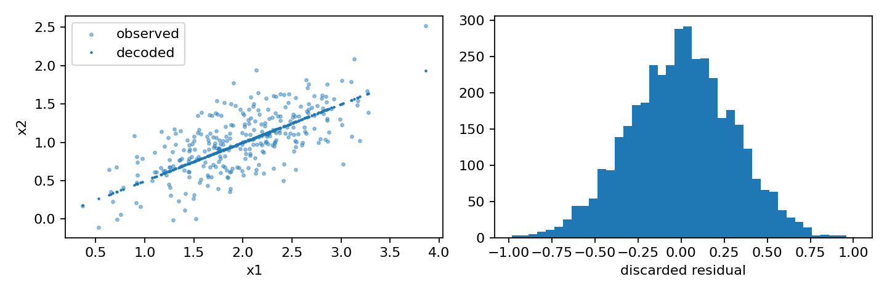
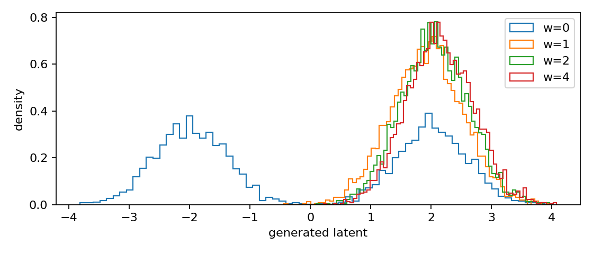
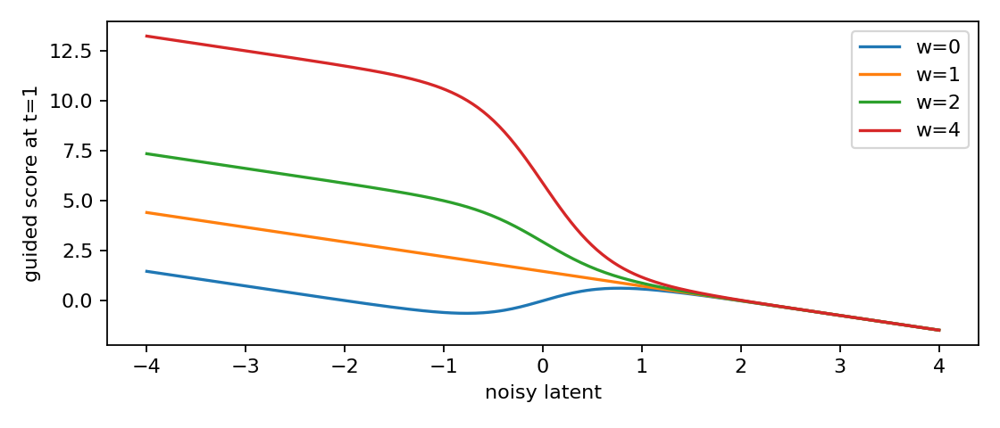
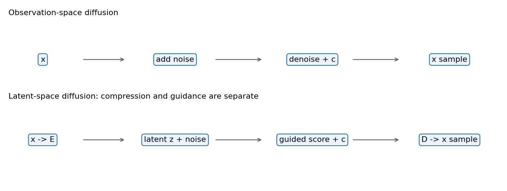

# 第096讲 / G4 潜空间、条件生成与引导

## 学习地图：先问条件、压缩和引导各管什么

当我们说“根据标签生成一个样本”，至少有三个独立设计决定。第一，条件告诉模型希望生成哪一类；第二，编码器决定在哪个空间表示样本；第三，引导决定采样时怎样强调条件。把三件事混在一起，会让实验很难解释：结果变化究竟来自模型更懂条件，还是丢掉了细节，还是采样时人为偏向某一部分分布？

本讲对应G4，直接先修053、058、062；需要的score与反向时间概念可参考093与094。我们使用同一个低维传感器故事：标签c为-1或+1，潜变量Z在类别c下服从均值2c、标准差0.6的Gaussian。观测有两个坐标X1=Z、X2=0.5Z+ε，其中ε标准差0.3。我们希望指定正类后生成观测，同时诚实记录编码丢掉了什么。

这个实验不下载大模型，不调用付费API，不训练商业图像生成器。条件和无条件score都有解析答案，因此我们能够隔离“引导本身的效应”。实验是oracle score采样器诊断，不是一次神经网络训练质量评测。学会这个分离后，才容易在大型潜空间扩散模型里寻找对应的误差来源。

::: {.concept}
蓝色重点：条件改变目标问题，压缩改变表示空间，引导改变采样向量场。三个开关分别控制，才有可能解释结果。
:::

## 1 条件概率不是给无条件模型贴一个标签

无条件分布p(z)包含两类读数。条件分布p(z|c=+1)只描述正类。若两类等概率，则p(z)=0.5p(z|+1)+0.5p(z|-1)。这是两个密度相加，不是把两个均值相加后得到一个单Gaussian。

正类均值为2，负类均值为-2，两个条件标准差均为0.6。混合分布均值是0，方差是0.36+4=4.36。若只记录均值0和方差4.36，就可能把明显双峰的混合误写为单峰宽Gaussian。因此生成评价需要比均值方差更多的检查。

条件生成的目标也不意味着每个样本都必须在z>0。真实正类Gaussian有很小但非零的负半轴概率。用符号是否为正当作条件一致性指标是有意义的简化，但它不是模型语义理解的万能量表。类别重叠越大，这种二值指标越容易掩盖分布差异。

## 2 编码器是信息的入口，也是丢失的地方

我们定义编码器E(x1,x2)=x1，所以z=x1；解码器D(z)=(z,0.5z)。这是一组故意很简单的确定性映射。它保留潜在主信号，丢掉第二坐标的独立残差ε。编码器不是随机“压缩文件”，而是在建模意义上决定哪些变化被保留。

对一个具体观测x=(2,1.3)，编码得到z=2，解码得到(2,1)。第二坐标误差为0.3。按两个坐标平均的平方误差为(0²+0.3²)/2=0.045。由于ε的方差为0.09，很多样本平均后预期每坐标MSE也是0.045。

这个误差不是潜变量采样器多跑几步就能消除的。解码器始终把点放在直线x2=0.5x1上，而真实观测分布是直线附近有厚度的点云。即使潜变量Z的分布完全正确，确定性解码结果仍缺失第二坐标残差。这个例子把“潜空间生成正确”和“观测空间生成正确”明确区分开。

真实潜空间模型通常用学习到的编码器和解码器，编码空间的尺度、正则化和重建损失都会影响后续扩散。不能把本例的0.045当作真实图像模型的压缩率或画质结论。潜空间扩散工作的动机与结构可见[1]，本课只保留能手算的机制。

## 3 两条误差链要分别测量

第一条链是“真实观测→编码→解码→重建误差”，检查表示。第二条链是“随机噪声→生成潜变量→解码→生成分布误差”，检查采样与表示的合成效果。若只看第二条链的最终图片，很难判断错误来自哪里。

我们的实验先用4000个真实合成潜变量和残差计算重建MSE，再单独扫描引导强度生成潜变量。这样至少能说清楚：潜变量分布变化来自引导和数值求解，而线外残差缺失来自确定性解码器。两者并非完全可加的独立误差定理，这里只是诊断上的分开控制。

一个实际研究中的最小基线是：直接解码真实潜变量，查看解码上限；再解码生成潜变量，查看新增误差。若真实潜变量解码已经丢失某项关键属性，就不应把生成器未恢复该属性全归咎于去噪网络。

## 4 给潜变量加噪声，条件score仍可手算

定义整个加噪过程为dZ_t=dW_t，即Z_t=Z_0+W_t，t从0增到T。只在固定t讨论边缘采样时，可以写Z_t=Z_0+sqrt(t)η，其中η为标准正态；不能用同一个η贯穿所有t替代Brownian路径，因为跨时增量相关性会不同。这是扩散系数为1的方差膨胀过程。条件分布为N(2c,0.36+t)，因此

$$s_c(z,t)=\partial_z\log p_t(z|c)=-\frac{z-2c}{0.36+t}.$$

例如t=1、c=+1、z=0时，score=2/1.36≈1.4706，指向正类中心。若z=3，score=-1/1.36≈-0.7353，指向左边。score本身不是密度，它是对数密度的局部斜率。

无条件分布是两个噪声Gaussian的混合。设正类责任概率r(z,t)=p(c=+1|z_t=z)。根据Bayes公式，两个等权、等方差分量的对数似然比是4z/(0.36+t)，所以r是该数的sigmoid。对混合密度求导可得

$$s_u(z,t)=\frac{2(2r(z,t)-1)-z}{0.36+t}.$$

注意是“分量score按当前位置的责任概率加权”，不是两个score等权平均。z越靠近正类，该分量责任越高。若错误地平均两个分量score，会得到指向0的场，把双峰结构毁掉。

## 5 从Bayes公式到条件引导

Bayes公式写成对数并对z求导：

$$\nabla_z\log p_t(z|c)=\nabla_z\log p_t(z)+\nabla_z\log p_t(c|z).$$

归一化项p(c)不依赖z，所以导数消失。这说明条件score比无条件score多一个“提高条件相容性”的梯度项。若单独训练分类器估计这个梯度，就得到一类分类器引导思路。

classifier-free guidance不一定使用外部分类器，而是组合条件与无条件预测。本讲固定以下明确约定：

$$s_w=s_u+w(s_c-s_u).$$

因此w=0是无条件，w=1是条件，w>1是加强条件方向。某些资料写成s_c+g(s_c-s_u)，其中g=w-1。讨论“引导强度1”之前必须写出公式，否则两个实现可能实际用了不同强度。[2]解释了无分类器引导的原始思路。

若网络预测的是噪声ε，只有在两支预测使用相同噪声日程、参数化和转换关系时，类似线性组合才能对应上述score组合。例如此加性Gaussian过程下，条件均值噪声预测与score有-1/sqrt(t)的比例关系；t=0端点不能直接除以零。不要把不同参数化的输出硬相加。

## 6 加强引导为什么不能叫精确后验采样

固定一个t，假设两个score都精确且密度为正，则组合场满足

$$s_w=\nabla_z\log\{p_t(z|c)^w p_t(z)^{1-w}\}.$$

这看起来像一个重加权密度的score。还需检查这个表达式是否可归一化。在本例Gaussian尾部下，所用正强度没有尾部发散问题，但一般能量模型不能跳过这个检查。

更重要的是：每个噪声时刻的重加权密度未必共同满足同一个前向扩散方程。因此把这些场放进反向采样器，不能仅凭上面一行代数就宣称终点严格服从p(z|c)^w p(z)^(1-w)，更不能说它是原始条件分布的精确样本。引导是一个会改变采样动力学的操作。

::: {.warning}
橙色误区：条件一致性上升，不代表原始条件分布恢复得更准确。强引导可能减少靠近决策边界的合法样本，改变均值、方差和尾部比例。
:::

图3在固定t=1处画出不同强度的场。它只能解释局部漂移差异；最终分布需要真正积分整个时间过程后测量。不要用一个时间截面的箭头图代替采样实验。

## 7 反向时间和采样循环逐行解释

我们用反向时钟τ=T-t，τ从0增到T。在这个时钟下，前向纯Brownian过程对应的反向SDE漂移为正score，扩散系数为1。Euler–Maruyama更新为

$$z\leftarrow z+h s_w(z,t)+\sqrt{h}\xi,\quad t=T-kh.$$

h为正，ξ每一步独立标准正态。正号不是把前向公式中的负号删掉，而是因为时间方向已经换了。若使用直接递减t的写法，dt为负，需要另一套符号约定。实验选择反向时钟是为了降低初学者误用符号的风险。

代码中T=9、steps=400、h=0.0225、样本数4000。不同w复用相同种子，因而初始样本和每步噪声相同；只有漂移场不同。这种共同随机数设计方便比较引导影响，不意味着四组终点样本是独立的。

起点从无条件p_T精确抽取：先等概率抽类别，再抽均值±2、方差9.36的Gaussian。这对w=0是匹配的起点；对w=1不是正类条件p_T。T较大使两类重叠更多，但差异不会严格消失。本实验故意沿用统一无条件起点来展示实际条件采样常见近似，并把起点偏差写入结论。不能把w=1结果与目标的全部偏差归因于步长。

## 8 评价指标都在问不同问题

sign_consistency是生成潜变量大于0的比例，检查标签方向。mean和std检查位置与离散程度。within_target_95是落入[2-1.96×0.6,2+1.96×0.6]的比例。left_tail_coverage和right_tail_coverage分别是低于2-1.645×0.6、高于2+1.645×0.6的比例；目标Gaussian两侧各应约5%。

这里的“tail coverage”实际上是尾部概率质量，不是“是否至少见过一次尾部”的布尔指标。阅读输出时一定连同定义看。中心区间比例更高可能是坍缩信号；某一尾部比例低说明该区域概率质量不足；均值偏移可能让另一侧尾部反而增加。

图2和metrics.json结合看，才能判断引导究竟在本例如何改变分布。本例有条件类间重叠、随机离散采样和统一起点偏差，不能预设“任何强引导都会单调缩小方差”。学习者应报告实际结果，包括不符合直觉的项目，而不是把结论写成口号。

## 9 从玩具模型转向真实潜空间模型

真实流程通常是观测x经过编码器得到z，训练时给z加噪并输入条件c，网络预测噪声、score或其他参数化，采样时从高噪声潜变量出发逐步求解，最后经解码器回到观测空间。条件可能由标签嵌入、文本编码器或交叉注意力注入；无条件支路需要适当训练，不能随意把未训练过的空输入视为可靠无条件模型。

我们的E和D是固定解析函数，两支score也是已知公式，因此没有条件丢弃概率、神经网络过拟合或文本编码误差。这是优点也是限制：我们能够归因采样机制，却不能用该结果估算真实模型的最佳引导强度、采样步数或内存节省。

在真实实验里，至少固定同一模型检查点、相同解码器、相同条件清单、样本数、随机种子和采样日程；把guidance强度当一个预先说明的扫描轴。若用测试集挑最漂亮的强度，必须保留独立验证协议，不应再称测试结果无偏。

## 10 练习与参考

1. 对观测(2,1.3)手算编码、解码与每坐标MSE。
2. 在z=0、t=1时算条件score、无条件score和w=2的引导score。
3. 将另一资料中的g=3换成本讲w，说明w=0与1各是什么。
4. 为什么固定t的重加权密度等式不足以证明反向终点服从该分布？
5. 设计区分起点偏差与离散误差的对照实验。
6. 如果一致性达到100%，但左尾质量接近0，你能说模型比目标分布“更正确”吗？

参考：[1] Rombach等，High-Resolution Image Synthesis with Latent Diffusion Models，CVPR 2022，https://arxiv.org/abs/2112.10752 。[2] Ho与Salimans，Classifier-Free Diffusion Guidance，2022，https://arxiv.org/abs/2207.12598 。[3] Song等，Score-Based Generative Modeling through Stochastic Differential Equations，ICLR 2021，https://arxiv.org/abs/2011.13456 。本课只借鉴概念并提供原创解析实验，不复现论文图像结果。
