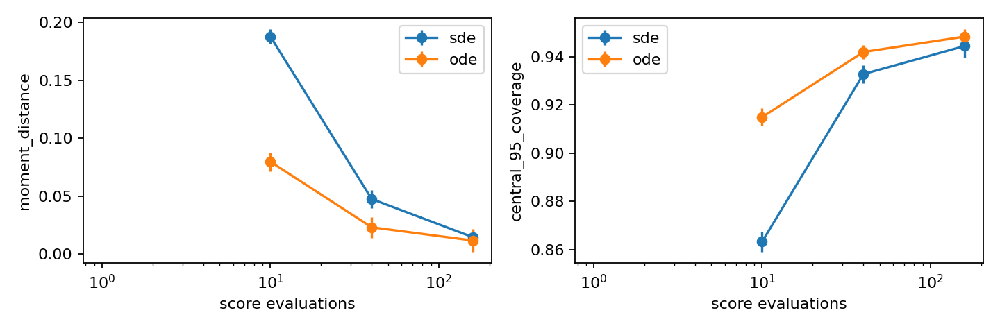
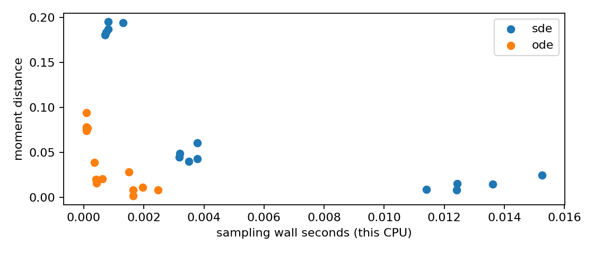
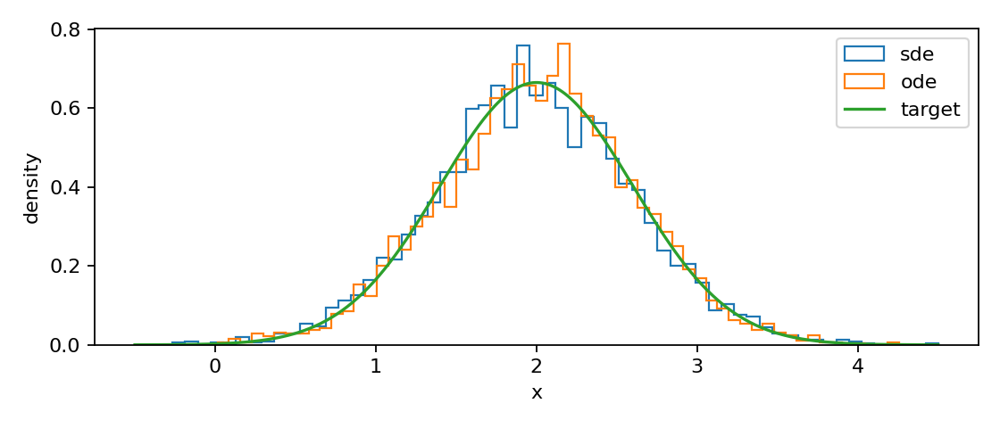

# 第097讲 / G5 生成算法比较与研究设计

## 学习地图：从“哪张更漂亮”转向可复查比较

前四讲分别学习了score、连续扩散、流匹配与条件引导。现在我们要把算法知识变成一个可以被别人检查的研究结论。最难的部分常常不是再多写一个模型，而是决定比较的问题、控制条件、评价单位和结论边界。

本讲对应原大纲G5，直接先修022、063与G1；因为本次实际比较反向SDE和概率流ODE，所以额外需要G2（094）。不要求把所有生成模型都放进同一张排行榜。本讲只比较两个可承担的采样器，用一个已知Gaussian目标回答一个狭窄问题：在相同score调用数下，两种一阶离散采样器在此分布上的误差怎样变化？

贯穿目标是均值2、标准差0.6的一维传感器读数。我们使用完全相同的解析score、相同高噪声起始分布、相同样本数与种子清单。没有训练模型，所以训练成本为零，且结论不包括神经网络训练的优劣。这不是回避真实问题，而是先拆开一段机制，建立可验证的基线。

本讲完成后，你应能写出一个预先规定的比较协议，计算配对差值与标准误，解释为什么单一质量分数不足以排名，并把“程序成功运行”与“科学主张得到支持”分开。建议先读正文，再运行实验，最后尝试写一段不超过200字的结论。

::: {.concept}
蓝色重点：实验的最小单位是“明确问题 + 固定协议 + 可检查输出 + 有边界的结论”，不只是一个最终分数。
:::

## 1 先固定要比较的是目标、模型还是求解器

两篇论文可能同时改变训练目标、网络大小、数据预处理、采样器、引导强度和评价实现。即使最后一个分数不同，也很难知道差异来自哪里。合理的研究可以做这种系统级比较，但要诚实称为完整系统比较，而不是把所有收益归因于某一公式。

我们的问题只涉及求解器：固定前向过程、score函数、起始分布和目标分布，仅改变采样更新中的随机扩散项以及相应漂移系数。选择10、40、160次score调用三个预算；每个设置生成4000个样本；重复五个种子11、23、37、51、73。协议写在代码里，实验后不能偷偷只留下最好的种子。

“相同训练步数”和“相同计算成本”也不是一回事。不同模型一次前向的成本不同；不同采样方法一次步进可能调用模型多次。因此我们同时记录步数和NFE（函数评价次数）。本实验两种算法每步调用一次解析score，所以NFE等于步数。若以后改成二阶求解器，需要重新计数，不能沿用旧等式。

## 2 一个有解析答案的目标如何消除混杂

前向过程为X_t=X_0+W_t，目标X_0服从N(2,0.36)，所以p_t为N(2,0.36+t)。设T=4，起点就应服从N(2,4.36)。代码先用标准正态z，再计算x_T=2+sqrt(4.36)z，得到精确起点。

解析score为s(x,t)=-(x-2)/(0.36+t)。两种采样器都使用这个函数。这样，结果中的系统偏差主要来自离散化，而不是学到的score不准。仍然存在有限样本误差与浮点误差，所以“解析模型”并不让输出指标完全无噪声。

注意本讲起点不同于096讲的统一无条件起点近似。096为了观察条件引导使用两类混合，这里为了公平隔离求解误差，使用与同一目标严格匹配的Gaussian起点。实验设计必须服务于问题，不能机械复制前一讲的设置。

## 3 两种更新公式逐项比较

采用反向时钟τ=T-t，步长h=T/N为正。反向SDE的Euler–Maruyama为

$$x_{k+1}=x_k+h\,s(x_k,t_k)+\sqrt h\,\xi_k.$$

概率流ODE的显式Euler为

$$x_{k+1}=x_k+\tfrac12 h\,s(x_k,t_k).$$

SDE每步有新噪声，ODE在给定起点后完全确定。ODE并非“忘记加噪的SDE”：漂移系数也从1改为1/2，正是这个配合让它们在连续极限共享相同边缘分布。[1]给出一般score-based SDE与概率流的联系。

为了理解半系数，想象Gaussian方差v(t)=0.36+t。反向时钟里目标方差以速率-1下降。SDE漂移对方差贡献-2，Brownian噪声贡献+1，总计-1；ODE无噪声，半漂移直接贡献-1。若把SDE里的噪声关掉但保留全漂移，方差会下降过快，生成样本过分集中。

这个方差计算依赖当前分布与精确边缘匹配。在有限步长下，每一步更新会引入误差，因此不能用连续理论替代离散测试。

## 4 为什么相同起点有帮助，为什么还不够

对每个种子，我们先生成一个长度4000的z数组，所有步数和方法共享它。这让相同种子条件下的比较具有配对结构：方法A与B面对同一批初始随机数。相比完全独立起点，差值中的一部分共同抽样变化可以抵消。

SDE还需额外的路径噪声，ODE不需；所以配对不是说两条轨迹会相同。代码用seed+1000生成SDE噪声，并保留生成规则。不同步数的SDE由于时间网格不同，并不是嵌套的同一Brownian路径；相同随机种子只复用随机数序列前段，不能称为严格跨步长Brownian耦合。若研究强误差，应将细步Brownian增量相加成粗步增量，另做专门实验。

本讲研究终点边缘统计，跨步长主要看总体趋势；配对统计用于同一步数的SDE与ODE比较。清楚写下配对发生在哪一层，可以避免把不相关的随机结果强行当配对数据。

## 5 指标的定义比指标的名字重要

第一个指标是均值μ帽，检查位置偏移；第二个是标准差σ帽，检查分散程度。为简化显示，定义矩距离

$$D=\sqrt{(\hat\mu-2)^2+(\hat\sigma-0.6)^2}.$$

对于两个真正的一维Gaussian分布，均值与标准差的这项表达式等于它们的2-Wasserstein距离；对一般经验分布，它只是Gaussian矩近似指标。我们因此在代码中命名moment_distance，而不直接称为全分布Wasserstein距离。一个双峰分布可能有完全相同的均值方差，D仍为0。

第三个指标是中心95%区间覆盖比例，即样本落在[0.824,3.176]的比例。正确目标下期望约95%。过大的比例可以提示尾部不足；过小可以提示过分分散或偏移。但它仍不能穷尽分布形状，所以还保留直方图和逐样本数组。

第四类是成本：NFE与当前CPU上的采样墙钟秒数。NFE容易复核但忽略单次调用成本；墙钟时间反映真实实现但容易受系统负载、缓存和计时范围影响。没有一种成本指标能独自解决所有公平性问题。

## 6 一份完整实验协议应该长什么样

数据与预处理：目标为原创合成Gaussian，不下载外部数据，不进行归一化或裁剪。score是解析式，无训练、验证集搜索与检查点选择。初始分布由理论精确确定。

比较设置：两个一阶方法，三个步数预算，五个种子，每次4000个样本，共30次运行和120000个终点样本。注意这些样本并非全部相互独立：配对设计共享起点，所以计算不确定性时以种子级结果作为比较单位。

评价实现：所有方法调用同一段均值、标准差、矩距离和覆盖代码；NumPy标准差使用ddof=0计算每组样本的分布离散程度。种子间标准差与标准误使用ddof=1，因为那里在估计重复试验之间的变化。

保存材料：data.npz保存起点标准正态与每个方法、步数、种子的样本；comparison.csv保存30行完整结果；metrics.json包含协议、逐运行记录和配对汇总；三个图展示质量、成本与分布。不能只保留汇总表，否则难以检查离群点或重算指标。

## 7 配对差值、标准误与谨慎解释

对固定步数，第i个种子差值为d_i=D_SDE,i-D_ODE,i。正值表示这次试验中SDE矩距离更大。五个差值的平均数估计此设置的平均差异，标准误为

$$SE(\bar d)=s_d/\sqrt5.$$

s_d是五个差值的样本标准差。不是把所有20000个生成点当作20000次独立“算法试验”；每组D本身是一个统计量，比较单位是种子级运行。

本次真实运行，10步平均差约0.10816，标准误约0.00547；40步平均差约0.02442，标准误约0.00650；160步平均差约0.00288，标准误约0.00590。这表明低步数下此ODE实现的矩指标更好，160步下差异已经与种子变化同量级。不能根据0.00288这个正数就宣布普遍胜负。

若在近似独立、近似正态的种子差值假设下写探索性95%t区间，五个种子的自由度为4，临界值约2.776，而不是机械用1.96。更重要的是，这种区间只描述该随机实验的不确定性，不覆盖模型选择偏差、遗漏指标、现实数据分布变化等系统问题。五个种子只是教学预算，不是充分统计功效的保证。

## 8 时间与内存：没有测的东西不能伪装测过

本代码在初始化起点和随机数发生器之后启动计时，计时包括采样循环内的score计算、数组更新以及SDE的随机数生成，不包含目标数据生成、图像绘制、文件保存、训练或模型加载。每个配置仅计一次，运行次序固定，没有交替顺序、专门预热或多次重复计时。几毫秒级差异易受系统噪声影响，所以墙钟图是本次运行记录，不能外推为硬件或部署速度排名。

训练成本在这里为零，因为没有训练模型；这与“训练成本可以忽略”不同。若把实验扩展为神经网络score，必须单独报告训练时间、参数量、数据读取与模型调用成本。SDE额外随机数生成可能在解析score实验中占比明显，而在大网络中占比很小。

代码没有测峰值内存，因此不报告实测内存优势。可以做粗略复杂度分析：采样时两个方法都保存长度n的一维状态，工作内存为O(n)；完整实验为复查保留全部配置样本，存储为O(种子数×预算数×方法数×n)。这不是操作系统级峰值RAM测量，也不能与GPU显存直接对照。

## 9 多目标前沿比单一总分更诚实

若一个方法在质量、覆盖和成本上都不差，并至少一项更好，可说它在选定指标下支配另一个设置。没有被支配的设置构成Pareto候选集合。这里“候选”很重要，因为指标有抽样误差，时间有噪声，且我们没有测完所有目标。

例如一个设置矩距离更小但NFE更多，另一个更省计算但尾部覆盖不准，二者之间需要使用需求来权衡。把质量与时间随意加权成总分，权重会隐藏使用者偏好。研究报告可以给出权重，但应公开，而不是把总分当作客观唯一事实。

对本实验，低步数ODE是有用候选；增加步数后两种方法都接近目标，但差别不再稳定。这个观察不能推出“ODE永远胜过SDE”。在学习score有误差、多模态分布、不同采样校正器或不同求解阶数下，结果可能改变。

## 10 故障注入比只运行正确代码更能训练判断

把ODE半系数误改成1，观察标准差和中心覆盖；这是理论结构故障。把SDE的sqrt(h)误改成h，观察步数增加后噪声消失的错误行为；这是数值量纲故障。把某方法的样本数改为400，观察指标波动；这是预算不公平。只保存最好的种子，观察结论怎样变得过分自信；这是选择偏差。

每次只注入一个故障，并在独立目录里运行，避免覆盖原始证据。故障实验不是为了证明你永远不会犯错，而是让测试与指标真正能捕捉预想中的失败模式。若一个指标对故障毫无反应，应重新考虑它是否适合当前主张。

## 11 可提交的结论与不能提交的结论

可提交：“在一维Gaussian目标、解析score、精确Gaussian起点、相同NFE的预定协议下，10和40步时概率流Euler的矩距离平均较小；160步的平均差与五种子的标准误同量级。两方法均存在有限样本和离散误差。结果不涉及学习score、复杂数据、GPU性能或训练成本。”

不能提交：“ODE生成模型更好、更快、覆盖更全。”这个句子越过了求解器与模型的界限，也把有限指标变成全面质量判断。论文的可读性不靠把结论说大，而靠让读者知道哪些证据支持哪些句子。

## 12 练习与参考

1. 为什么去掉SDE噪声却保留全score漂移不是概率流ODE？
2. 两个不同分布可以有相同矩距离0吗？构造例子。
3. 根据五个差值计算均值与标准误，为什么不能把4000个点直接当4000次算法重复？
4. 设计一个更可靠的墙钟基准协议，写清预热、顺序、计时边界与重复次数。
5. 在不扩大数据范围的前提下，为实验增加一个分布形状指标并说明局限。
6. 写一段包含设置、结果、不确定性与限制的结论，不使用“普遍”“证明最好”等词。

参考：[1] Song等，Score-Based Generative Modeling through Stochastic Differential Equations，ICLR 2021，https://arxiv.org/abs/2011.13456 。[2] 本课程第022、063讲及G1–G4。比较协议、实现、图形与合成数据为本课程原创；本次结果不是论文复现或真实部署基准。
