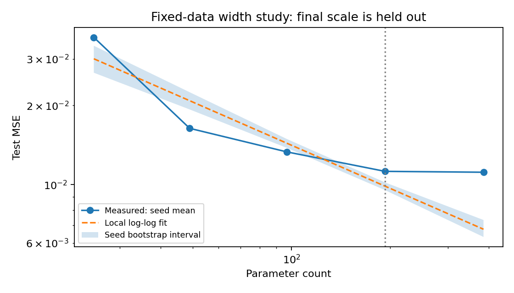
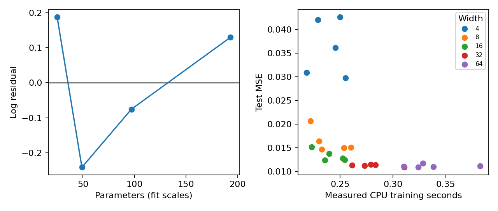

# 098｜规模规律与实验外推

X1 · 先修：022（实验设计）、055（规模与训练）、065（效率评估）

## 1. 一个预算问题，为什么不是“大模型总更好”

假设你用四个传感器预测一项连续读数。手头只有1024条训练记录，下一轮可以购买更多数据、增加网络宽度，或者让当前网络多训练一些时间。三种投入都可能降低误差，却解决不同的问题：新数据减少不知道的情况；更宽网络增加可表达的函数；更多更新让现有参数更接近训练目标。把三种投入都叫“规模”，就无法判断钱该花在哪里。

本讲只先做其中一条切片：固定训练数据、优化器和更新次数，改变单隐藏层网络的宽度。你会从原始误差开始，推导对数拟合，检查残差，再预测一个没有参与拟合的更大宽度。实验不使用语言模型，也不声称复现大模型的幂律指数。它训练的是25个真实小型神经网络，适合在普通CPU上检查研究流程。

::: {.concept}
**学习目标**：能区分模型参数量、独立数据量、样本呈现次数和计算预算；能解释一条直线的拟合区间；能把“预测失败”写成有用结果，而不是悄悄修改拟合再宣布成功。
:::

## 2. 先把测量对象讲清楚

我们的输入是四维向量，每个分量独立均匀分布在−1到1之间。干净信号包含正弦、乘积和余弦，随后加入标准差0.1的独立高斯噪声。网络输出一个实数，以均方误差MSE衡量预测和观测读数的距离。误差平方会放大少数较大的偏离，因此同时应保留逐样本预测，允许以后检查异常点。

训练集1024条、验证集512条、测试集1024条由不同固定随机种子产生。三者来自同一合成分布，但是不共享样本。本实验不做验证集选优；验证误差仍保留，便于发现训练误差低而非训练误差高的过拟合现象。测试集用来描述规模曲线和检验预先留出的宽度，不用于反复改变学习率或迭代次数。真实研究若在看到结果后改变协议，需要新的外部测试数据。

噪声方差是0.01。若知道产生标签的真实函数，期望MSE仍不能低于这个不可约噪声水平。这是总体意义的下限，不是每一份有限测试集都严格大于0.01。用观测误差减去0.01再取对数，偶尔可能得到零或负数；所以本讲先拟合正的总MSE，并明确它只是局部经验近似。

## 3. 参数量不等于宽度，更不等于数据量

输入层到隐藏层有4w个权重和w个偏置；隐藏层到标量输出有w个权重和1个偏置，因此参数量为：

$$N=4w+w+w+1=6w+1.$$

宽度4、8、16、32、64分别对应25、49、97、193、385个参数。宽度翻倍时，参数量接近翻倍但并不严格翻倍，因为最后一个偏置不随宽度变化。拟合时使用实际参数量，不直接拿宽度替代。

每个网络全批量更新500次，每次见到相同1024条训练记录，所以样本呈现次数为512000，独立训练样本仍然只有1024。反复读同一本书不等于得到500本新书。网络可能通过重复训练更好地拟合已有样本，但重复数据不能被当成独立数据扩展来解释。

粗略计算量会随参数量、样本呈现次数增加。时间还受矩阵形状、线程调度、缓存、框架开销影响。小模型中这些常数开销可能占很大比例，因此本实验同时记录实际CPU训练时间，绝不将参数量直接换算为GPU时长或金额。

::: {.warning}
**固定步数不是固定计算预算。** 大网络每一步通常更贵。此实验研究“同样数据和训练步数下的宽度效应”，没有寻找固定计算量下的最佳模型，也不能得出计算最优的宽度。
:::

## 4. 从幂函数到直线：每一步变换都在假设什么

先设一个局部模型：在已经观测到的参数区间内，误差大致满足下式，a为正数，b通常希望为负数。

$$L(N)=aN^b.$$

取自然对数后，乘法变成加法，指数变成系数：

$$y=\log L=\log a+b\log N=c+bx.$$

因此对每个规模点计算x和y，再拟合直线即可。最小二乘斜率是x、y共同变化的程度除以x本身的变化程度；截距让拟合直线经过样本均值。

$$b=\frac{\sum_i(x_i-\bar{x})(y_i-\bar{y})}{\sum_i(x_i-\bar{x})^2},\qquad c=\bar{y}-b\bar{x}.$$

举个纯手算例子：参数从100增至200，误差从0.08降至0.06，二者比值给出b=log(0.06/0.08)/log(200/100)，约为−0.415。它表示在这两个点之间，模型翻倍伴随误差乘约0.75；不是每增加一个参数都减少相同误差。只有两点时总能画出一条完美直线，因此这个例子仅解释斜率，不能检验幂律是否成立。

最小化对数误差和最小化原尺度误差也不同：对数会更重视相对偏差。预测0.02而实测0.01，与预测0.2而实测0.1在对数残差上相同。选择坐标实际上选择了误差的权重，研究报告必须写出。

## 5. 噪声底、曲率与“看起来直”

更常见的设想是存在不可约误差E：

$$L(N)=E+aN^{-\alpha},\qquad E\geq0,\ \alpha>0.$$

此时log L对log N不再严格是直线。N很大时L逐渐接近E，曲线变平；继续沿早期直线外推可能预测低于实际可达到的误差。若E已知且样本足够，可考虑拟合log(L−E)；若E未知，需要联合估计三个参数，少量规模点容易导致不同参数组合都拟合得很好。多加一个自由参数，并不自动得到更可信的未来预测。

本实验保留简单的两参数直线，目的正是让残差暴露失配。残差定义为实测log MSE减去预测log MSE。残差正，说明模型误差比拟合预测更大；残差负，说明比拟合预测更小。如果低、高规模点残差都同向而中间反向，可能存在曲率。如果某个宽度的不同种子分散很大，可能是优化不稳定。

## 6. 留一个规模点，而不是留一个随机训练样本

传统训练测试划分解决“没见过的样本表现如何”；这里还需要另一个层次的划分：“没参与曲线拟合的规模能否预测”。前四个宽度参与拟合，64完全留出。所有宽度共享相同测试输入，所以不同模型的误差差异不会被测试样本变化淹没。

实验开始前就固定宽度集合、500次更新、学习率0.01、Adam、tanh、五个种子，以及最终宽度留出规则。训练留出宽度后不再重新拟合预测线。预测相对误差定义为：

$$e=\frac{\widehat L(N_{hold})-L(N_{hold})}{L(N_{hold})}.$$

正值意味着预测更悲观，负值意味着预测过于乐观。一个留出点只能提供一次局部外推检验，不能证明整个未来区间都可靠。若将385个参数的结果外推到数十亿参数，还跨越了架构、优化、数据分布和硬件条件，统计上的外推距离之外又叠加了机制改变。

## 7. 不确定性带覆盖的是什么

每个规模使用五个初始化种子。我们把一个种子对应的整条宽度曲线当成一组，重复有放回抽取五组，再重新拟合。取1000次拟合预测的2.5%与97.5%分位数形成种子bootstrap区间。保持一整条曲线一起抽样，可以保留同一编号种子跨宽度的配对结构。

这个区间仅反映固定数据下的初始化与优化变化。它没有重新抽训练集，也没有更换噪声生成机制，无法代表全部数据不确定性；没有测试不同优化器，也无法代表方法选择的不确定性。五个种子本身很少，百分位区间可能不稳定。特别要注意：画在留出规模位置的带子，是拟合参数波动造成的预测均值区间，不是包含未来单次训练波动和模型失配的完整预测区间。

::: {.concept}
**窄区间也可能共同错。** 如果所有随机种子都支持同一条错误的模型形式，bootstrap会给出很稳定的错误预测。必须把随机波动、模型形式失配和分布改变分开说明。
:::

## 8. 规模规律和计算最优分配怎样衔接

如果研究目标真的是给定计算预算C，应该同时改变模型规模N与独立数据量D，而不是只沿N变化。一个教学性的分解写法是L(N,D)=E+A/N的α次方+B/D的β次方，计算约束近似C=kND。它表达“模型太小”和“数据太少”都可能形成瓶颈，常数和指数必须由特定实验估计。

代入D=C/(kN)，会看到增大N虽然降低第一项，却使预算内可用的D减小、提高第二项；最优点来自两种边际收益平衡，而不是把全部预算投入模型。实际训练还涉及重复轮次、学习率日程、早停和数据质量。大型语言模型的规模研究提供了这种设计思想，但不能把其拟合常数直接移植到本讲的四维回归。

在每个规模分别调学习率，研究的是“该规模可取得的最佳训练配置”；所有规模固定同一学习率，研究的是“共同协议下的表现”。两者都能合理，但回答的问题不同。前者需要匹配调参预算，否则大模型投入更多搜索本身就成为混杂变量。本讲选择后者，并把优化不足视为结果的一部分。

## 9. 如何把失败写成可继续的研究

先从outputs/runs.csv核对每次训练是否完成、误差是否有限，再从training_history.csv检查最后阶段是否还明显下降。若大模型仍在快速下降而小模型已停止，固定步数可能对大模型不利。可提出下一轮“同时测试500和1000步”的实验，而不是修改现有结果。

然后检查训练和验证误差差距。如果训练误差随宽度下降，验证和测试误差不降，问题可能转向数据不足；如果三者都停滞，则需要检查优化、模型结构或噪声底。最后才分析拟合斜率、残差和留出点。一个失败的留出点应促使你缩小声明范围、增加规模点或改变模型形式，而不是删除这个点。

本讲的最低合格结论是：“在固定合成数据、CPU、单隐藏层tanh网络与500次更新协议下，我们观测到了这些宽度的误差和时间；用前四个宽度拟合的局部模型对第五个宽度产生了记录中的预测偏差。”只有经过新实验，才有理由扩大到别的数据、架构或预算。

## 10. 阅读与复习导航

- 原始研究：[Kaplan等，Scaling Laws for Neural Language Models](https://arxiv.org/abs/2001.08361)，用于理解经验规模关系与计算分配问题；本讲不复现其数值指数。
- 原始研究：[Hoffmann等，Training Compute-Optimal Large Language Models](https://arxiv.org/abs/2203.15556)，用于理解模型与训练数据应联合研究。
- 回看022：为什么预先确定留出规则；回看055：规模与训练资源；回看065：测量边界。
- 下一讲099转向注意力的计算与存储；最后102把质量约束与系统成本放在同一研究协议中。

**离开本讲前自测**：重复500轮是否让D扩大500倍？固定步数是否固定计算？对数拟合是否一定意味着幂律成立？五个种子的置信带是否包含换数据集的风险？四个问题若仍拿不准，请先完成实验手册中的手算与反例。
