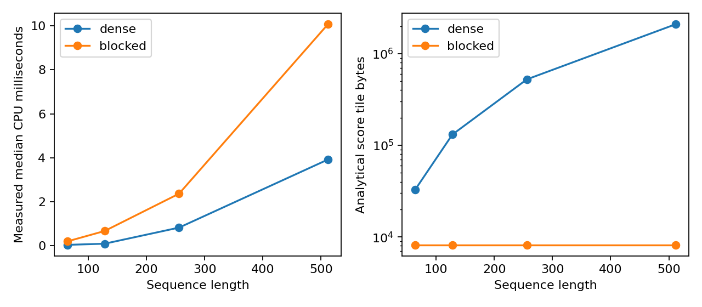
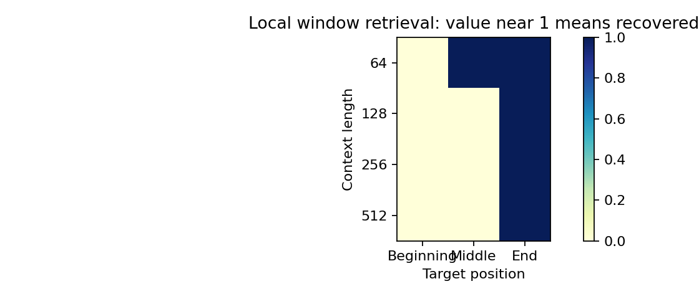

# 099｜高效注意力与长上下文

X2 · 先修：052–053（注意力）、056（计算资源）、066（长序列）

## 1. 能放进去，是否就能找出来

想象你读一份很长的维修记录，最后被问到“最早那次故障的编号是什么”。把整份记录放进模型的上下文窗口，只保证接口接受这些文字；模型是否真的使用开头的证据，还取决于注意力连接、训练方式、位置编码和干扰信息。窗口长度是容量声明，检索正确率是能力测量，两者不相等。

另一方面，标准注意力会生成“每个位置对每个位置”的分数。如果记录长度翻倍，分数个数接近四倍，很快占用大量内存。我们希望减少内存，但又不想丢失开头的证据。这就出现两条不同路径：保持同一个数学结果，换一种计算顺序；或者减少连接，改变模型计算。第一条主要优化执行，第二条改变信息通路。

本讲实现一个可检查的CPU分块精确注意力，并和完整矩阵实现比较；另做一个局部窗口检索反例。它不是FlashAttention的优化内核复现，也不是训练好的语言模型长文本评测。我们刻意把机制缩小，使每一次归一化都能手算验证。

::: {.concept}
**本讲的核心判断**：低内存、低延迟、长窗口、有效信息利用是四个不同目标。任何一个改善都不能自动推出另外三个改善。
:::

## 2. 从一个查询理解Q、K、V

查询Q可以理解为“我现在想找什么”；键K是每条记录用于匹配的索引；值V是匹配后要取出的内容。若查询和某个键方向接近，点积大，该位置通常获得较高权重。对维度d开平方进行缩放，防止维度变大时点积幅度随之放大，使softmax过早接近只有一个位置非零。

对于n个查询、n个键，Q和K是n乘d的矩阵。先计算每个查询与每个键的相似度S，再逐行归一化为权重P，最后加权汇总值：

$$S=\frac{QK^\top}{\sqrt d},\qquad P_{ij}=\frac{\exp S_{ij}}{\sum_t\exp S_{it}},\qquad O=PV.$$

softmax每一行的权重和为1，但它不保证权重代表因果解释，也不保证最大权重对应真实证据。若模型学到错误的键表示，高效计算只会更高效地得到错误答案。本实验直接构造键与查询，因此测试的是计算机制，不是表征学习质量。

手算一行分数为0、log2、0，则指数为1、2、1，权重为1/4、1/2、1/4。值若为0、10、0，输出为5。这里输出是加权平均，并不是“直接复制最高分位置”；要让输出接近10，匹配位置的分数必须明显超过干扰位置。

## 3. 为什么标准实现出现平方瓶颈

QK的转置乘法需要计算n平方个点积，每个点积约d次乘加，主要计算量为O(n²d)。若值维度与d相同，PV也有同阶计算。标准写法常把S或P作为完整矩阵保存在内存，单个float32矩阵就占4n²字节。实际峰值还包括Q/K/V、输出、中间临时量，以及训练时的梯度和激活。

例如n=4096时，一个float32分数矩阵约64 MiB；多个头、多个样本会再乘对应维度。这个数字只是一个张量的理论大小，不是进程实际峰值，也不是GPU显存仪表的读数。计算张量字节很有用，但必须说明统计边界。

CPU和GPU还存在不同的存储层级。把数据频繁从较慢的大内存搬到较快的小缓存，可能比算几次乘法更贵。分块算法让部分数据在较快存储中重复利用，试图减少大中间矩阵的读写。即使理论乘加次数没减少，也可能加速；反过来，Python循环的开销也可能让小规模CPU分块更慢。

## 4. 为什么不能每块softmax后直接相加

假设一行分数分成两块，第一块只有一个分数0，第二块只有一个分数log9。分别softmax时，每块唯一的元素权重都为1。把两块输出平均，就得到各占一半；真正全局softmax权重却是1/10与9/10。块内归一化丢掉了各块在全局分母中的相对大小。

正确做法必须保留“这一行目前见过的最大值”“指数和”“加权值的未归一化和”。最大值用于数值稳定，指数和保存归一化分母，加权和保存分子。分块的关键不是改变softmax公式，而是用可以合并的统计量重建相同结果。

## 5. 在线softmax的合并公式

对一个查询行，已有最大分数m、归一化前的指数和l、加权累积量a。读到新块分数s后，先求新的共同最大值m'。因为旧指数以旧m为基准，需要乘exp(m−m')，才能与新块以m'为基准的指数相加：

$$m'=\max(m,\max_j s_j),\qquad r=\exp(m-m').$$

$$l'=rl+\sum_j\exp(s_j-m'),\qquad a'=ra+\sum_j\exp(s_j-m')v_j.$$

所有块完成后输出a/l。初始m为负无穷、l和a为零；第一个非空块到来时r为零，正好清除初始空状态。我们的代码没有全掩蔽块，因此不会出现“负无穷减负无穷”的未定义情况。如果扩展为因果或任意稀疏掩码，必须专门处理全掩蔽块，不能直接照搬这里的初始化逻辑。

指数函数对大正数会溢出。减去当前最大值让新块指数不超过1，再用缩放系数调整旧统计量，从而保持稳定。注意“精确”在这里指同一数学运算的精确重排；浮点加法顺序不同仍会产生舍入误差，所以测试使用容差而不是要求比特完全一致。

## 6. 分块减少了什么，没有减少什么

本实验查询块与键块都为32。每次只生成最多32乘32的分数块；还保留每个查询块的累积量，以及完整输入与最终输出。因此分数缓冲从n²缩小到块大小的平方，但整体内存并不是常数，因为Q/K/V和输出仍随n增长。

代码遍历全部查询块和全部键块，仍覆盖所有n²个连接，计算复杂度仍为O(n²d)。在专门优化内核中，分块有机会降低内存访问成本；在本讲CPU Python循环中，循环、函数调用与大量小矩阵操作会产生明显开销。实测可能出现“缓冲更小、耗时更长”，这是正确且重要的结果。

::: {.warning}
本讲未使用GPU，未测显存。右图只能称“理论分数块存储”，不可改写成显存节省倍数；CPU结果也不能证明某个GPU内核更慢或更快。
:::

## 7. 局部注意力：省掉连接也会省掉证据

局部窗口只允许查询访问邻近位置。最后一个查询若只能看最近32条记录，那么位于窗口之外的故障编号根本不进入计算。是否包含中间位置要按长度核对：长度64的零基中间位置32仍在最近32个位置内，长度128及以上的中间位置则不在本实验窗口内。不是它匹配得不够好，而是图上根本没有那条边。训练可以改善可见位置的表示，却不能从当前层不存在的连接里直接读出值。多层网络可能通过间接传播扩大感受野，因此不能用单层例子直接断言所有局部架构都无法处理远程信息。

实验对长度64、128、256、512分别把目标放在开头、中间和末尾。目标键和查询得到分数12，其他键得分0；目标值为1，其他值为0。全局输出为exp(12)/(exp(12)+n−1)，长度增长时干扰位置的总分母增长，输出略微下降，但这些长度下仍超过0.5的成功阈值。

局部窗口如果看不到目标，输入值全为0，输出只能为0；如果目标在末尾，就能恢复接近1的值。分块全局算法与完整矩阵算法一致。这个“针在草堆里”的极简任务只检验位置可达性与归一化，不能代表自然语言理解、跨文档推理或模型真实的长上下文能力。

## 8. 因果掩码、训练与增量解码不要混淆

完整矩阵正确性实验使用双向注意力，所有位置都可见。自回归训练通常需要因果掩码，使位置i只能访问不晚于i的键。我们另外提供local函数演示“因果且局部”的连接规则，但没有将它的数值与双向结果作等价比较，因为二者数学目标本就不同。

生成新token时通常只有一个新查询，但保留过去的K/V缓存。此时单步与上下文长度的关系和一次性处理n个查询不同，不能简单把本讲n乘n前向计时当成每token解码延迟。预填充处理整个提示，解码逐步处理新查询；长度、批量和缓存都会改变瓶颈。101讲将把这些差异放进服务队列的模型。

训练时还要计算反向传播，并决定保存哪些中间量或重新计算哪些量。本讲没有反向内核，所以只证明前向数值正确性。声称完整训练加速还必须测梯度一致性、反向耗时、峰值内存以及收敛结果。

## 9. 一个可靠的比较应如何报告

先报告数据类型float64、CPU单线程、维度32、长度集合、块大小32。每个算法预热一次，正式计时9次，交替调用顺序，降低单一顺序带来的偏差。计时只包住前向函数，不含随机输入生成、序列化和画图。小任务的计时仍易受调度噪声影响，因此保留每次测量，不只保留中位数。

正确性从随机输入、非整除块长度、极端分数和均匀注意力四个角度检查。若随机测试通过而极端输入产生NaN，说明数值稳定仍不够。检索测试则同时改变长度和位置，防止只把目标放在末尾，误以为长窗口都有效。

最后把结论限制在证据范围：分块实现与密集参考在浮点容差内一致；理论分数块存储减少；CPU时间以CSV实测为准；局部窗口在本实验中丢失不可见目标。没有训练大模型，没有GPU显存证据，也没有语言理解能力的保证。

## 10. 原始资料与下一步

[FlashAttention原始论文](https://arxiv.org/abs/2205.14135)提出IO感知的精确注意力实现思路。本文使用可读CPU代码解释在线合并，不复制其工程内核或速度结论。比较论文的测量时，首先检查硬件、精度、前向/反向和序列长度是否一致。

回看052–053理解注意力归一化，回看056理解计算与内存边界，回看066理解长上下文测试。下一讲100研究量化与压缩：那里的权重舍入通常确实改变数值结果，所以除了速度和内存，还要增加质量回归与分组检查。
