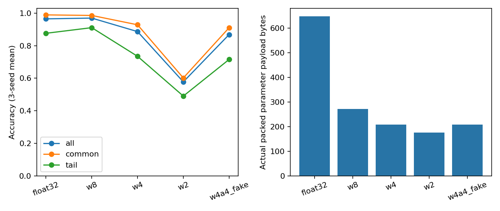
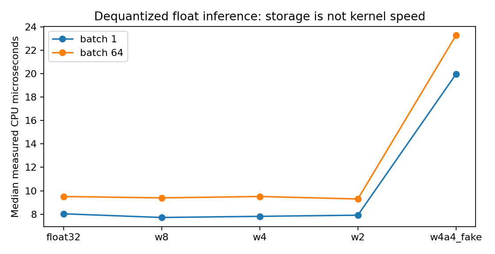

# 100｜量化蒸馏与压缩

X3 · 先修：013–014（数值与优化）、039（模型训练）、068（推理部署）

## 1. 把模型缩小，究竟缩小了什么

你准备把一个分类网络放进资源有限的设备。模型文件小了，下载确实更方便，但运行时可能先把低位宽权重还原成float32，内存和延迟不一定跟着减少；分类平均准确率不变，也可能掩盖少数困难样本退化。压缩必须同时回答“保存成本”“运行成本”和“任务质量”三个问题。

本讲的贯穿例子是一套两传感器故障分类器。多数输入来自常见工况，约20%来自偏移的尾部工况。我们训练三个随机初始化的小网络，把相同权重压成8、4、2位整数，再还原为浮点执行推理；还加入一个4位权重加4位激活的模拟配置。你会亲自看到：存储格式变小和计算内核加速是两回事，平均指标也不够描述退化。

“蒸馏”是另一个方向：用较大教师模型的输出帮助较小学生学习。本讲推导其软目标，但真实实验选择量化路径，避免将没有训练的学生模型写成实验成果。结构剪枝也会讲清机制与约束，不虚构剪枝加速数据。

::: {.concept}
先定义你要省什么：磁盘字节、加载时内存、推理峰值内存、延迟、能耗还是训练成本。不同目标需要不同测量，模型文件大小不能替代全部成本。
:::

## 2. 线性量化：给连续数值放一把尺子

float32可以表示大量不同数值；低位宽整数只能使用有限个格点。对称量化以0为中心，用一个正尺度s表示每个整数步长。对于b位的有符号对称方案，令qmax=2的b−1次方减1，整数范围为−qmax到qmax：

$$q=\operatorname{clip}\left(\operatorname{round}(w/s),-q_{max},q_{max}\right),\qquad \widehat w=sq.$$

本实验取s=max|w|/qmax，因此最大的绝对权重恰好落在量化范围内。一个全零张量没有非零最大值，我们约定s=1且整数全零，防止除以零。偏置保留float32，因为其数量少，也方便区分权重舍入和偏置误差。

手算：权重−0.9、−0.1、0.4、1.0使用4位对称量化，qmax=7，s=1/7；对应整数约−6、−1、3、7，还原约−0.857、−0.143、0.429、1.0。每个数都被移到最近格点，所以数值改变是预期行为，不应要求与原始输出完全相同。

当没有发生范围截断时，最近舍入的绝对误差最多为s/2。若人为把范围缩小，超出范围的值会被截断，其误差可以远大于s/2。因此报告量化误差上界时必须说明是否包含裁剪。2位对称方案只使用−1、0、1三个码值，四种二进制码中的一种未用；这也是一种设计选择，不代表所有2位量化器都如此。

## 3. 权重误差怎样传播到输出

线性层输出y=Wx+b。量化后W变为W+ΔW，于是输出差为ΔWx。即使ΔW的每个元素都小，输入x的幅度大、维数高或误差方向相互叠加时，输出偏差仍可能明显。经过ReLU后，原本接近0的预激活可能跨过开关边界，从而改变后续路径。

分类最终取最大logit的类别。如果两个类别logit差很大，小扰动不容易改变决策；如果样本位于决策边界附近，很小的数值误差也可能翻转标签。因此权重均方误差小不能保证每个样本分类不变。尾部工况可能具有更大的输入幅度或更小的分类间隔，值得单独检查。

本实验将约20%的样本第一维平移3，形成一个明确可记录的尾部分组。标签由非线性函数确定，训练和测试都包含两组。这个分组是合成的工况标签，不是现实人群标签；其作用是演示切片检查，而不是证明任何真实设备的安全性。

## 4. 为什么校准集要与测试集分开

权重范围可以直接从参数读取；激活范围取决于输入数据。若没有代表性数据，就不知道中间层常见值多大、异常值多大。训练后量化通常先用一批校准数据估计这些范围，然后冻结量化器，再在独立测试集上评价。

本实验训练1800条记录、校准400条、测试1200条，三者独立生成。对每个教师模型，计算校准集ReLU隐藏激活的99.5百分位作为裁剪上限。正激活从0到上限均匀映射到0至15，共16个4位格点。超过上限的值被裁剪。这是预先指定的教学配置，没有比较不同百分位后挑测试结果最好的那个。

若拿测试数据挑裁剪范围，再用同一测试集报告准确率，就把部署选择的信息泄漏进了评估。校准集并不需要标签才能收集激活，但“无标签”不代表可以任意使用测试分布进行调参。尤其尾部工况若在校准中很少出现，激活范围可能不覆盖它，平均校准效果仍可能不错。

::: {.warning}
本讲激活量化是浮点中的模拟量化：先裁剪、舍入、再还原。它能研究量化误差，却没有实现真正整数矩阵乘法，因此不能据此声称4位内核加速。
:::

## 5. PTQ与QAT：误差出现后要不要再训练

训练后量化PTQ先把浮点模型训练好，再确定尺度并转换权重。优点是额外训练成本低；缺点是原模型没有机会适应新格点。量化感知训练QAT把模拟量化放进训练前向，让参数在训练中适应量化噪声。因为round的普通导数几乎处处为0，工程上常用直通估计等近似梯度；它是优化近似，不是round函数真实导数的神奇恢复。

QAT也不是自动保证更好：训练时间、学习率、校准范围和部署内核一致性都要验证。若训练模拟使用一套尺度，而部署采用另一套规则，所谓“感知”可能没有覆盖真正的误差。本实验只做PTQ与模拟激活量化，不包含QAT训练结果。

尺度还可以按整个张量、按输出通道或按小组设置。逐通道通常能减少少数异常权重对所有通道步长的影响，但需要保存更多尺度，也要求内核支持对应格式。比较两种方案时应把尺度、零点和对齐填充等开销一起记账，不能只计算b乘参数个数。

## 6. 真正打包与假装压缩有什么区别

把4位整数存进一个int8数组，每个元素仍占一个字节，并没有获得理想的4位存储。我们的pack函数把每个码展开为b个比特，再拼接打包到字节；unpack读取相同位序恢复整数。每层随后附加一个float32尺度和float32偏置。测试不仅核对公式，也核对实际.bin文件的字节数。

本模型有128个权重和34个偏置。float32参数原始载荷为(128+34)×4=648字节；8位载荷为128+8+136=272字节；4位为64+8+136=208字节；2位为32+8+136=176字节。这里8字节来自两个尺度。偏置和尺度让压缩比明显小于“32除以位数”。

这些数字是实际写出的原始参数载荷，不包括描述形状的元数据、Python对象、解释器、依赖库或通用文件容器。激活裁剪阈值也另外记录在calibration.csv，不包含在参数载荷数字中。真实部署包必须把这些开销补上。因此本讲可以说“参数载荷变小”，不能直接说整个应用安装包缩小同样倍数。

## 7. 延迟实验为什么故意不承诺加速

所有权重先从打包码解码成float32，再调用相同浮点矩阵乘法。权重量化配置没有更小的浮点张量，也没有换成整数内核；它只改变了数值和保存格式。因此8位或4位参数载荷更小，不意味着本次前向更快。激活模拟量化还增加裁剪和舍入操作，可能更慢。

实验对batch=1和64分别预热5次、正式计时21次，3个教师模型共630条计时。计时边界仅前向函数，不含训练、打包、解码和磁盘读写。CPU单线程、float32；每次时间保留在timings.csv。配置按固定顺序运行，仍可能有顺序和系统状态混杂，微小差异不应被宣传成可靠加速。

## 8. 蒸馏：为什么软目标比硬标签多一点信息

硬标签只告诉学生正确类别。教师在其他类别上的概率也可能编码“哪些错误更接近正确答案”。温度T把logit除以T后再softmax；较高温度通常让分布更平缓，使原本很小的概率更可见。一个常用训练形式组合真实标签交叉熵与教师学生软分布的KL散度：

$$\mathcal L=(1-\lambda)\,\operatorname{CE}(y,p_S)+\lambda T^2\,\operatorname{KL}(p_T^{(T)}\Vert p_S^{(T)}).$$

这里λ控制软目标比重，教师参数通常冻结。T²常用于补偿温度对梯度量级的影响；并不意味着任意温度都等价。教师也会犯错、偏向某些类别，学生可能继承错误；因此仍要用独立真实标签评价，而不是仅报告学生与教师一致率。

蒸馏真正降低推理成本，通常依赖学生结构更小、更浅或更适合硬件。若学生与教师同样大，只是换了训练目标，不能自动算作部署压缩。本讲没有训练学生，故不将此公式与量化实验结果混为一谈。

## 9. 剪枝：零参数不一定少计算

非结构化剪枝把单个权重设为零。普通密集矩阵乘法仍会计算这些零乘法，因此参数稀疏不自动带来低延迟。结构化剪枝删除整个通道、神经元或层，能真正改变矩阵形状，但也会改变网络容量，需要微调与质量验证。

例如把隐藏层32个神经元减成16个，可以减少输入与输出两侧对应权重；但删哪些神经元、是否重新训练、是否匹配调参预算都会影响结论。比较时必须包含剪枝后模型实际形状、实际内核和实测时间。仅报告“50%权重为零”还没有回答设备是不是更快。

## 10. 怎样选择一个可接受的压缩配置

先固定容忍标准，例如总体准确率下降不超过某阈值、尾部分组下降不超过更严格阈值，再看哪些配置满足约束，最后在可行集合内比较成本。阈值应由任务后果决定，并在看结果之前确定。一次小型测试中的一两个样本差异也可能造成百分比变化，因此保留样本数、逐样本logit和多种子结果很重要。

最诚实的结果可能是某个低位宽配置虽然更小却不合格。报告应给出这种失败，而不是把所有配置都叫“无损压缩”。如果需要真正部署加速，下一轮应选择支持相应整数格式的目标硬件与推理后端，测加载、峰值内存和端到端延迟，再按相同质量协议回归。

[Hinton等蒸馏原始论文](https://arxiv.org/abs/1503.02531)提供软目标的研究起点。本讲量化器、合成数据和CPU实验均为教学实现，不宣称复现工业量化内核。下一讲101转向服务并行和排队；102将把压缩候选放入明确的质量与成本约束研究协议。
