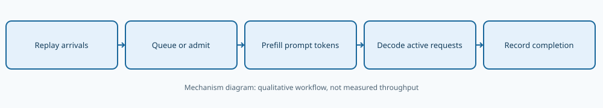
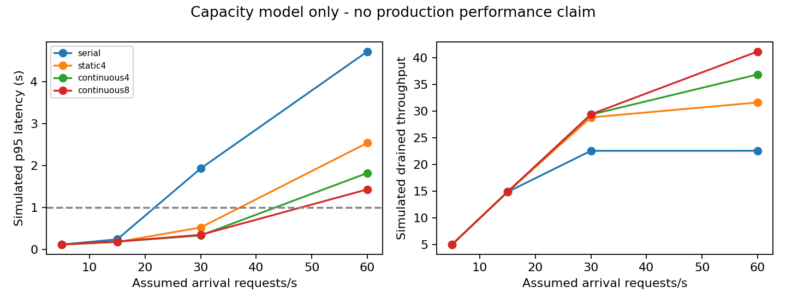
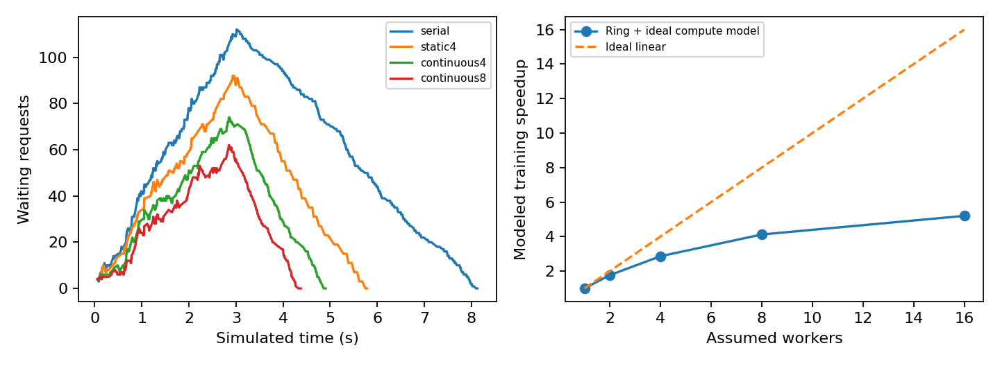

# 101｜并行服务与系统级瓶颈

X4 · 先修：056（资源）、067–068（训练与推理系统）

## 1. 同样加一张卡，训练和服务为何不同

训练通常有一个共同目标：多个计算单元一起更新同一组参数，尽快完成规定工作。服务面对很多独立用户：有人刚提交长提示，有人已经等着下一个token，有人只需要短回答。训练可接受的一次同步等待，可能恰好造成在线用户的长尾延迟。

因此“八张卡比一张卡快多少”和“每秒可接多少请求”不是同一个问题。前者要明确固定总工作还是固定每卡工作；后者要说明请求长度、到达时间、批处理策略、缓存容量和服务目标。峰值矩阵乘法吞吐不能直接回答用户等多久。

本讲在没有多卡硬件的条件下，交付两种可核对模型：一个训练通信容量公式，一个可重放的服务离散事件模拟器。程序确实在CPU上执行，记录了模拟器运行时间；但图中的服务秒数和吞吐由预设常数产生，不是CPU或GPU服务实测。我们把这个区别写进每份数据与图注，防止模型预测被误当成生产保证。

::: {.warning}
所有服务延迟、服务吞吐、队列长度和多卡加速数字均为模拟或解析模型结果。唯一实测墙钟时间是执行模拟程序本身的时间，它不代表被模拟服务的性能。
:::

## 2. 延迟、带宽与吞吐先分开

传输一个消息通常有启动成本和按字节付费的传输时间。一个简化公式是t=ℓ+M/B：ℓ是启动延迟，M是消息字节数，B是有效带宽。小消息常被ℓ支配，大消息常被M/B支配。硬件标称带宽不一定等于应用可用带宽，还受拓扑、竞争、协议和实现影响。

吞吐是单位时间完成的工作量；延迟是一个工作从开始到结束的时间。批量增大可以让设备一次处理更多请求，提高吞吐，却让其中单个请求等待凑批或等待其他长请求，延迟可能变差。不能把吞吐的倒数当成单请求延迟，除非工作严格串行且没有其他重叠。

例如某服务一次批量处理10个请求，整批耗时0.1秒，吞吐可达100请求/秒；但每个请求仍至少经历约0.1秒服务时间，而不是0.01秒。若还要等0.2秒凑批，总响应时间会更长。这种单位分析是检查系统报告最便宜也最有效的第一步。

## 3. 数据并行：计算分摊以后，梯度还要交流

数据并行让各工作单元持有模型副本，处理不同数据分片，然后同步梯度。若总批量和工作固定，把计算均分到p个单元，理想计算时间可从T降到T/p；但通信不会随之自动消失。以简化ring all-reduce为例，梯度量G、有效带宽B、每阶段启动延迟ℓ时：

$$T_{comm}\approx\frac{2(p-1)}p\frac GB+2(p-1)\ell.$$

若不考虑重叠，步时间为T/p+Tcomm，加速比为T除以并行步时间，并行效率再除以p。本讲假定单卡计算80毫秒、梯度64 MiB、有效带宽12 GiB/s、阶段启动20微秒。它们是演示输入，不是测得的设备参数。改变这些数值会改变结论，应把参数表一起交付。

p=1时通信项为0，是最简单的边界检查。p增加时计算项继续下降，通信项却趋近一定数据传输成本并增加启动阶段；所以效率可能下降。真实系统还能把部分通信与反向计算重叠，公式会高估某些开销；也可能受拓扑、拥塞和负载不均影响而低估开销。

## 4. 张量并行与流水线并行各自移动了什么

张量并行把一个大矩阵或一层计算切到多个单元。它能让单模型超过单卡容量，却往往需要在多个层中交换部分激活或合并结果。数据并行常按训练步同步梯度，张量并行可能在一次前向的多个位置通信；消息大小、频率和延迟敏感性不同，不能共用一个“通信占比”常数。

流水线并行把不同层放在不同阶段，让多个微批依次流过。阶段没有数据可算的空闲部分叫气泡。一个均匀阶段、无额外开销的教学近似中，p个阶段处理m个微批，利用率约为m/(m+p−1)。例如4阶段、1微批只有1/4；微批增多可摊薄气泡，但增加调度和激活管理压力。

上述公式没有模拟异构阶段、内存不足、重计算或具体训练调度。它的用途是定位可能的瓶颈和提出测量问题，不是替代真实多卡试验。若要声称多卡加速，必须记录设备型号、连接拓扑、全局批量、精度、重叠策略和同步范围。

## 5. 请求时间线：排队、预填充和解码

一个文本请求到达后，通常先等待被系统接纳。预填充处理提示中的已有token，建立可供后续使用的缓存；解码随后逐步生成新token。首token时间TTFT从请求到达到第一次生成输出，包含排队、预填充和第一步解码。总延迟直到请求完成，包含全部输出步骤与期间等待。

预填充的计算形态通常更像对较长序列做批量计算；解码每次生成一个新位置，可能更依赖读取模型权重与K/V缓存。实际瓶颈随模型、批量、上下文长度和硬件而变，不能简单宣布某阶段永远计算受限或永远带宽受限。

本讲模拟把预填充时间设为2毫秒加每个提示token 0.1毫秒；每轮批量解码为0.8毫秒加每个活跃请求0.15毫秒。这是假设线性成本的容量模型，没有真实注意力复杂度、缓存争用或内存容量。它允许推导调度因果，却不适合精确预测某个模型的绝对吞吐。

## 6. 静态批与连续批：空出的座位何时补人

串行策略容量为1。静态批策略一次接纳最多4个已经到达的请求，随后等这一批所有请求完成，才开始下一批。短回答提前完成后，空出的座位暂时不补人；长回答可能拖住批次边界。我们的静态策略不专门等待凑满批，因此低负载时也可以只接一个请求。

连续批策略在每一轮解码开始前检查空位，把已到达的请求补进来。它可以利用早完成请求释放的容量，但新请求的预填充也可能干扰已有解码。模拟器采用串行、未分块的预填充：接纳一个新请求时，全部活跃解码会暂停到它的提示处理完。长提示因此可能拉高其他请求的等待时间。

这是刻意保留的调度限制，不是现代服务框架的完整实现。真实系统可采用分块预填充、不同优先级或更复杂的内存管理。若只模拟理想连续批而忽略预填充干扰，就会过度乐观；若把这里的简单调度等同某个真实框架，又会错误贬低真实系统。

## 7. 如何产生一份可重放负载

每个负载含180个请求，到达间隔服从指数分布，平均到达率分别为5、15、30、60请求/秒。提示长度从32、128、512中按固定概率选择，输出长度从8、32、64中选择。三个随机种子产生三份不同序列，但各策略使用完全相同的到达、提示和输出，避免一方碰巧接到更短请求。

工作负载保存为workloads.npz，逐请求结果保存在requests.csv。每条结果含到达、开始、首token、完成时间以及等待、TTFT和总延迟。全部48次模拟共产生8640条请求记录，没有丢弃慢请求；有限负载最终排空，统计窗口包括最后请求的排空阶段。

重放结束后的平均吞吐定义为请求数除以从首个到达到最后完成的跨度。它不是无限时间下的稳态容量。如果过载持续更久，队列可能继续增长；短负载最后被排空，不意味着服务能稳定承受那个到达率。报告必须同时展示队列和延迟，而不是只看最终吞吐。

## 8. 长尾为什么先于平均数暴露问题

当平均到达工作接近可用服务能力，短暂到达突发或几个长请求就可能积累队列。后续请求不仅等待自身服务，还等待前面未完成的工作。平均延迟可能仍显得温和，但最慢的一部分用户已经等很久，所以至少要看p50、p95和超时比例。

本讲把1秒设为演示SLO阈值，保存超过1秒的请求比例。它不是用户真实业务目标，也不是经过容量保障的合同承诺。p95由有限180条请求估计，只有少数最慢样本决定尾端；不能从这个样本量声称可靠估计极高分位数，如p99.99。

## 9. 看懂队列图和训练加速图

队列图只计已经到达但尚未被接纳的请求，不包括正在处理的活跃请求。若队列上升，说明到达工作暂时超过接纳与服务能力；若队列下降，可能是到达停止后系统排空，不代表之前负载可长期稳定承受。要区分“结束后清空”和“运行中稳定”。

训练加速图则比较解析通信模型与理想线性加速。两张图放在一起，是为了提醒你：训练瓶颈主要围绕同步计算与通信，服务瓶颈还涉及随机到达与请求长度。用训练每秒样本数直接推断在线延迟，缺少了中间的重要机制。

## 10. 从模型走向真实测量的下一步

先用真实服务的请求时间戳、提示长度、输出长度校准负载；再测不同长度和批量下的预填充、解码时间，替换这里的线性常数。随后补充K/V缓存容量、调度策略和拒绝请求行为。只有模型在独立负载上能预测趋势，才有理由用它辅助容量规划。

测量时要包含到达端与服务端的时钟边界、预热、失败请求、并发数和超时。报告吞吐时给出满足SLO的吞吐，而不是无限积压队列情况下的峰值完成速率。如果真实生产数据包含敏感内容，可只保留去标识化长度与时间模式；本讲合成数据不需要用户日志。

[实现背景：PagedAttention原始论文](https://arxiv.org/abs/2309.06180)研究大型模型服务中的内存管理与吞吐问题。本讲未实现其缓存分页算法，也不复现其性能数字。回看056与067–068理解资源与推理路径；下一讲102将把质量回归、真实CPU测量和预先固定的可接受标准组织成一个完整研究报告。
