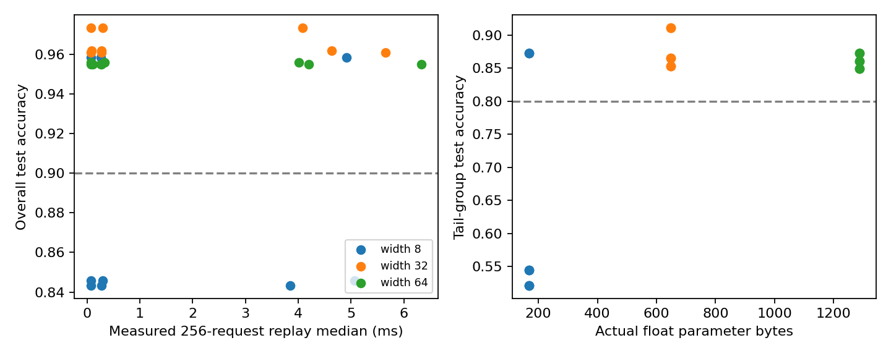
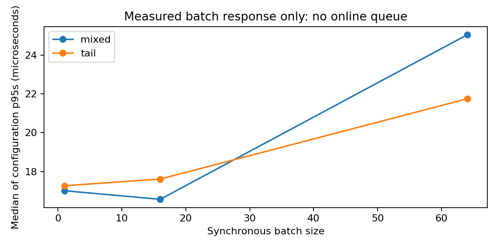

# 102｜成本约束下的系统研究

X5 · 先修：022（实验设计）、065（效率测量）、070–071（系统研究）

## 1. 快了两倍，为什么仍可能没有研究价值

假设你要部署两传感器故障分类器。甲方案每秒处理更多记录，但漏掉了大量少见工况；乙方案模型大一些，却在困难样本上稳定。若只报速度，甲似乎获胜；若先规定最低质量，甲可能根本不进入候选集合。系统研究真正的问题是：在任务质量可以接受的前提下，怎样减少明确界定的成本？

本讲把前四讲串起来：098提醒规模趋势不能任意外推；099区分改变执行顺序与改变信息连接；100区分参数存储和实际运行；101区分真实测量与容量模拟。现在我们用同一套可重放合成任务，完成一个小而完整的CPU研究：训练不同宽度、保存逐样本预测、固定质量门槛、测量批量前向与重放时间，再找满足约束的质量—成本折中。

本实验是真实CPU训练和计时，没有GPU、在线请求服务、网络或付费API。最后的结果不会被包装成生产吞吐、货币节省或能耗降低。学习重点不是得到最好看的倍数，而是建立别人可以推翻、复查和扩展的证据链。

::: {.concept}
一个合格的效率结论至少包括：做什么任务、质量约束是什么、比较了什么候选、用什么负载、计时覆盖哪里、资源如何计算、失败条件是什么。
:::

## 2. 从口号写成约束优化问题

把配置记为c，它包括网络宽度、训练种子、批量和执行方式。成本函数C(c)可以是耗时、内存或金额，但一次研究必须明确具体哪一种。质量Q(c)越高越好，延迟分位数L95(c)越低越好，可以写成：

$$\min_c C(c),\qquad Q_{all}(c)\geq q_{all},\quad Q_{tail}(c)\geq q_{tail},\quad L_{95}(c)\leq\tau.$$

约束决定哪些方案能比较，目标决定可行方案之间如何取舍。不能先选最快方案，再降低质量门槛让它通过。也不能把一个严重退化的分组藏进总体平均数。真实应用中的阈值应来自任务后果和需求，本讲的90%总体准确率、80%尾部准确率、2毫秒批响应p95只是预先设置的教学门槛，不是安全认证。

可行集合也可能为空。这时正确结论是“当前候选没有满足全部要求”，然后提出新实验；不是删除最难的约束。本次实验还会看到同一宽度的不同训练种子可能一部分通过、一部分失败，所以一个幸运模型不等于训练流程本身稳定可靠。

## 3. 贯穿任务：常见工况和尾部工况

输入有两维。约80%的样本来自标准正态分布，约20%的样本把第一维平移3形成尾部工况。标签由sin(2x₀)+0.6x₁是否大于0决定。这个任务既有非线性，也有一个明确可检查的困难切片；不包含真实个人数据或设备日志。

训练集1800条，测试集1200条，用不同种子生成。所有候选共享同一批输入和标签。网络为两维输入、ReLU隐藏层、两类输出；隐藏宽度8、32、64，每种宽度使用三个训练种子，每个模型固定700次Adam更新、学习率0.015。总共真正训练9个模型，不从中删除不合预期的种子。

分类准确率是正确个数除以样本数。总体准确率按两个组的样本数加权，而不是简单平均两组准确率。本次测试集尾部有259条，所以一个尾部样本约对应0.386个百分点；总体一个样本约对应0.083个百分点。看似小的百分比差异可能只有几个样本，必须保留分母与逐样本输出。

## 4. 训练随机性与选择偏差

本次宽度8的三个种子中，一个总体准确率约95.83%、尾部约87.26%；另外两个总体约84.33%和84.58%，尾部约52.12%和54.44%。这不是打印错误，而是固定训练协议下真实得到的差异。网络小，并不意味着一定学不好；但某个小网络偶然学好，也不能证明小网络训练稳定。

如果报告只展示宽度8最好的种子，会把训练失败风险藏起来。我们逐个保留9个模型，并把配置是否达标写进summary.csv。若部署要求是“随机初始化重新训练也能稳定满足需求”，还应定义跨种子成功率或最坏情形约束，增加更多独立训练，而不是直接使用本讲按单模型判断的可行集合。

这是一项预先固定候选与门槛的比较研究，没有在看到测试结果后搜索新超参数。若根据本次结果继续挑宽度、步数或阈值，应将当前测试集视为开发证据，再用新的外部留出集确认最终方案。测试集被反复用于决策后，不能仍把每次报告都称为独立最终验证。

## 5. 可重放负载是什么，不是什么

质量在完整1200条测试集上计算。性能重放另保存两条256请求的ID序列：mixed从测试集不放回抽取256条；tail只从尾部样本中有放回抽取256条。所有配置使用相同ID顺序，因此不会让一个方案碰巧处理不同输入。

本次tail重放只有163条不同样本，重复记录用来构造固定性能负载，不用于增加质量评价的独立样本量。不能把五次重放的1280个请求称为1280个独立质量测试样本。性能重复和统计独立性是两个问题。

我们的负载是同步批重放：把一批输入准备好，调用模型，等待返回，再处理下一批。没有请求到达时间，没有凑批等待，没有网络排队。批量1、16、64都处理相同256条记录，但调用次数不同。它适合比较本地推理执行成本，不能直接回答在线用户的端到端等待时间。

## 6. 两个计时器为什么都要保留

第一个计时器紧贴每次模型前向调用，记录一批从进入模型到返回的时间。输入切片已经准备好，计时不含训练和磁盘读写。批内各请求一起开始、一起返回，因此这批的每个请求都拥有相同的批响应时长。不能把批耗时除以批量后，称为用户看到的响应延迟。

第二个计时器包住整条256请求的重放循环。它包括Python循环、输入切片和记录测量结果的开销。这个总时间不是所有内层时间的严格求和，而是更宽的测量边界。重放吞吐定义为256除以总时间；它反映本程序同步重放速率，没有服务排队含义。

例如一批64条记录耗时0.2毫秒，平均每条的计算份额约3.125微秒，但批响应仍是0.2毫秒。若为了凑齐64条还等待20毫秒，那20毫秒在本实验中没有测到。把摊销成本与响应时间分开，是避免“高吞吐等于低延迟”误读的关键。

## 7. 预热、顺序与分位数

每次重放前预热5次，然后正式重放；每种配置重复5遍。每轮用固定随机种子打乱配置顺序，降低某个配置总在冷启动或系统高负载时执行的偏差。CPU限制单线程，推理使用float32并关闭梯度跟踪。环境文件记录实际Python、NumPy、PyTorch版本和机器架构。

每个模型有3个批量和2种负载，共54个配置；五次重放共有270条总时间记录。每次256请求分别需要256、16、4次模型调用，因此批前向计时共9×2×5×(256+16+4)=24840条。数据量多不意味着机器噪声消失：操作系统调度、缓存和共同负载仍会影响微秒级测量。

p95按每次批耗时重复该批请求数后计算，使统计对象是请求而不是批次数。本例各批量都整除256；若以后有尾批，按请求数加权尤其重要。图中为各配置p95的中位数汇总，它不是把所有配置混在一起计算出的一个总体p95。精确配置值应回到summary.csv。

::: {.warning}
本讲的2毫秒限制约束“无排队批响应p95”。它不是网络服务SLO，也不覆盖凑批、排队、失败重试或启动加载。不要把一次满足阈值写成生产稳定性保证。
:::

## 8. 资源账：参数字节不是峰值内存

两维到宽度w的层有2w权重和w偏置，宽度w到两个输出的层有2w权重和2偏置，总计5w+2个参数。float32每个参数4字节，所以宽度8、32、64分别为168、648、1288字节。这些数字由实际张量元素数与元素大小求和，属于真实参数存储账。

运行时还存在输入、输出、激活、中间张量、模型对象和库占用；训练还包括梯度和优化器状态。本实验没有测进程峰值内存，因此不能用168字节宣称整个分类服务只需168字节内存。也没有测能耗，不能用CPU时间直接推出焦耳或碳排放。

若要估计货币成本，还需要明确计费单位、设备利用率、空闲资源和定价来源。把任意“每秒价格”乘本次前向时间会遗漏共享设备和空闲成本，因此本讲坚持以CPU秒和参数字节报告，不虚构货币节省。

## 9. Pareto前沿：为什么不一定有唯一赢家

假设方案A比B准确率不低、参数字节不多、重放时间不长，并且至少有一项严格更好，那么B被A支配。若没有其他方案支配某方案，它位于当前候选集的Pareto前沿。前沿允许你保留不同取舍，而不是先随意给准确率和毫秒各乘一个权重。

代码先过滤未满足质量和延迟限制的配置，再分别在mixed和tail负载内计算前沿。前沿的三个比较维度是总体准确率、参数字节、重放时间；尾部准确率先作为门槛，不继续作为第四个优化维度。这是明确的研究选择，不应把它解释成尾部表现已不重要。

计时有噪声，因此前沿成员可能在不同运行中改变。两个配置差几微秒时，不宜用一次严格不等式宣布稳定优胜。应看逐轮测量、重复机器上的结果，必要时定义实际有意义的最小差异。当前前沿只是这次数据下的描述性集合，不是跨硬件的永久排名。

## 10. 压力测试和失效区域

tail负载把全部重放请求集中到尾部工况，让我们检查输入切片变化是否影响本实现耗时；它不是增加在线到达压力。对于本例固定形状的稠密网络，不同数值输入未必明显改变计算路径。若图上出现微小差异，可能来自计时噪声，不能直接归因于“模型更难思考”。

质量失效区域则很清楚：两个宽度8种子未达到总体和尾部门槛；它们即使参数更小，也不应进入可行前沿。宽度32或64不是越大越好，固定700步与共同学习率下，较大模型未必最高准确率，这与098讲的优化混杂相呼应。

## 11. 一页研究报告应该交付什么

第一段写任务与预设门槛；第二段写模型、训练、数据与负载；第三段写测量边界和环境；第四段列所有候选的质量、尾部质量、参数账和计时分位数；最后写失败配置、前沿和不能外推的部分。附原始请求ID、预测、参数、计时记录与重算代码，让别人能够独立验证。

本次结果支持“小型合成分类器在这个CPU协议下的比较”。它不支持真实设备故障安全性、GPU性能、网络服务容量、能源收益或货币收益。若下一步使用100讲的量化，应保持同样数据与质量门槛，并增加真实整数内核；若研究099高效注意力，应先检查数值与目标等价；若研究101服务，应增加真实到达和队列测量。

[PyTorch官方基准测试教程](https://docs.pytorch.org/tutorials/recipes/recipes/benchmark.html)可用于进一步学习计时中的预热、线程和重复测量。本讲为便于逐批审计保留显式计时循环，不声称替代专业性能分析工具。严肃加速结论还应使用更稳定的计时机制和更多环境重复来验证。

## 12. 课程收束：把“会运行”推进到“能研究”

从最初的张量与梯度，到模型、生成方法和系统研究，贯穿的不是某个永远最优的算法，而是四个动作：明确问题，建立可检验机制，保留可重放证据，限制结论范围。最后五讲分别练习规模外推、注意力内存、压缩质量、系统队列和约束研究，恰好构成一次完整实验的检查链。

复习时不必从第一讲机械重读。推导卡住，回到线性代数、概率和优化；实验不稳，回到数据划分与训练诊断；模型太慢，先定义测量边界再看高效实现；结果好得异常，先找泄漏、混杂和错误单位。目录中的学习路线只是复习导航，不等于对旧课所有材料的独立质量认证。

**结课自测**：最快配置若质量不达标怎么办？batch耗时除以batch是否是响应延迟？重复重放是否增加独立质量样本？Pareto前沿是否跨硬件不变？参数字节是否等于峰值内存？能准确回答这些问题，你就具备了把性能数字写成可审查研究结论的基本习惯。
